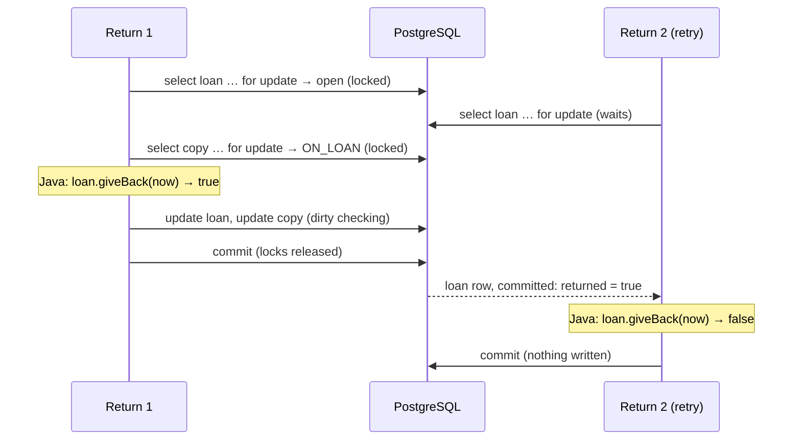
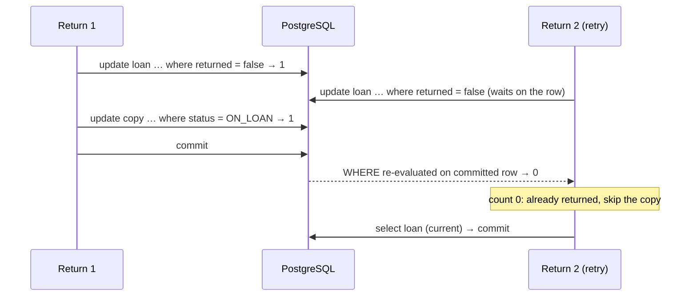

# Conditional update vs `SELECT … FOR UPDATE`: one example, two fixes

This note compares the two ways of letting **only one** of several concurrent transactions perform a
state transition:

- **Option A — lock, check in Java, update:** `SELECT … FOR UPDATE` the row, let the domain object
  check the rule in Java, let dirty checking write the change.
- **Option B — conditional update:** one `UPDATE … WHERE <old state>` and look at the affected-row
  count.

The example is the **return of a loan** (the story of lesson 11 in
[`reservation-expiry-lessons.md`](reservation-expiry-lessons.md)). Option B is the code the project
already has ([`ConditionalLoanReturnService`](../src/main/java/cat/tecnocampus/library/loan/ConditionalLoanReturnService.java)).
Option A is written **only here**, as an illustration: the repository methods and the service of
option A do not exist in the code base.

Background you need: sections 2.2 (READ COMMITTED), 2.3 (dirty checking), 2.4 (row locks) and 2.5
(conditional updates) of the lessons document.

---

## 1. The transition and its invariant

Anna drops copy N0005 into the return machine. The machine times out and sends the same request
again, so two `POST /loans/{id}/return` for **the same loan** run at the same time.

**Invariant:** a loan is closed **exactly once**, and only the call that closes it puts the copy back
on the shelf. A second return must change nothing and answer `200` with the same loan (idempotent).

Both requests do, in essence:

```
if (loan is open) {
    loan.returned = true; loan.returnedAt = now;
    copy.status = AVAILABLE;
}
```

The `if` is the problem. Without help from the database, both transactions evaluate it on the same
committed snapshot (`returned = false`), both enter, and the second one writes a stale copy row
(lesson 11: it can erase a reservation made in between). The two options below differ in **where the
`if` is evaluated**.

---

## 2. Option A — `SELECT … FOR UPDATE`, check in Java, update

### 2.1 The code (illustration only)

A locking query on the loan. `PESSIMISTIC_WRITE` becomes `SELECT … FOR UPDATE` (on PostgreSQL
Hibernate may write it as `FOR NO KEY UPDATE`, which blocks the same competitors here):

```java
public interface LoanRepository extends JpaRepository<Loan, UUID> {

    /** Return, option A: the loan row is locked until commit; a second return waits here. */
    @Lock(LockModeType.PESSIMISTIC_WRITE)
    @QueryHints(@QueryHint(name = "jakarta.persistence.lock.timeout", value = "5000"))
    @Query("select l from Loan l where l.id = :id")
    Optional<Loan> lockById(@Param("id") UUID id);
}
```

The copy is locked with the query the project already has,
[`CopyRepository.lockCopies`](../src/main/java/cat/tecnocampus/library/persistence/CopyRepository.java).

The service. The rule stays in the domain: [`Loan.giveBack`](../src/main/java/cat/tecnocampus/library/domain/Loan.java)
already returns `false` when the loan is closed, and
[`Copy.returnToShelf`](../src/main/java/cat/tecnocampus/library/domain/Copy.java) refuses a copy that
is not `ON_LOAN`.

```java
@Service
public class LockingLoanReturnService {

    private final LoanRepository loans;
    private final CopyRepository copies;
    private final Clock clock;

    // constructor omitted

    @Transactional
    public LoanResponse giveBack(UUID loanId) {
        // 1. The arbitration point: the first statement of the transaction is the lock.
        //    No findById before it: a lock does not refresh an entity already loaded (lesson 4).
        Loan loan = loans.lockById(loanId)
                .orElseThrow(() -> new NotFoundException("Loan", loanId));

        // 2. Lock the copy too: we are going to write it with dirty checking, which writes every
        //    column, so the object must be read under a lock (fresh, and nobody can change it until
        //    commit). Lock order: loan, then copy. Nothing locks a copy and then a loan, so no cycle.
        //    loan.getCopy() is still an uninitialized proxy; getId() does not load it.
        copies.lockCopies(List.of(loan.getCopy().getId()));

        // 3. Read the clock after we have the right to decide (lesson 2).
        Instant now = clock.instant();

        // 4. The check, in Java, on rows nobody else can change now.
        loan.giveBack(now);          // false on a retry: nothing changes, no error

        // 5. No explicit save: at commit, dirty checking writes the loan and the copy.
        return LoanResponse.from(loan);
    }
}
```

### 2.2 The SQL it sends (first return)

```sql
select l.* from loan l where l.id = ? for update;                      -- lock the loan
select c.* from book_copy c where c.id in (?) order by c.id for update; -- lock the copy
-- Java: loan.returned == false → close it, copy ON_LOAN → AVAILABLE
update loan      set returned = true, returned_at = ?, ...  where id = ?;  -- dirty checking
update book_copy set status = 'AVAILABLE', reservation_id = null, ... where id = ?;
commit;
```

Second return (the retry):

```sql
select l.* from loan l where l.id = ? for update;   -- WAITS until the first one commits,
                                                    -- then returns the committed row: returned = true
select c.* from book_copy c where c.id in (?) order by c.id for update;
-- Java: loan.returned == true → giveBack returns false, nothing is dirty
commit;                                             -- no UPDATE at all
```

### 2.3 Timeline



### 2.4 What makes it correct

- The **check and the write happen while holding the lock**, so the state the `if` sees cannot change
  before the write.
- `SELECT … FOR UPDATE` that waited returns the **newly committed** row (2.2), so the Java `if` of
  the second return sees `returned = true`.
- Everything we write (loan and copy) was **read under a lock in this transaction**, so the full-row
  `UPDATE` of dirty checking writes back current values, not stale ones.

---

## 3. Option B — conditional update

### 3.1 The code (exists in the project)

[`LoanRepository.closeIfOpen`](../src/main/java/cat/tecnocampus/library/persistence/LoanRepository.java)
and [`CopyRepository.shelveIfOnLoan`](../src/main/java/cat/tecnocampus/library/persistence/CopyRepository.java):

```java
@Modifying(clearAutomatically = true, flushAutomatically = true)
@Query("update Loan l set l.returned = true, l.returnedAt = :now where l.id = :id and l.returned = false")
int closeIfOpen(@Param("id") UUID loanId, @Param("now") Instant now);

@Modifying(clearAutomatically = true, flushAutomatically = true)
@Query("""
        update Copy c set c.status = cat.tecnocampus.library.domain.CopyStatus.AVAILABLE
        where c.id = :copy and c.status = cat.tecnocampus.library.domain.CopyStatus.ON_LOAN
        """)
int shelveIfOnLoan(@Param("copy") UUID copyId);
```

[`ConditionalLoanReturnService.giveBack`](../src/main/java/cat/tecnocampus/library/loan/ConditionalLoanReturnService.java):

```java
@Transactional
public LoanResponse giveBack(UUID loanId) {
    // Only a scalar before arbitration: no entity that could go stale.
    UUID copyId = loans.findCopyId(loanId).orElseThrow(() -> new NotFoundException("Loan", loanId));

    // The check is the WHERE clause; the count is the answer. 1: this call closed it. 0: already closed.
    if (loans.closeIfOpen(loanId, clock.instant()) == 1
            && copies.shelveIfOnLoan(copyId) != 1) {      // the side effect's count is checked too
        throw new IllegalStateException("The copy of an open loan was not on loan: " + copyId);
    }
    // Read after the update: the persistence context was cleared, this is the current row.
    return LoanResponse.from(loans.findById(loanId).orElseThrow());
}
```

#### What `@Modifying(clearAutomatically = true, flushAutomatically = true)` is for

`@Modifying` on its own tells Spring Data that the `@Query` is an `UPDATE`/`DELETE`. Spring then
runs it with `executeUpdate()` and returns the **affected-row count**, the `int` that the service
checks. Without `@Modifying`, Spring would run the statement as a `SELECT` and the call would fail
with an exception. You can't leave out `@Modifying` itself. The two attributes are about something
else.

A JPQL `update` is a **bulk statement**. It goes straight to the database and **bypasses the
persistence context** (the first-level cache that dirty checking works on, 2.3). Hibernate doesn't
update any `Loan` or `Copy` objects that are already in memory. So the context and the database can
disagree in two directions: unflushed changes in memory that the `UPDATE` can't see, and objects in
memory that the `UPDATE` has made stale. Each attribute deals with one of these.

- **`flushAutomatically = true`**: *before* the `UPDATE`, flush pending changes. Any dirty entity
  in the context is written to the database first, so the `UPDATE` (and its `WHERE`) sees this
  transaction's own earlier changes.
- **`clearAutomatically = true`**: *after* the `UPDATE`, clear the persistence context. Every
  managed entity is detached, so the next `findById` really runs a `SELECT` and gets the row as
  the `UPDATE` left it.

**What would happen without `clearAutomatically`.** Suppose the `Loan` had already been loaded in
this transaction, for example because someone later adds `loans.findById(loanId)` at the start of
`giveBack` to validate something:

1. The context holds a `Loan` with `returned = false`.
2. `closeIfOpen` sets `returned = true` in the database, but the object in memory isn't touched.
3. The final `loans.findById(loanId)` finds the id in the context and returns **that same stale
   object, without any SQL**. The response says the loan is still open, even though the return just
   succeeded.
4. Worse: if anything modifies that stale object, dirty checking writes it back at commit. By default
   Hibernate's `UPDATE` sets **all** columns, so it would write `returned = false` again and silently
   undo the conditional update. This is the stale write from section 1, coming back
   through the cache.

**What would happen without `flushAutomatically`.** This flag matters mainly *because* of
`clearAutomatically`. Clearing the context drops all pending changes **without writing them**.
Suppose the transaction had modified a managed entity (say `loan.setNotes(...)`) and then called
`closeIfOpen`. If Hibernate hasn't flushed that change yet, the clear throws it away and nothing
reports an error. Also, the `UPDATE`'s `WHERE` would be evaluated against the database without this
transaction's own pending changes. Hibernate's default flush mode (`AUTO`) often flushes before a
bulk statement on the same table anyway. But that depends on the flush mode and on which tables
Hibernate thinks the query touches. `flushAutomatically = true` makes the flush explicit and
guaranteed.

**In this particular service** neither problem shows up today. `findCopyId` returns only a scalar,
so no `Loan` or `Copy` is managed before the updates, and there is nothing pending to flush. The
attributes are **defensive**. They keep `closeIfOpen` and `shelveIfOnLoan` safe to call from code
that *does* hold entities, and they make the comment "the persistence context was cleared, this is
the current row" true by construction rather than by luck.

**The price.** `clear()` detaches *every* entity in the context, not only the updated one. After the
call, changes to an entity you were still holding are no longer saved, and accessing its
uninitialised lazy associations throws `LazyInitializationException`. That's why the service
re-reads what it needs **after** the update instead of reusing objects from before.

### 3.2 The SQL it sends (first return)

```sql
select l.copy_id from loan l where l.id = ?;                                    -- plain read, no lock
update loan set returned = true, returned_at = ? where id = ? and returned = false;   -- 1 row
update book_copy set status = 'AVAILABLE' where id = ? and status = 'ON_LOAN';        -- 1 row
select l.* from loan l where l.id = ?;                                          -- for the response
commit;
```

Second return (the retry):

```sql
select l.copy_id from loan l where l.id = ?;
update loan set returned = true, returned_at = ? where id = ? and returned = false;
-- WAITS for the first one's row lock; after its commit PostgreSQL re-evaluates the WHERE
-- on the committed row: returned = true → 0 rows. The copy is not touched.
select l.* from loan l where l.id = ?;
commit;
```

### 3.3 Timeline



### 3.4 What makes it correct

- The **check and the write are one statement**. There is no gap between them for another
  transaction to slip into.
- The `UPDATE` takes the row lock itself; a second one waits and then **re-checks the condition** on
  the committed row (2.2), so at most one gets `1`.
- The copy update **touches only `status`**, and only if it is still `ON_LOAN`: no stale columns are
  ever written.

---

## 4. Side by side

| | Option A: `FOR UPDATE` + Java check | Option B: conditional `UPDATE` |
| --- | --- | --- |
| Where the rule is evaluated | In Java, in the domain (`Loan.giveBack`, `Copy.returnToShelf`) | In the `WHERE` clause of the query |
| Who arbitrates | The row lock taken by the `SELECT` | The row lock taken by the `UPDATE` + re-evaluation of `WHERE` |
| How you know you won | The domain method's result (`true` / `false`) | The affected-row count (`1` / `0`) |
| Statements (winner) | 2 locking selects + 2 updates | 1 scalar select + 2 updates + 1 select for the response |
| Lock held | From the `SELECT` to commit (includes the Java work) | From the `UPDATE` to commit (shorter) |
| Columns written | Every column of the entity (unless `@DynamicUpdate`) | Only the columns in `SET` |
| Rule duplicated? | No: one place, the domain, unit-testable without a database | Yes: the domain has it, and the query repeats it (same boundary!) |
| Complex rules | Easy: any Java logic, several fields, several entities | Hard: must fit in one `WHERE`; multi-row rules need several statements |
| Persistence context afterwards | Normal: entities stay managed | Cleared (`clearAutomatically`): read again what you need |
| Typical mistakes | `findById` before `lockById` (stale entity, lesson 4); forgetting to lock the other rows you write; inconsistent lock order (deadlock, lesson 7) | Ignoring the count (lesson 3); using an entity loaded before the update; writing the condition differently from the domain |

---

## 5. Which one to choose

**Prefer option B (conditional update) when:**

- the transition is a **single-row state change** whose rule fits in a `WHERE` (`returned = false`,
  `status = 'ACTIVE' and expires_at <= :now`);
- the operation is hot (many concurrent calls) and you want the lock held as briefly as possible;
- you want to avoid full-row writes of possibly stale entities.

**Prefer option A (lock + Java check) when:**

- the rule is **real domain logic**: several fields, several entities, a computation you want in one
  tested place (for example the member limit: count the member's active reservations and loans, then
  decide — that cannot be a single conditional `UPDATE` of one row);
- you need to **read the state before deciding what to write**, and the write depends on that read;
- the domain object must stay the single source of truth for the rule.

In this project both appear: the expiry transitions exist in both flavours
([`LockingExpiryTransitions`](../src/main/java/cat/tecnocampus/library/expiry/LockingExpiryTransitions.java)
is option A, [`ConditionalExpiryTransitions`](../src/main/java/cat/tecnocampus/library/expiry/ConditionalExpiryTransitions.java)
is option B), while the loan return uses only option B because its rule is one boolean.

---

## 6. What is **not** a fix (for contrast)

```java
@Transactional
public LoanResponse giveBack(UUID loanId) {
    Loan loan = loans.findById(loanId).orElseThrow();   // plain SELECT: no lock, nobody waits
    if (loan.isOpen()) {                                 // both returns see "open"
        loan.giveBack(clock.instant());                  // both close it, both shelve the copy
    }
    return LoanResponse.from(loan);
}
```

This is the shape of option A **without the lock**: the same Java check, but evaluated on a snapshot
that another transaction can change before the write. `@Transactional` does not make the second
return wait (2.1). Either take the lock **before** reading (option A) or move the check **into** the
write (option B).
