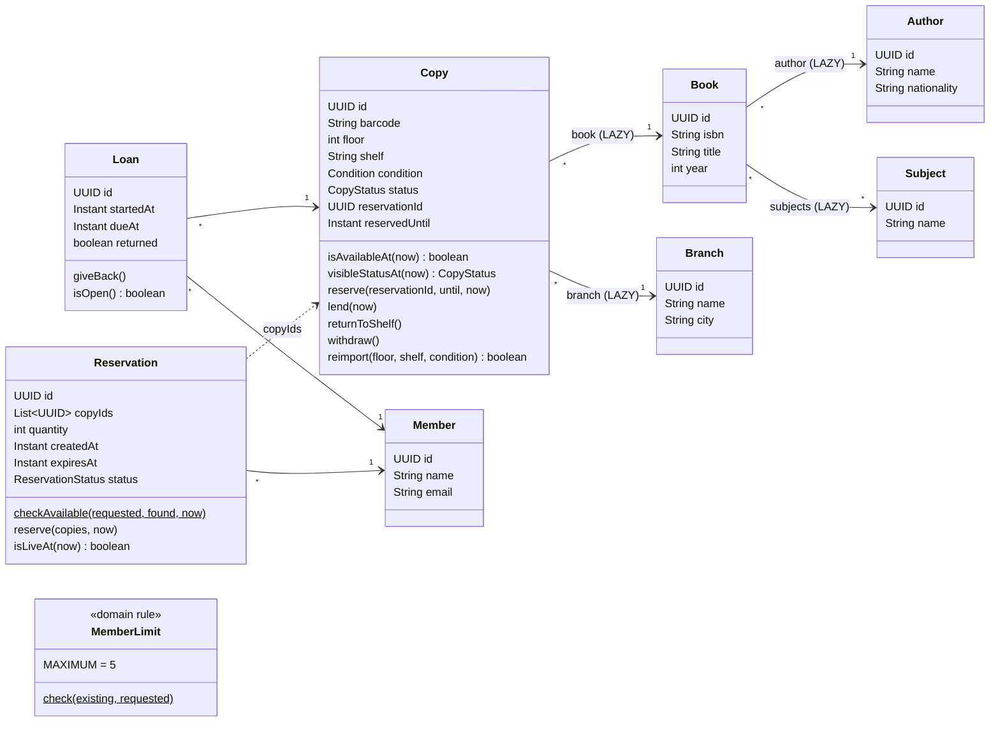
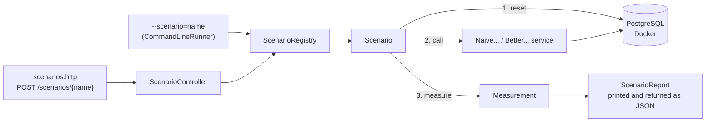
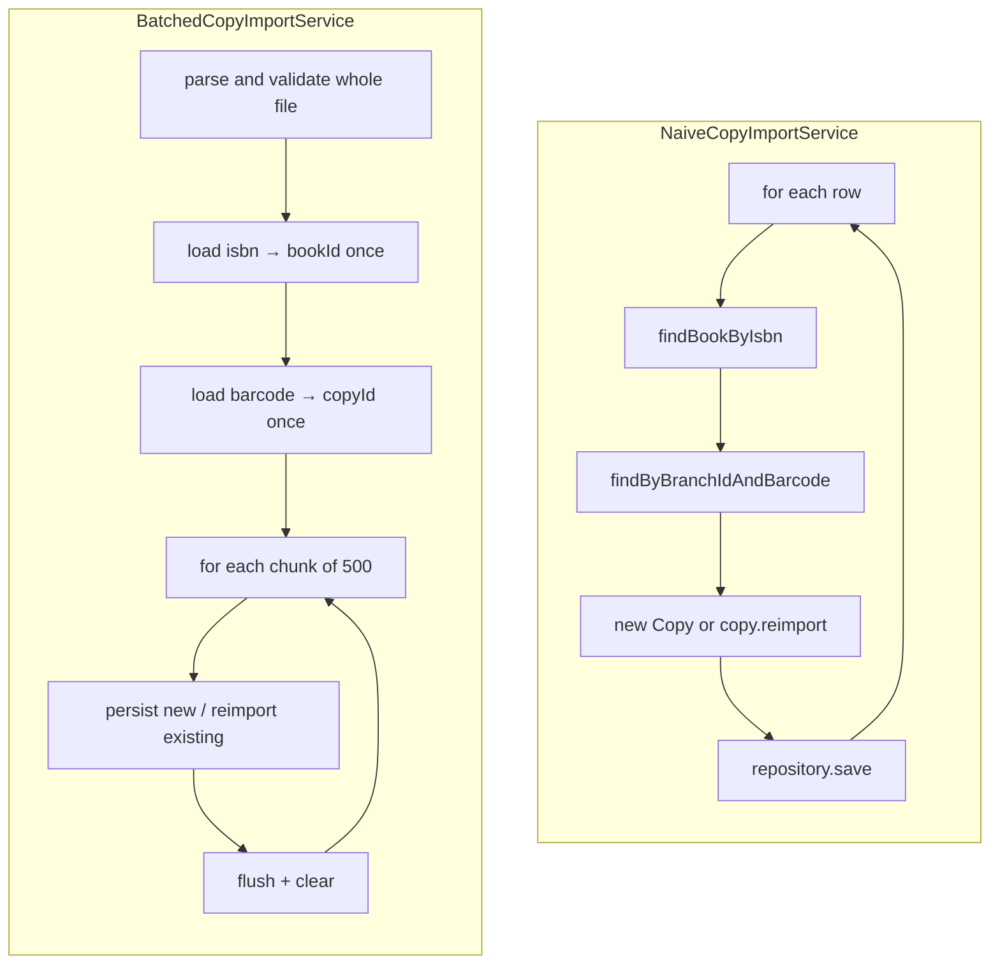
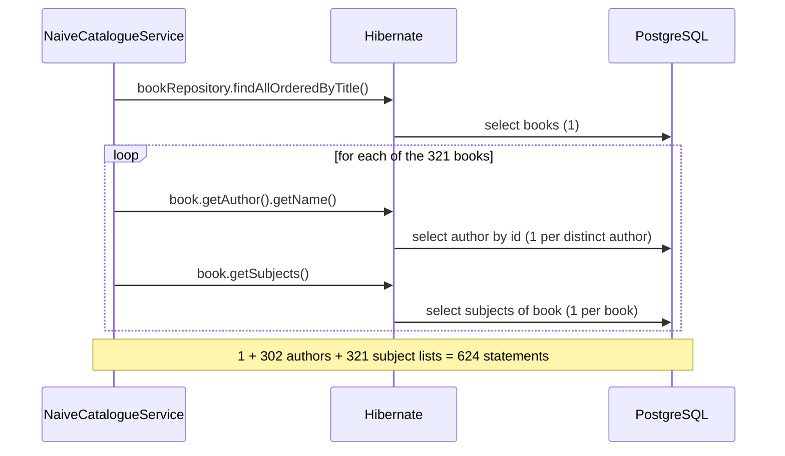
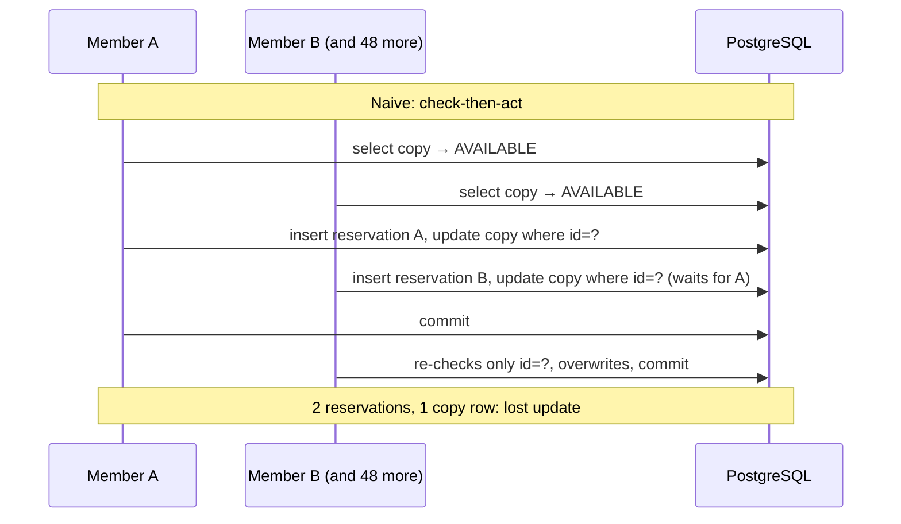
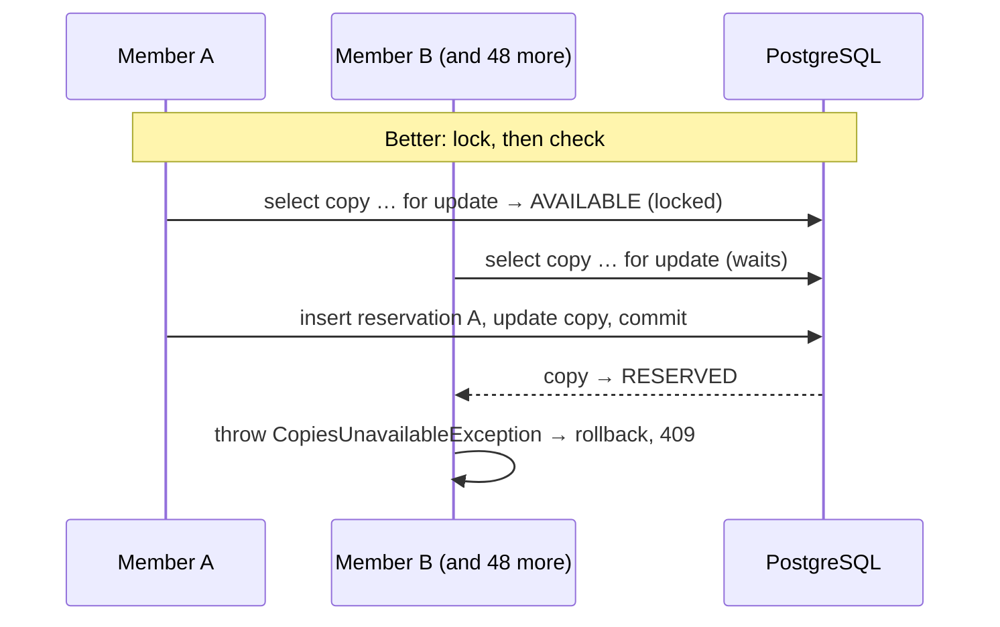
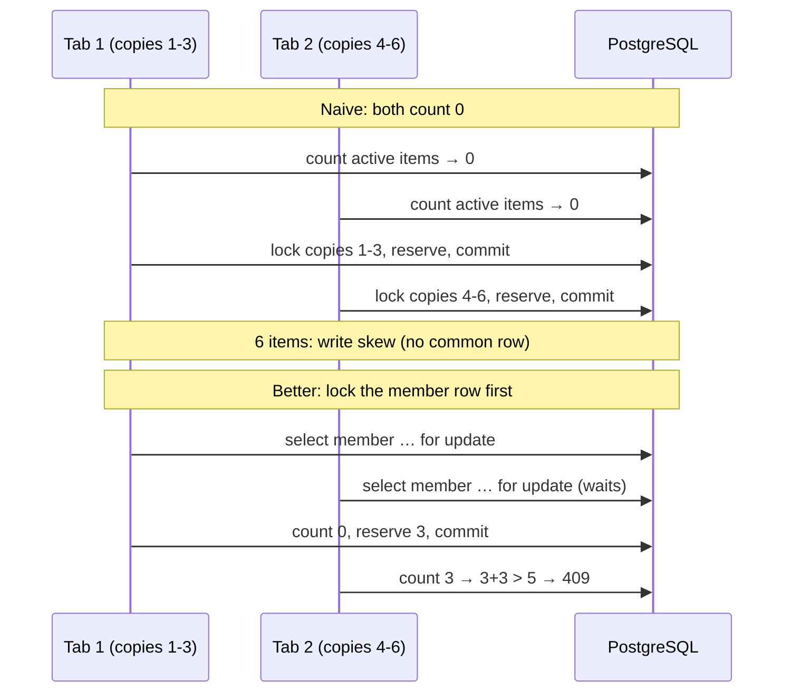

# Domain and examples plan

This document describes the library domain used by the example and plans, lesson by lesson, the
code, the data and the scenarios. For each piece of code it states the concept that piece teaches.
The concepts themselves are described in [concepts.md](concepts.md).

## 1. The domain

A public library has several **branches**. Each branch holds physical **copies** of **books**. A
book has one **author** and a few **subjects**. **Members** borrow copies (**loans**) or reserve
them for 48 hours (**reservations**). A member can have at most 5 active items at a time.



### 1.1 Enumerations

| Enum | Values |
| --- | --- |
| `CopyStatus` | `AVAILABLE`, `ON_LOAN`, `RESERVED`, `WITHDRAWN` |
| `Condition` | `NEW`, `GOOD`, `WORN`, `DAMAGED` |
| `ReservationStatus` | `ACTIVE`, `CANCELLED`, `COLLECTED` |

### 1.2 Domain rules

The rules live in the entities, never in the services. The services orchestrate them.

| Rule | Where | Used in lesson |
| --- | --- | --- |
| A barcode is unique within a branch | `Copy` + unique constraint `(branch, barcode)` | Import |
| A copy is available if its status is `AVAILABLE`, or `RESERVED` with a passed `reservedUntil` | `Copy.isAvailableAt(now)` | Shelf map, Reservation |
| The public status of an expired reservation is `AVAILABLE` | `Copy.visibleStatusAt(now)` | Shelf map |
| All or nothing: every requested copy must have been found and be available; the exception lists the ones that are not | `Reservation.checkAvailable(requested, found, now)` | Reservation |
| Reserving a copy that is not available is refused | `Copy.reserve(...)` throws `CopiesUnavailableException` | Reservation |
| A loan puts the copy on loan; returning it puts it back | `Loan` constructor → `Copy.lend(now)`, `Loan.giveBack()` → `Copy.returnToShelf()` | Member limit (open loans count) |
| A reservation lasts 48 hours | `Reservation` constructor computes `expiresAt` | Reservation |
| A reservation is live while `ACTIVE` and not expired | `Reservation.isLiveAt(now)` | Member limit |
| A member has at most 5 active items (open loans + copies in live reservations) | `MemberLimit.check(existing, requested)` | Member limit |
| Re-importing a copy changes only its physical attributes; it keeps its id and status | `Copy.reimport(...)` | Import |

### 1.3 Mapping decisions and what they teach

| Decision | Why | Concept |
| --- | --- | --- |
| UUID ids assigned in the constructor | The id exists before the database sees it | `persist` vs `merge`, `isNew()` |
| Every `@ManyToOne` marked `LAZY` | JPA's default for it is `EAGER` | Lazy vs eager loading |
| `Book.subjects` as `@ManyToMany List` | A small collection per book, like Affora's performances per event | N+1 on collections, `JOIN FETCH` |
| `Copy` has no collection back to its loans or reservations | The copy row alone answers "is it available?" | Aggregates, keeping the lockable row small |
| `Reservation.copyIds` as an `@ElementCollection` of ids | A reservation refers to copies, it does not own them | References between aggregates |
| `Copy.reservationId` and `reservedUntil` on the copy row | The availability check and the lock happen on one row | Lockable row, lost update |

## 2. Data loaded at startup

Hibernate drops and creates the schema at every start (`ddl-auto=create`). `data.sql` runs after
it (`defer-datasource-initialization=true`) and generates the rows with `generate_series`. Every
start begins from the same data; ids are random UUIDs, so scenarios find rows by business key
(branch name, ISBN, barcode, member email). The counts below are checked by
`ExampleDataAndQueriesTest`.

| Data | Volume | Used in |
| --- | --- | --- |
| Branches | `Central` (20,000 copies), `North` (small, for reservations), `Annex` (empty, target of the import) | All |
| Authors | 302: `Author 001`–`Author 300` (one per book), `Prolific Author` (20 books), `Bestselling Author` (the bestseller) | Catalogue |
| Subjects | 20 | Catalogue |
| Books | 321: `Title 001`–`Title 300` (ISBN `978-84-000001`…), `Prolific Title 301`–`320`, and `The Last Copy` (ISBN `978-84-999999`); each with 2–4 subjects (963 links) | Catalogue, Shelf map |
| Copies in `Central` | 20,000 (`C000001`–`C020000`) over books 1–300; 5 floors × 40 shelves × 100 copies | Shelf map |
| Statuses in `Central` | 18,450 `AVAILABLE`, 1,000 `ON_LOAN` (with their loans), 500 `RESERVED` (with their reservations; 100 already expired, so the map shows 18,550 available), 50 `WITHDRAWN` | Shelf map |
| Members | 60 scenario members (`member01@library.test`…) with no items; 500 readers (`reader001@library.test`…) who own Central's loans and reservations, at most 3 items each | Reservation, Member limit |
| Copies in `North` | The **bestseller** (`N-BEST`, a single copy) and 30 ordinary available copies (`N0001`–`N0030`) | Reservation, Member limit |
| Copies in `Annex` | None | Import |

Resource files:

- `import/annex-20000.csv`: 20,000 rows `isbn,barcode,floor,shelf,condition`, all ISBNs from the
  loaded books.
- `import/annex-error-last-row.csv`: 20,000 rows, the last one with an unknown condition.

## 3. Scenario infrastructure



| Piece of code | What it does | Concept learned |
| --- | --- | --- |
| `Scenario` interface (`name()`, `run()`) | One demonstration, one report | Repeatable measurement |
| `ScenarioRunner` (`CommandLineRunner`) | Runs the scenarios given in `--scenario` and stops | Spring Boot startup hooks |
| `ScenarioController` | `POST /scenarios/{name}` returns the report | Driving a demo from `.http` |
| `JdbcExecutionCounter` (Hibernate `SessionEventListener`, registered with `hibernate.session.events.auto`) | Counts single JDBC statements and JDBC batches | A batch is one round trip; `Statistics` cannot tell batches apart |
| `Measurement` | `sql(action)`: clears and reads the counters and Hibernate `Statistics`; `time(warmups, samples, action)`: median, min, max; `heap(action)`: peak heap growth sampled every 2 ms | Counting statements, warm-up, median, noisy memory |
| `SqlCounts`, `Measured`, `Timing` (records) | What was measured, ready to put in a report | |
| `ScenarioReport` (record) | Statements, entity loads, collection fetches, batches, median time, heap, bytes, outcome counts | Comparing naive and better with the same numbers |
| `RaceWindow` | No-op in normal use; a `CyclicBarrier` in concurrency scenarios | Forcing a possible interleaving |
| `ConcurrentRun` helper | 50 tasks on an `ExecutorService`, released by a `CountDownLatch` | Starting requests at the same instant |
| `DemoReset` | Restores the rows a scenario uses (JPQL bulk deletes and updates) | Identical data for naive and better |

## 4. Lesson 1: Bulk import of a branch's copies

**Learned:** write-side N+1, `merge` vs `persist`, auto-flush, dirty checking, persistence-context
growth, JDBC batching, `getReferenceById`, atomic import.

**Endpoints:** `POST /naive/branches/{id}/copies/import` and `POST /better/branches/{id}/copies/import`
(multipart CSV). Response: number of created and updated copies.

**Scenarios:** `import-naive` and `import-batched`. Each one empties `Annex`, imports
`annex-20000.csv`, then imports it again.



| Piece of code | Concept learned |
| --- | --- |
| `CopyCsvParser` (shared) | Validation before writing; a bad row anywhere → nothing imported |
| `NaiveCopyImportService.importFile` | The natural loop: the per-row lookups are the write-side N+1 |
| `copyRepository.save(copy)` with an assigned UUID | `save()` calls `merge()`, which first `SELECT`s by id |
| `findByBranchIdAndBarcode` inside the loop | Flush mode `AUTO`: every query flushes the pending insert, so batches hold one row, and every flush dirty-checks all managed copies (O(n²)) |
| One `@Transactional` around the loop | Atomicity, and a persistence context that keeps 20,000 copies |
| `bookRepository.findIsbnIndex()` (JPQL → `record IsbnRef(String isbn, UUID id)`) | One scalar query instead of one per row |
| `entityManager.getReferenceById(Book, id)` | A proxy for the association without loading the book |
| `copyRepository.findBarcodeIndex(branch)` | Idempotency decided in memory, ids kept on re-import |
| `entityManager.persist(copy)` | No `merge`, no hidden `SELECT` |
| `copy.reimport(...)` + dirty checking | An `UPDATE` only when an attribute really changed |
| `flush()` + `clear()` every 500 rows | Batches actually sent; at most 500 managed copies |
| `application.yaml`: `jdbc.batch_size`, `order_inserts`, `order_updates`, `reWriteBatchedInserts` | Configuring JDBC batching through Hibernate |

**Report:** first import and re-import, each with time, statements, JDBC batches, entity loads and
heap. Extra request in `scenarios.http`: import `annex-error-last-row.csv` and show that `Annex`
is still empty.

**Example tests:** parser rules (unit); re-import keeps ids and count (Testcontainers);
error file imports nothing (Testcontainers).

## 5. Lesson 2: The catalogue (read-side N+1)

**Learned:** lazy loading, N+1, the first-level cache hiding queries, `EAGER` is not a fix,
`JOIN FETCH`, DTO projection, `readOnly`.

**Endpoints:** `GET /naive/books` (optionally `?author=Prolific Author`),
`GET /better/books/join-fetch`, `GET /better/books/projection`. The three return the same JSON:
per book, `isbn`, `title`, `authorName`, `authorNationality` and `subjects` (sorted).

**Scenarios:** `catalogue-naive`, `catalogue-join-fetch`, `catalogue-projection`
(`CatalogueScenarios`). Each one lists the 321 books once with the SQL counted and logged, then
three warm-ups and ten timed calls with the SQL log silenced. The better scenarios also check that
their response equals the naive one; the naive scenario also measures the 20 books of
`Prolific Author`.

**Measured** (Apple M3 Pro, 18 GB, PostgreSQL 17 in Docker, 321 books, one run of the scenarios):

| Version | JDBC statements | Entities loaded | Collections fetched | Median time |
| --- | --- | --- | --- | --- |
| Naive | 624 | 643 | 321 | 87.2 ms |
| JOIN FETCH | 1 | 643 | 0 | 3.8 ms |
| Projection | 1 | 0 | 0 | 2.4 ms |

643 entities = 321 books + 302 authors + 20 subjects. The JOIN FETCH removes the statements but
not the entities; the projection removes both.



| Piece of code | Concept learned |
| --- | --- |
| `@ManyToOne(fetch = LAZY) Author author` | Proxies; the default `EAGER` would load authors anyway |
| `@ManyToMany List<Subject> subjects` (lazy by default) | An uninitialized collection loads when first touched |
| `NaiveCatalogueService.list` walking `getAuthor()` and `getSubjects()` | The N+1, visible in the SQL log and in the count |
| `NaiveCatalogueService.listByAuthor("Prolific Author")`: 20 books, 22 statements (1 + 1 author + 20 subject lists) instead of 41 | The first-level cache answers repeated author lookups |
| `@Transactional(readOnly = true)` on every catalogue service | Flush mode manual, no snapshots |
| `BookSummary.of(book)`, shared by the naive and the JOIN FETCH services | The same mapping code: whether it queries depends only on what was fetched before |
| `BookRepository.findAllWithAuthorAndSubjects()` (`select distinct b … join fetch b.author left join fetch b.subjects`) | One statement; managed entities still built |
| `BookRepository.findCatalogueRows()` (`select new BookRow(b.id, b.isbn, b.title, a.name, a.nationality, s.name) …`) + grouping in `ProjectionCatalogueService` | No managed entities at all; one row per book and subject |
| `Measurement.time` silencing the `org.hibernate.SQL` logger | Writing 624 log statements per call would be measured too |
| `BookSummary` DTO, built in the service | Services return DTOs; nothing lazy reaches the controller (`open-in-view=false`) |

**Report:** statements, entity loads, collection fetches and median time for the three variants.

**Example tests** (`CatalogueTest`): the three versions return the same 321 books; statement
counts 624 / 1 / 1; the projection loads no entity; `LazyInitializationException` when a lazy
association is touched after the transaction ended; the endpoints over HTTP.

## 6. Lesson 3: The shelf map of a branch

**Learned:** cost of managed entities in a read, response size, scalar projection, expiry
computed at read time, privacy by construction, first-level cache, why not a second-level cache.

**Endpoints:** `GET /naive/branches/{name}/shelf-map` and `GET /better/branches/{name}/shelf-map`
(by name, because ids are random UUIDs that change at every start). An unknown branch is a `404`
problem+json (`NotFoundException`, `ProblemDetailsHandler`).

- Naive response (`NaiveShelfMap`): one object per copy (`id, barcode, floor, shelf, isbn, status`).
- Better response (`ShelfMapResponse`): shelves with parallel arrays.

```json
{
  "branch": "Central",
  "legend": { "A": "AVAILABLE", "L": "ON_LOAN", "R": "RESERVED", "W": "WITHDRAWN" },
  "shelves": [
    { "floor": 1, "shelf": "1-01",
      "copyIds": ["…", "…"], "barcodes": ["C000001", "C000002"],
      "isbns": ["978-84-000001", "978-84-000002"], "statuses": "AA" }
  ]
}
```

**Scenarios:** `first-level-cache` (the concept the lesson starts from), then `shelf-map-naive` and
`shelf-map-projection` (`ShelfMapScenarios`), on `Central` (20,000 copies). Both measure the SQL of
one call, then the time and peak heap of call **plus JSON serialization** (the size of the
response is part of the cost), the JSON bytes, the statuses shown and whether any reservation id
or deadline appears in the JSON. The projection scenario also checks that it shows the same status
for every copy as the naive one.

**Measured** (Apple M3 Pro, 18 GB, PostgreSQL 17 in Docker, 20,000 copies, one run of the
scenarios; heap is a noisy sample):

| Version | JDBC statements | Entities loaded | JSON bytes | Median time (service + JSON) | Peak heap growth |
| --- | --- | --- | --- | --- | --- |
| Naive | 2 | 20,301 | 2,697,631 | 137.9 ms | 44 MB |
| Projection | 2 | 1 (the branch) | 1,335,304 | 50.6 ms | 16 MB |

Both show 18,550 available (the 100 expired reservations included), 1,000 on loan, 400 reserved
and 50 withdrawn, and neither contains a reservation id or deadline. The statement count is the
same: the naive version's problem is invisible to a statement counter.

| Piece of code | Concept learned |
| --- | --- |
| `NaiveShelfMapService`: `copyRepository.findByBranchWithBooks(branch)` (`join fetch c.book`) | The N+1 is already avoided (lesson 2): 2 statements, but 20,301 managed entities |
| `copy.visibleStatusAt(now)` in `CopyItem.of` | Logical expiry as a domain rule, with the request's `Clock` |
| `CopyItem` DTO without reservation or deadline | Mapping to a DTO is the first privacy defence |
| `@Transactional(readOnly = true)` | Cheaper entities, still entities |
| JSON bytes in the report | 20,000 repeated field names |
| `CopyRepository.projectShelfMap(branch, now)`: JPQL `select new ShelfRow(…, case when c.status = RESERVED and c.reservedUntil <= :now then 'AVAILABLE' else cast(c.status as String) end)` joined with `Book`, ordered by floor and shelf | Scalars only, one query, expiry in the query |
| The `case` on the status as text, and the `ShelfRow` constructor taking a `String` | Hibernate writes an enum literal in a `CASE` as a number; PostgreSQL refuses to mix it with the text column |
| `ShelfRow` record without reservation or deadline fields | Privacy by construction: nothing to leak |
| `ShelfMapResponse.from(branch, rows)` and `statusesByCopy()` | Grouping into the compact format, and how a client reads it back |
| `Clock` bean (`ClockConfiguration`) | "Now" is injected: the test reads the same data two days later and every reservation has expired |
| `FirstLevelCacheScenario` (`first-level-cache`): two `findById` of the same copy in one `TransactionTemplate`, then in two | First-level cache: 1 statement and the same object in one transaction; 2 statements and two objects in two |

**Discussion point:** a second-level cache on `Copy` would be invalidated by every loan,
return and reservation.

**Example tests** (`ShelfMapTest`): both versions show the same status for every copy; with the
clock two days ahead every reservation shows as available; 20,301 entities vs 1; 200 shelves whose
arrays all have 100 entries; leak test over HTTP for both endpoints (no reservation id, no
`reservationId` or `reservedUntil` field); unknown branch → `404` problem+json.

## 7. Lesson 4: Reserving the last copy

**Learned:** check-then-act, lost update, `READ COMMITTED` behaviour, pessimistic lock with JPA,
checking the locked rows, rollback by exception, fixed lock order, lock timeout.

**Endpoints:** `POST /naive/reservations` and `POST /better/reservations`, body
`{ "memberId": "…", "copyIds": ["…"] }`.

- `201` with `Location`, `id`, `expiresAt`.
- `409` problem+json with `unavailableCopies`.

**Scenarios:**

- `reservation-naive` and `reservation-pessimistic`: 50 members, the bestseller's single copy,
  released together, with the `RaceWindow` barrier between read and write.
- `reservation-partial-naive` and `reservation-partial-pessimistic`: three copies requested, one
  already reserved; after the `409`, are the other two still available?





| Piece of code | Concept learned |
| --- | --- |
| `NaiveReservationService.reserve`: `findAllById`, `isAvailableAt`, `raceWindow.pause()`, `copy.reserve(...)` | Check-then-act: the check holds no lock |
| Dirty-checking `UPDATE … WHERE id = ?` (in the SQL log) | Why waiting for the lock does not protect the rule |
| Scenario report: 50 `201`, 50 reservations, 1 reserved copy | Count promises, not only rows |
| `CopyRepository.lockCopies(ids)`: `@Lock(PESSIMISTIC_WRITE)` + `order by c.id` + `@QueryHints(jakarta.persistence.lock.timeout)` | `SELECT … FOR UPDATE`, fixed lock order, bounded waiting |
| `LockingReservationService.reserve`: no unlocked pre-read | The locked rows are the ones checked (no stale managed copies) |
| `locked.size() != copyIds.size()` | A missing copy cannot be locked, so it is a rejection |
| `throw new CopiesUnavailableException(ids)` | Runtime exception → rollback; "leaves no trace" |
| `Copy.reserve(...)` called on locked copies | The rule stays in the domain |
| `ProblemDetailsHandler`: `CopiesUnavailableException` → `409`, `LockTimeoutException` → `409` | Clean rejections, never `500` |

**Report:** successes, rejections, errors, reservation rows, reserved copies, median and p95 time.
Partial scenario: the state of the two other copies.

**Example tests:** fifty threads, one copy (Testcontainers): exactly one success; three copies with
one taken: nothing left reserved; `Copy.reserve` refuses an unavailable copy (unit).

## 8. Lesson 5: The per-member limit

**Learned:** write skew vs lost update, phantoms, why the copy locks do not help, why
`REPEATABLE READ` does not help, materializing the invariant as one locked row, lock order.

**Endpoints:** the same reservation endpoints; the limit is part of reserving.

**Scenarios:** `member-limit-naive` and `member-limit-locked`. One member with no items. Two
requests ("two browser tabs") for 3 different copies each, released together with the barrier
after the count. A third, single request from a new member shows the first attempt is accepted.



| Piece of code | Concept learned |
| --- | --- |
| `MemberLimit.check(existing, requested)` | The rule in the domain, correct for one request |
| `ReservationRepository.countActiveItems(member, now)` (JPQL sum over live reservations + count of open loans) | The invariant is over a **set** of rows |
| Naive: count, `raceWindow.pause()`, then the locking reservation of lesson 4 | Copy locks do not help: the copies are different |
| `memberRepository.lockById(id)` (`@Lock(PESSIMISTIC_WRITE)`) before the count | The write skew becomes a conflict on one existing row |
| Lock order in `LockingReservationService`: member → copies | Same order everywhere avoids deadlocks |
| `MemberLimitExceededException` → `409` with its own problem `type` | The client can tell "limit" from "copy taken" |

**Report:** statuses of the two tabs, items held by the member afterwards, first-attempt result.

**Discussion points:** a `FOR UPDATE` on the member's existing reservations locks nothing for a
member with none; `REPEATABLE READ` gives both tabs the same snapshot of 0; a limit per member and
branch would need a counter row that does not exist on the first attempt.

**Example tests:** two concurrent tabs → one `201`, one `409` (Testcontainers); first request of a
new member accepted; `MemberLimit` boundaries 5 and 6 (unit).

## 9. Package layout

```text
cat.tecnocampus.library
├── domain            Author, Book, Subject, Branch, Copy, Member, Loan, Reservation, MemberLimit, enums, exceptions
├── persistence       Spring Data repositories, projection records (IsbnRef, BarcodeRef, BookRow, ShelfRow)
├── importing         CopyCsvParser, NaiveCopyImportService, BatchedCopyImportService, ImportController
├── catalogue         NaiveCatalogueService, JoinFetchCatalogueService, ProjectionCatalogueService, CatalogueController
├── shelfmap          NaiveShelfMapService, ProjectedShelfMapService, ShelfMapController
├── reservation       NaiveReservationService, LockingReservationService, ReservationController
├── web               ProblemDetailsHandler
└── scenario          Scenario, ScenarioRegistry, ScenarioRunner, ScenarioController, ScenarioReport,
                      Measurement, JdbcExecutionCounter, SqlCounts, Measured, Timing,
                      RaceWindow, ConcurrentRun, DemoReset
                      (each scenario class lives in the package of its lesson)
```

Lessons 4 and 5 share the `reservation` package: the member limit is part of reserving, and its
better version is the same `LockingReservationService` with the member lock added.

## 10. Demonstration order

| Order | Lesson | Scenarios | Main number to show |
| --- | --- | --- | --- |
| 1 | Catalogue | naive → join-fetch → projection | 624 → 1 → 1 statements; 87 → 3.8 → 2.4 ms |
| 2 | Shelf map | first-level-cache, naive → projection | 20,301 → 1 entities; 2.7 → 1.3 MB; 138 → 51 ms |
| 3 | Import | naive → batched | time and statements, first import and re-import |
| 4 | Reservation | naive → pessimistic, partial naive → partial pessimistic | 50 promises → 1 |
| 5 | Member limit | naive → locked | 6 items → 3 |

The catalogue goes first because it introduces lazy loading and the persistence context, which
the import and the shelf map build on. The numbers in this table are expected values from the
data volumes; the reports give the measured ones.
