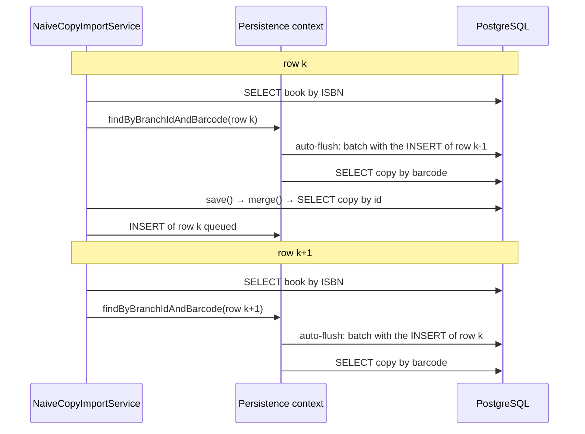
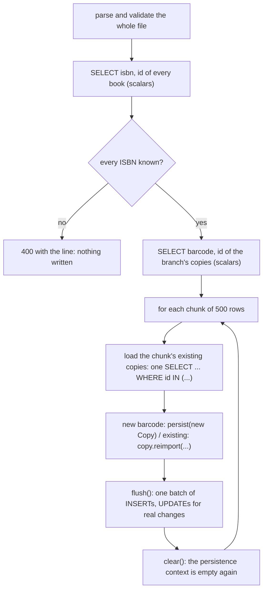

# Bulk import: the naive and the better version

This document explains the import lesson (`import-naive` and `import-batched`) in detail: what each version
sends to the database, why the naive one grows with the **square** of the rows, why its inserts
travel in **batches of one**, what **dirty checking** costs in each version, and which JPA tools the
better version uses. The domain and the measurement plan are in
[domain-and-examples.md](domain-and-examples.md); the concepts are summarized in
[concepts.md](concepts.md).

## 1. The task

A branch uploads a CSV with one physical copy per line: `isbn,barcode,floor,shelf,condition`.
The import must be:

- **atomic**: a bad line anywhere imports nothing;
- **idempotent**: importing the same file again creates nothing and keeps the copies' ids, so
  loans and reservations that point to them stay valid;
- **an update** when a copy already exists: only the physical attributes (floor, shelf,
  condition) change, and only if they really changed.

Both versions share `CopyCsvParser`, which reads and validates the whole file before anything is
written (header, five fields, numbers, known condition, no repeated barcode). The two services
accept and reject exactly the same files; they differ only in how they talk to the database.

## 2. The numbers

Apple M3 Pro, 18 GB, PostgreSQL 17 in Docker, normal JIT, one run per line (the heap figure is a
noisy sample, see `Measurement.heap`):

| Version and rows | Import | Time | JDBC statements | JDBC batches | Entities loaded | Peak heap growth |
| --- | --- | --- | --- | --- | --- | --- |
| Naive, 5,000 | first | 21,501 ms | 15,001 | 5,000 | 321 | 127 MB |
| Naive, 5,000 | again | 17,007 ms | 10,001 | 0 | 5,321 | 92 MB |
| Batched, 5,000 | first | 279 ms | 3 | 10 | 1 | 32 MB |
| Batched, 5,000 | again | 202 ms | 13 | 0 | 5,001 | 24 MB |
| Batched, 20,000 | first | 476 ms | 3 | 40 | 1 | 68 MB |
| Batched, 20,000 | again | 378 ms | 43 | 0 | 20,001 | 60 MB |

How to read the counters (`JdbcExecutionCounter`):

- **JDBC statements** are statements sent one at a time: every `SELECT`, and any `INSERT` or
  `UPDATE` that is not batched.
- **JDBC batches** are executions of a JDBC batch: one round trip that may carry one or many
  `INSERT`s. A batch is counted once, whatever its size.
- **Entities loaded** are entity objects Hibernate built from a row. An entity that is already
  in the persistence context is not loaded again.

Every section below explains some of these numbers.

## 3. The naive version

`NaiveCopyImportService.importCopies` is the loop anybody would write first:

```java
for (CopyRow row : rows) {
    Book book = books.findByIsbn(row.isbn()).orElseThrow(...);
    Optional<Copy> existing = copies.findByBranchIdAndBarcode(branch.getId(), row.barcode());
    if (existing.isPresent()) {
        existing.get().reimport(row.floor(), row.shelf(), row.condition());
        copies.save(existing.get());
    } else {
        copies.save(new Copy(branch, book, row.barcode(), row.floor(), row.shelf(), row.condition()));
    }
}
```

It is correct: it is atomic (one `@Transactional`), idempotent (the barcode lookup finds the
existing copy) and it updates only what changed (`reimport` returns `false` when nothing changed).
The tests pass with it. All its problems are invisible with ten rows.

### 3.1 What one row sends: three SELECTs

| Step | SQL |
| --- | --- |
| `findByIsbn` | `SELECT` of the book |
| `findByBranchIdAndBarcode` | `SELECT` of the copy |
| `save(new Copy(...))` | `SELECT` of the copy by id (see below), then an `INSERT` queued for later |

So 15,001 statements = the branch + 3 × 5,000 rows. This is the **write-side N+1**: a constant
number of queries per row instead of a constant number per file.

Two of them deserve a closer look.

**The book lookup is not answered by the persistence context.** The 5,000 rows use 320
different books, and from the second time on the book is already managed. That does not save the
`SELECT`: the first-level cache answers lookups **by id** (`find`, `getReference`), not queries.
`findByIsbn` is a query, so it always goes to the database. What the persistence context saves is
building the object again: that is why only 321 entities are loaded (the branch and the 320
books), not 5,000.

**`save()` of a new copy sends a SELECT.** Spring Data's `save()` decides between `persist()` and
`merge()` by asking whether the entity is new, and by default "new" means "the id is `null`".
`Copy` assigns its UUID in the constructor (the id exists before the row does), so `save()` thinks
the copy already exists and calls `merge()`. `merge()` must find out what is in the database, so
it `SELECT`s the copy by id, finds nothing, and only then schedules the `INSERT`. One useless
query per new row.

### 3.2 Why every batch carries one INSERT

`application.properties` configures JDBC batching for every use case
(`hibernate.jdbc.batch_size=500`), so the naive version has it too. Yet the first import sends
5,000 batches for 5,000 rows: every batch carries **one** `INSERT`.

The reason is how Hibernate writes:

1. `persist()` or `merge()` does not send the `INSERT`. It puts it in the **action queue** of the
   persistence context.
2. The queue is sent at a **flush**. A flush happens at commit, when the code calls `flush()`, or
   automatically before a query (flush mode `AUTO`, the default).
3. Batching groups the statements **of one flush**: all the queued `INSERT`s of the same table
   go to the driver as one batch (up to 500 per batch), in one round trip.

Now follow two consecutive rows:



The barcode lookup of row k+1 queries the copy table, and the copy table has a pending `INSERT`
(row k). If Hibernate ran the query without flushing, the query could miss a row that this very
transaction has already created (think of a file with the same barcode twice). Under flush mode
`AUTO` Hibernate guarantees that a query sees the transaction's own pending changes, so it
flushes first. The queue holds a single `INSERT` at that moment, so the batch carries a single
`INSERT`.

Batching is not broken: it is configured and it runs. It has nothing to group, because a query
inside the loop empties the queue at every row. **Batching only helps when nothing reads in
between the writes.**

(Our parser already rejects repeated barcodes, but Hibernate cannot know that: it must assume the
query may depend on the pending row.)

### 3.3 Dirty checking, and why the time grows with the square of the rows

**Dirty checking** is how Hibernate finds the `UPDATE`s to send without being told. When an
entity becomes managed (loaded, persisted or merged), Hibernate keeps a **snapshot** of its
values. At every flush, it compares every managed entity with its snapshot, field by field;
an entity that differs gets an `UPDATE`. This is why `copy.reimport(...)` needs no `save()`: it is
enough to change the managed object.

The cost of one flush is therefore proportional to the **number of managed entities**, not to the
number of changes. A flush with nothing to write still compares every managed entity.

In the naive import nothing ever leaves the persistence context: every copy created or found
stays managed until the transaction ends. And before the queries in the loop, flush mode `AUTO`
makes Hibernate look for pending changes, which means dirty-checking everything managed so far.
So:

- at row 1 there is about 1 managed copy to check, at row 1,000 about 1,000, at row k about k;
- the total work is 1 + 2 + … + n ≈ n² / 2 comparisons (times the number of checks per row).

That is **quadratic growth**: twice the rows, four times the work; four times the rows, sixteen
times the work. 5,000 rows took 21.5 s; 20,000 rows would be about 16 × 21.5 s ≈ 6 minutes,
and the first try did take about seven minutes. That is why the scenario stops at 5,000 rows.

The **re-import** proves that the time goes into dirty checking, not into SQL:

- it sends a third fewer statements (10,001: the branch + 2 lookups per row; `save()` of a managed
  copy is a no-op `merge()`, no `SELECT`), and **no write at all** (0 batches: nothing changed);
- yet it takes 17 s, almost as long as the first import;
- the 5,000 existing copies are loaded one by one by the barcode lookups (5,321 entities loaded),
  and each one stays managed, so the dirty checking grows exactly as in the first import.

Compare with the batched version, which writes the same 5,000 rows in 279 ms: the SQL cannot
explain the naive version's 21 s. The persistence context can.

Memory follows the same story: every managed copy has the object, its snapshot and its entry in
the persistence context, and none of them can be collected before the commit (127 MB of peak
growth for 5,000 rows).

### 3.4 Summary of the naive version

| Cause | Effect | Number that shows it |
| --- | --- | --- |
| 2 lookups per row | write-side N+1 | 15,001 / 10,001 statements |
| `save()` with an assigned id calls `merge()` | 1 extra `SELECT` per new row | 15,001 − 10,001 = 5,000 |
| a query in the loop auto-flushes | batches of one `INSERT` | 5,000 batches for 5,000 rows |
| nothing is ever cleared | every flush dirty-checks every copy so far: n² | 21.5 s, 17 s with no writes |
| nothing is ever cleared | all copies stay in memory until the commit | 127 MB |

## 4. The better version

`BatchedCopyImportService.importCopies` keeps the same contract (atomic, idempotent, update only
what changed) and the same domain method (`Copy.reimport`). It removes each cause with a JPA tool:



Its first import of 5,000 rows sends 3 statements and 10 batches: the branch, the ISBN index, the
barcode index, then 10 chunks of 500 `INSERT`s. 20,000 rows: still 3 statements and 40 batches,
in 476 ms. Four times the rows, less than twice the time (part of the cost is fixed, such as the two
indexes): the cost grows linearly, not with the square.

### 4.1 The tricks

**1. Two scalar indexes instead of two lookups per row.**
`books.findIsbnIndex()` returns `IsbnRef(isbn, id)` records for every book, and
`copies.findBarcodeIndex(branchId)` returns `BarcodeRef(barcode, id)` for every copy of the branch.
They become two `Map`s, and every row is resolved in memory. These are **projections**: no
entity is built, so nothing is added to the persistence context and nothing will be dirty-checked.
The question "does this copy exist?" (idempotency) is answered by the map, not by a query per row.

**2. Every ISBN is checked before writing anything.** With the ISBN map in hand, the service finds
an unknown ISBN before the first `persist()`. A file whose last row is bad costs no writes at all.
The naive version writes 4,999 copies and the rollback undoes them: correct, but expensive.

**3. `getReference` instead of loading the branch and the books.** A new copy needs its branch and
its book only as foreign keys. `entityManager.getReference(Book.class, id)` returns a **proxy**
that holds only the id, without any `SELECT`; the `INSERT` uses the id. That is why the first
import loads a single entity: the branch, found by name at the start. The branch reference is
obtained again in every chunk because `clear()` detaches the previous one, so every object the
new copies point to belongs to the current persistence context.

**4. `persist()` instead of `save()`.** `persist()` says "this is new": no `merge()`, no
`SELECT` by id, the `INSERT` goes straight into the action queue. It is safe only because trick 1
already decided, from the barcode map, that the copy does not exist. If it did, the unique
constraint (branch, barcode) would make the flush fail and the whole import would roll back:
wrong, but never silently duplicated.

**5. No query between the writes of a chunk.** Inside a chunk, the loop only works with the maps,
creates objects and calls `persist()`. Nothing reads the copy table, so auto-flush never fires,
and up to 500 `INSERT`s pile up in the action queue. This is the real fix for the batches of one:
batching was always configured, now it finally has something to group.

**6. `flush()` + `clear()` every 500 rows.**

- `flush()` sends the chunk: one JDBC batch of 500 `INSERT`s (10 batches for 5,000 rows), plus
  the `UPDATE`s that dirty checking finds.
- `clear()` detaches everything: the copies of the chunk, their snapshots, the proxies. The next
  chunk starts with an empty persistence context.

So at most one chunk (500 copies) is ever managed. Every flush dirty-checks at most 500 entities,
and there are n / 500 flushes: the total dirty-checking work is about n, not n². Memory is bounded
by the chunk size too: 32 MB for 5,000 rows, 68 MB for 20,000 (the two maps and the parsed rows
grow with the file; the managed entities do not).

The chunks are **not** commits. Everything still runs in the one `@Transactional`, so a failure at
the last chunk rolls back the first one too. `flush()` writes to the database inside the
transaction; only the commit makes it visible to others.

**7. The existing copies of a chunk in one query.** On a re-import, the chunk's copies must be
managed entities, so that `reimport(...)` plus dirty checking writes the `UPDATE`s. `loadExisting`
takes their ids from the barcode map and loads them with one `findAllById` (`SELECT ... WHERE id
IN (...)`) per chunk; a chunk of new copies sends none. That explains the re-import numbers:
5,000 rows = 3 + 10 chunk queries = 13 statements and 5,001 entities loaded (the branch and the
copies); 20,000 rows = 3 + 40 = 43.

**8. Configuration that makes the batches efficient** (`application.properties`, shared by both
versions):

| Property | Why |
| --- | --- |
| `hibernate.jdbc.batch_size=500` | Up to 500 statements per JDBC batch. Matches the chunk size, so one chunk is one batch |
| `hibernate.order_inserts=true` / `order_updates=true` | Groups the statements of a flush by table, so a flush that writes several tables does not break the batch at every change of table |
| Hikari `reWriteBatchedInserts=true` | The PostgreSQL driver rewrites a batch of `INSERT`s as multi-row `INSERT ... VALUES (...), (...)` statements: fewer statements for the server to parse and run |

**9. The assigned UUID, a double-edged choice.** It is what made `save()` call `merge()` in the
naive version. It is also what makes insert batching possible at all: with database-generated
`IDENTITY` ids, Hibernate must run each `INSERT` immediately to learn the id, and cannot batch
inserts. The better version keeps the assigned id and avoids `save()`.

### 4.2 Dirty checking in the better version

Dirty checking still does real work, but only where it is useful:

| Import | What is managed at a flush | What dirty checking finds |
| --- | --- | --- |
| First import | at most 500 new copies (and proxies, which are not checked until initialized) | nothing to update: the copies were just persisted |
| Re-import, file unchanged | at most 500 existing copies | no change: no `UPDATE` (0 batches in the table) |
| Re-import, some rows changed | at most 500 existing copies | an `UPDATE` only for the copies whose `reimport` changed a field, sent as a batch |

The rule is the same as in the naive version (compare every managed entity at every flush). What
changed is the number of managed entities at each flush (≤ 500 instead of up to n) and the number
of flushes (n / 500 instead of about 2 per row).

## 5. Trade-offs and alternatives

- **Memory of the indexes.** The two maps hold one entry per book and one per copy of the branch:
  20,000 short strings and UUIDs, a few megabytes. For millions of copies, look the barcodes up
  per chunk instead (`WHERE barcode IN (...)`, one query per chunk).
- **Chunk size.** Larger chunks mean fewer round trips but more managed entities per flush and more
  memory; 500 matches `batch_size`. Measure before changing it.
- **One long transaction.** Atomicity requires it: a commit per chunk would leave a half-imported
  file after an error. The price is a transaction that runs as long as the import, which is fine
  for a branch's catalogue.
- **`saveAll()`** is not an alternative: it calls `save()` for each entity, with the same `merge()`.
- **Teaching Spring Data that the copy is new** (implementing `Persistable.isNew()`, or a `@Version`
  field whose `null` means "new") would make `save()` call `persist()`. It removes the extra
  `SELECT` but neither the auto-flush nor the growing persistence context, which are the expensive
  part.
- **Changing the flush mode** to `COMMIT` would stop the auto-flushes, and the batches would fill.
  But the barcode lookups would then miss the transaction's own pending rows, and the persistence
  context would still grow without limit. Removing the queries from the loop fixes the cause.
- **Plain JDBC or a bulk `INSERT ... SELECT`** would be faster still, but this project uses JPA for
  all application persistence, and the domain method `reimport` would no longer decide what
  changes.

## 6. Where to look

| What | Where |
| --- | --- |
| The two services | `importing/NaiveCopyImportService.java`, `importing/BatchedCopyImportService.java` |
| The shared parser | `importing/CopyCsvParser.java` |
| The scalar indexes | `BookRepository.findIsbnIndex`, `CopyRepository.findBarcodeIndex` |
| The domain update | `Copy.reimport` |
| The scenarios and how they measure | `importing/ImportScenarios.java`, `scenario/Measurement.java`, `scenario/JdbcExecutionCounter.java` |
| Batching configuration | `src/main/resources/application.properties` |
| Tests | `CopyCsvParserTest`, `CopyImportTest` |

Run `POST /scenarios/import-naive` and `POST /scenarios/import-batched` from `scenarios.http`
(the naive one takes about 40 s), or
`./mvnw spring-boot:run -Dspring-boot.run.arguments=--scenario=import-naive,import-batched`.

## 7. Questions to check understanding

1. The naive import configures `batch_size=500`. Why does it still send 5,000 batches?
2. The naive re-import writes nothing. Where do its 17 seconds go?
3. Why does the book lookup reach the database every time, even for a book already managed?
4. Why is `persist()` safe in the better version and not in the naive one?
5. What would break if the better version committed every chunk?
6. Twice the rows: how much longer would each version take, and why?
