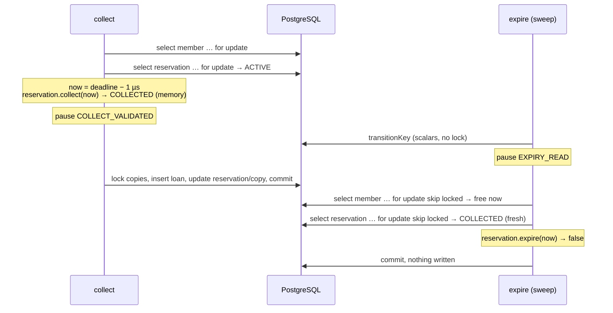
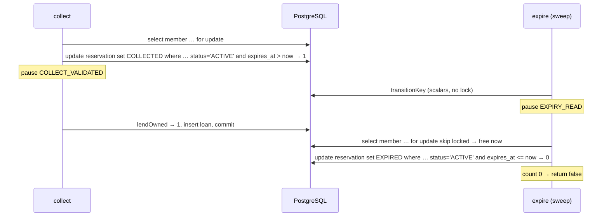
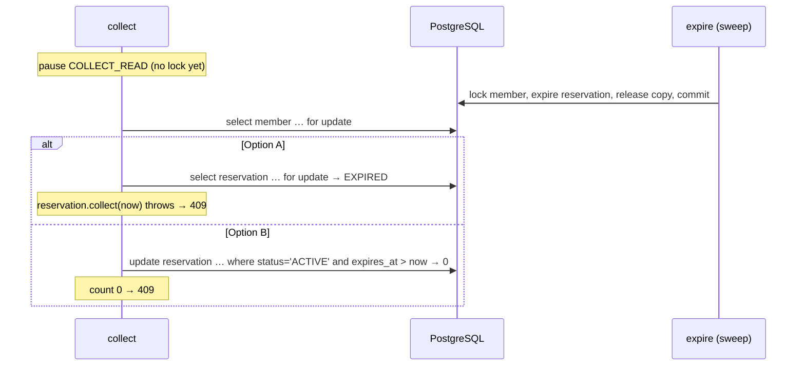

# Collect vs expire: `SELECT … FOR UPDATE` or a conditional `UPDATE`

A second example of the same idea as
[`conditional-update-vs-select-lock.md`](conditional-update-vs-select-lock.md), this time with the
code that is **already in the project** and the two scenarios that measure it:

| Scenario | Implementation | Approach |
| --- | --- | --- |
| `collect-expiry-locked` | [`LockingExpiryTransitions`](../src/main/java/cat/tecnocampus/library/expiry/LockingExpiryTransitions.java) | Option A: lock the rows, check the rule in Java, let dirty checking write |
| `collect-expiry-conditional` | [`ConditionalExpiryTransitions`](../src/main/java/cat/tecnocampus/library/expiry/ConditionalExpiryTransitions.java) | Option B: `UPDATE … WHERE <old state>`, the affected-row count decides |

Both scenarios run the race in [`ExpiryRaces`](../src/main/java/cat/tecnocampus/library/expiry/ExpiryRaces.java)
(`collectionCommitsFirst`, `expiryCommitsFirst`) and are defined in
[`ExpiryScenarios`](../src/main/java/cat/tecnocampus/library/expiry/ExpiryScenarios.java). Run them
with the application started (`./mvnw spring-boot:run`) and the requests in
[`../scenarios.http`](../scenarios.http):

```http
POST {{host}}/scenarios/collect-expiry-locked
POST {{host}}/scenarios/collect-expiry-conditional
```

Nothing in this document changes the code; every snippet below is copied from it (some comments
shortened).

---

## 1. The race

Anna reaches the desk **one microsecond before** her reservation's deadline. The librarian scans it
(`collect`). At the same moment the sweep, whose clock already says "deadline", picks the same
reservation (`expire`).

Two different operations want to move the **same reservation row** out of `ACTIVE`:

```
collect:  ACTIVE and now <  expiresAt  →  COLLECTED, copies → ON_LOAN, one Loan per copy
expire:   ACTIVE and now >= expiresAt  →  EXPIRED,   copies → AVAILABLE, one notice
```

**Invariant:** exactly one of them wins, and every other fact (copy status, open loans, notices)
agrees with the winner.

The rules live in the domain,
[`Reservation`](../src/main/java/cat/tecnocampus/library/domain/Reservation.java):

```java
public boolean isLiveAt(Instant now) {
    return status == ReservationStatus.ACTIVE && now.isBefore(expiresAt);
}

public void collect(Instant now) {
    if (!isLiveAt(now)) {
        throw new ReservationNotActiveException(id);
    }
    status = ReservationStatus.COLLECTED;
}

public boolean expire(Instant now) {
    if (status != ReservationStatus.ACTIVE || now.isBefore(expiresAt)) {
        return false;
    }
    status = ReservationStatus.EXPIRED;
    return true;
}
```

The naive version (`collect-expiry-naive`, lesson 1 of
[`reservation-expiry-lessons.md`](reservation-expiry-lessons.md)) calls these methods on entities
read with a plain `findById`: both transactions read `ACTIVE`, both say yes, and the second
`UPDATE reservation SET status = ? WHERE id = ?` silently overwrites the first one.

The two fixes below both answer the same question differently: **who reads the status, and when?**

---

## 2. Option A — `LockingExpiryTransitions`: lock, then let the domain decide

### 2.1 Collect

```java
@Transactional
public CollectionResponse collect(UUID memberId, UUID reservationId) {
    ownedBy(memberId, reservationId);                                     // scalars only
    pauses.observe(TransitionPauses.COLLECT_READ, reservationId);
    Member member = members.lockById(memberId).orElseThrow();             // lock 1: member
    Reservation reservation = reservations.lockById(reservationId)        // lock 2: reservation,
            .orElseThrow(() -> new NotFoundException("Reservation", reservationId));   // read fresh
    Instant now = clock.instant();                                        // after the locks
    reservation.collect(now);                                             // current status, current time
    pauses.observe(TransitionPauses.COLLECT_VALIDATED, reservationId);

    List<Copy> held = copies.lockCopies(reservation.getCopyIds());        // lock 3: copies, id order
    if (held.size() != reservation.getQuantity()) {
        throw new CopiesUnavailableException(reservation.getCopyIds());
    }
    List<Loan> loans = held.stream().map(copy -> {
        copy.collect(reservationId, now);                                 // throws if not held by it
        return Loan.forCollection(member, copy, now);
    }).toList();
    loans.forEach(entityManager::persist);
    return new CollectionResponse(...);
}
```

### 2.2 Expire

```java
@Transactional
public boolean expire(UUID reservationId) {
    ReservationKey key = reservations.transitionKey(reservationId).orElse(null);   // scalars only
    if (key == null) return false;
    pauses.observe(TransitionPauses.EXPIRY_READ, reservationId);
    Member member = members.lockIfFree(key.memberId()).orElse(null);    // lock 1: member, SKIP LOCKED
    if (member == null) return false;
    Reservation reservation = reservations.lockIfFree(reservationId).orElse(null);   // lock 2
    if (reservation == null || !reservation.expire(clock.instant())) {
        return false;                                                    // already decided by someone else
    }
    List<Copy> held = copies.lockCopies(reservation.getCopyIds());       // lock 3: copies
    held.forEach(copy -> copy.releaseFrom(reservationId));               // only if still held by it
    events.publishEvent(new ExpiryNotice(...));                          // sent after the commit
    return true;
}
```

### 2.3 The locking queries

[`ReservationRepository`](../src/main/java/cat/tecnocampus/library/persistence/ReservationRepository.java):

```java
@Lock(LockModeType.PESSIMISTIC_WRITE)
@QueryHints(@QueryHint(name = "jakarta.persistence.lock.timeout", value = "5000"))
@Query("select r from Reservation r where r.id = :id")
Optional<Reservation> lockById(@Param("id") UUID id);                 // SELECT … FOR UPDATE

@Query(value = "select * from reservation where id = :id for update skip locked", nativeQuery = true)
Optional<Reservation> lockIfFree(@Param("id") UUID id);               // the sweep never waits
```

Plus `MemberRepository.lockById` / `lockIfFree` (the same two flavours on the member) and
`CopyRepository.lockCopies` (`FOR UPDATE`, ordered by id).

### 2.4 SQL of a winning collect

```sql
select r.id, r.member_id from reservation r where r.id = ?;              -- ownedBy: scalars
select m.* from member m where m.id = ? for update;                      -- lock 1
select r.* from reservation r where r.id = ? for update;                 -- lock 2, fresh row
select ... from reservation_copy where reservation_id = ?;               -- copy ids
-- Java: reservation.collect(now) → isLiveAt → COLLECTED (in memory)
select c.* from book_copy c where c.id in (?) order by c.id for update;  -- lock 3
-- Java: copy.collect(reservationId, now) → ON_LOAN (in memory)
insert into loan ...;
update reservation set status = 'COLLECTED', ... where id = ?;           -- dirty checking
update book_copy  set status = 'ON_LOAN', reservation_id = null, ... where id = ?;
commit;
```

The `UPDATE`s at the end have **only the id** in their `WHERE`, exactly as in the naive version.
They are safe now only because every row they write was **read under a lock held until commit**.

### 2.5 What makes it correct

1. **Nothing stale in the persistence context before the lock.** `ownedBy` and `transitionKey` read
   a projection (`ReservationKey`), never the entity. If the entity had been loaded before
   `lockById`, the lock query would return that same Java object with its old status (lesson 4).
2. **The status is read under the lock**, so it is the last committed one.
3. **The clock is read after the lock** (lesson 2): "now" belongs to the moment you have the right
   to decide, not to the moment you started.
4. **Every row written is locked**: member, reservation, copies, always in that order (lesson 7).
5. **The rule is Java**, in one place: `Reservation.collect`, `Reservation.expire`, `Copy.collect`,
   `Copy.releaseFrom`, all unit-testable without a database.

---

## 3. Option B — `ConditionalExpiryTransitions`: the `WHERE` decides

### 3.1 Collect

```java
@Transactional
public CollectionResponse collect(UUID memberId, UUID reservationId) {
    pauses.observe(TransitionPauses.COLLECT_READ, reservationId);
    members.lockById(memberId).orElseThrow(...);                          // lock order
    Instant now = clock.instant();
    if (reservations.collectIfLive(reservationId, memberId, now) == 0) {  // the arbitration point
        throw reservations.transitionKey(reservationId)
                .filter(key -> key.memberId().equals(memberId)).isPresent()
                ? new ReservationNotActiveException(reservationId)
                : new NotFoundException("Reservation", reservationId);
    }
    pauses.observe(TransitionPauses.COLLECT_VALIDATED, reservationId);

    List<UUID> copyIds = reservations.findCopyIds(reservationId);
    if (copies.lendOwned(reservationId) != copyIds.size()) {              // the count is checked
        throw new CopiesUnavailableException(copyIds);                    // rolls the collection back
    }
    Member member = entityManager.getReference(Member.class, memberId);
    List<Loan> loans = copyIds.stream()
            .map(id -> Loan.forCollection(member, entityManager.getReference(Copy.class, id), now))
            .toList();
    loans.forEach(entityManager::persist);
    return new CollectionResponse(...);
}
```

### 3.2 Expire

```java
@Transactional
public boolean expire(UUID reservationId) {
    ReservationKey key = reservations.transitionKey(reservationId).orElse(null);
    if (key == null) return false;
    pauses.observe(TransitionPauses.EXPIRY_READ, reservationId);
    Member member = members.lockIfFree(key.memberId()).orElse(null);    // never wait behind a member
    if (member == null) return false;
    String email = member.getEmail();          // read before the bulk updates clear the context
    if (reservations.expireIfDue(reservationId, clock.instant()) == 0) {
        return false;                                                     // someone else decided first
    }
    List<String> barcodes = copies.findBarcodesOfReservation(reservationId);
    copies.releaseOwned(reservationId);        // 0 is fine: a newer reservation may hold the copy
    events.publishEvent(new ExpiryNotice(reservationId, email, barcodes));
    return true;
}
```

### 3.3 The conditional queries

```java
// ReservationRepository
@Modifying(clearAutomatically = true, flushAutomatically = true)
@Query("""
        update Reservation r set r.status = COLLECTED
        where r.id = :id and r.member.id = :member
          and r.status = ACTIVE and r.expiresAt > :now
        """)
int collectIfLive(UUID id, UUID memberId, Instant now);

@Modifying(clearAutomatically = true, flushAutomatically = true)
@Query("""
        update Reservation r set r.status = EXPIRED
        where r.id = :id and r.status = ACTIVE and r.expiresAt <= :now
        """)
int expireIfDue(UUID id, Instant now);

// CopyRepository
@Modifying(clearAutomatically = true, flushAutomatically = true)
@Query("""
        update Copy c set c.status = ON_LOAN, c.reservationId = null, c.reservedUntil = null
        where c.reservationId = :reservation
        """)
int lendOwned(UUID reservationId);

@Modifying(clearAutomatically = true, flushAutomatically = true)
@Query("""
        update Copy c set c.status = AVAILABLE, c.reservationId = null, c.reservedUntil = null
        where c.reservationId = :reservation and c.status = RESERVED
        """)
int releaseOwned(UUID reservationId);
```

(The real queries spell the enum constants with their full class name.)

#### What `@Modifying(clearAutomatically = true, flushAutomatically = true)` is for

`@Modifying` on its own tells Spring Data that the `@Query` is an `UPDATE`/`DELETE`. Spring then
runs it with `executeUpdate()` and returns the **affected-row count**, the `int` that `collect`
and `expire` check. Without `@Modifying`, Spring would run the statement as a `SELECT` and the call
would fail with an exception. You can't leave out `@Modifying` itself. The two attributes are about
something else.

A JPQL `update` is a **bulk statement**. It goes straight to the database and **bypasses the
persistence context** (the first-level cache that dirty checking works on). Hibernate doesn't update
any `Reservation`, `Copy` or `Member` objects that are already in memory. So the context and the
database can disagree in two directions: unflushed changes in memory that the `UPDATE` can't see,
and objects in memory that the `UPDATE` has made stale. Each attribute deals with one of these.

- **`flushAutomatically = true`**: *before* the `UPDATE`, flush pending changes. Any dirty entity
  in the context is written to the database first, so the `UPDATE` (and its `WHERE`) sees this
  transaction's own earlier changes.
- **`clearAutomatically = true`**: *after* the `UPDATE`, clear the persistence context. Every
  managed entity is detached, so the next read really runs a `SELECT` and gets the rows as the
  `UPDATE` left them.

**What would happen without `clearAutomatically`.** Suppose the `Reservation` had been loaded as an
entity in this transaction, for example if `collect` started with `reservations.findById(...)`
instead of reading the `ReservationKey` projection:

1. The context holds a `Reservation` with `status = ACTIVE`.
2. `collectIfLive` sets `status = COLLECTED` in the database, but the object in memory isn't
   touched.
3. Any later `findById` of that reservation in the same transaction finds the id in the context
   and returns **that same stale object, without any SQL**. It still says `ACTIVE`.
4. Worse: if anything modifies that stale object, dirty checking writes it back at commit. By default
   Hibernate's `UPDATE` sets **all** columns, so it would write `status = ACTIVE` again and silently
   undo the conditional update. The same applies to the `Copy` rows that `lendOwned` and
   `releaseOwned` change. This is the stale-entity trap of lesson 4, coming back *after* the
   update instead of before the lock.

**What would happen without `flushAutomatically`.** This flag matters mainly *because* of
`clearAutomatically`. Clearing the context drops all pending changes **without writing them**.
`collect` persists the new `Loan`s **after** the last bulk update, so nothing is pending today. But
suppose someone moves `loans.forEach(entityManager::persist)` above `copies.lendOwned(...)`. If
Hibernate hasn't flushed those inserts yet, the clear throws them away and nothing reports an
error. The reservation would be `COLLECTED` and the copies `ON_LOAN` with no loan rows. Also, the
`UPDATE`'s `WHERE` would be evaluated against the database without this transaction's own pending
changes. Hibernate's default flush mode (`AUTO`) often flushes before a bulk statement on the same
table anyway. But that depends on the flush mode and on which tables Hibernate thinks the query
touches. `flushAutomatically = true` makes the flush explicit and guaranteed.

**In this particular class** neither problem shows up today, and the code is written so it can't:

- `transitionKey` and `findCopyIds` return a projection and ids, never `Reservation` or `Copy`
  entities, so there is nothing in the context for the updates to make stale.
- The only entity loaded before the updates is the locked `Member`. In `collect` it isn't used
  afterwards: the `Loan`s get `entityManager.getReference(Member.class, memberId)` instead, a
  reference that belongs to the current, freshly cleared context. In `expire` the email is read
  **before** `expireIfDue` (`// read before the bulk updates clear the context`), so the code never
  depends on an object that the clear has detached.
- The `Loan`s are persisted after the last bulk update, so there is nothing pending to flush.

So the attributes are **defensive**. They keep the four repository methods safe to call from code
that *does* hold entities or has pending changes.

**The price.** `clear()` detaches *every* entity in the context, not only the updated rows. That
includes the `Member` returned by `lockById`/`lockIfFree`. The database row lock stays in place
until commit, because locks belong to the transaction, not to the Java object. But changes made to
that detached `Member` would no longer be saved, and accessing its uninitialised lazy associations
throws `LazyInitializationException`. That's why option B works with ids, projections and
`getReference`, and takes what it needs from an entity **before** the bulk updates.

### 3.4 SQL of a winning collect

```sql
select m.* from member m where m.id = ? for update;                               -- lock order only
update reservation set status = 'COLLECTED'
 where id = ? and member_id = ? and status = 'ACTIVE' and expires_at > ?;          -- 1 = won, 0 = lost
select copy_id from reservation_copy where reservation_id = ?;
update book_copy set status = 'ON_LOAN', reservation_id = null, reserved_until = null
 where reservation_id = ?;                                                         -- count must = copies
insert into loan ...;
commit;
```

### 3.5 What makes it correct

1. **Check and write are one statement.** There is no Java `if` between a read and a write, so
   nothing can change in between.
2. **The `UPDATE` takes the row lock itself.** A second `UPDATE` of the same reservation waits for
   the first one; when the first commits, PostgreSQL **re-evaluates the `WHERE` on the committed
   row** (section 2.2 of the lessons). `status = 'ACTIVE'` is now false: 0 rows.
3. **Every count is checked.** `collectIfLive == 0` → 409; `lendOwned != copyIds.size()` → throw
   and roll back. `releaseOwned` may return 0 legitimately (a newer reservation may hold the copy
   after lazy expiry, lesson 6), and the code says so.
4. **Only the columns in `SET` are written**: no stale full-row updates are possible.
5. **No entities to go stale.** It works with ids, `getReference` and bulk statements; the
   persistence context is cleared after each bulk update, so the member's email is read before.

The member is still locked first. The conditional update would arbitrate collect vs expire on its
own; the member lock is kept so that every operation of a member takes its locks in the same order
as reserving does (member → reservation → copies), which is what keeps the member limit correct and
avoids deadlocks (lesson 7).

---

## 4. The two orderings, step by step

The scenarios force two timings with pause points (`TransitionPauses`) and a movable clock.

### 4.1 Collection commits first

Collection runs one microsecond before the deadline and stops at `COLLECT_VALIDATED` (it has
decided, it has not committed). The clock moves to the deadline. Expiry starts and stops at
`EXPIRY_READ` (it has read the scalar key, it holds no lock). Collection commits, then expiry goes on.

**Option A:**



**Option B:**



### 4.2 Expiry commits first

Collection reads one microsecond before the deadline and stops at `COLLECT_READ`, before taking any
lock. The clock reaches the deadline. Expiry runs completely and commits. Collection goes on.

**Option A:** collection's `lockById` loads the reservation **for the first time** (its earlier read
was only scalars), so it sees `EXPIRED`; the clock, read after the lock, says "deadline";
`reservation.collect(now)` throws `ReservationNotActiveException` → `409`.

**Option B:** `collectIfLive` finds `status = 'EXPIRED'` (and `expires_at > now` is false too): 0
rows → `409`.



### 4.3 What the pauses do and do not show

In both orderings the pause sits **before** the loser's arbitration point, so the loser arrives
after the winner has committed and simply reads the committed state. In a real collision, where
both reach the database at the same instant, the **member lock** is what serialises them, in both
options: collection's `lockById(member)` waits; the sweep's `lockIfFree(member)` returns nothing at
once and skips the reservation (a later run sees it again). Whoever proceeds then meets the
reservation-level check (the lock + Java `if` in A, the `WHERE` in B) on committed data.

---

## 5. Measured

From [`../design/evidence/expiry-better-scenarios.json`](../design/evidence/expiry-better-scenarios.json), 10 rounds
per ordering for each scenario:

| Scenario | Ordering | collect | expire | Reservation | Copy | Open loans | Notices | Rounds matching required |
| --- | --- | --- | --- | --- | --- | --- | --- | --- |
| `collect-expiry-locked` | collection first | `200` | `false` | `COLLECTED` | `ON_LOAN` | 1 | 0 | 10 / 10 |
| `collect-expiry-locked` | expiry first | `409` | `true` | `EXPIRED` | `AVAILABLE` | 0 | 1 | 10 / 10 |
| `collect-expiry-conditional` | collection first | `200` | `false` | `COLLECTED` | `ON_LOAN` | 1 | 0 | 10 / 10 |
| `collect-expiry-conditional` | expiry first | `409` | `true` | `EXPIRED` | `AVAILABLE` | 0 | 1 | 10 / 10 |

Same result, every round, for both options. For contrast, `collect-expiry-naive` answered `200` and
`true` in every round of both orderings
([`../design/evidence/expiry-naive-scenarios.json`](../design/evidence/expiry-naive-scenarios.json)).

---

## 6. Side by side

| | A: `LockingExpiryTransitions` | B: `ConditionalExpiryTransitions` |
| --- | --- | --- |
| Arbitration point | `reservations.lockById` / `lockIfFree` (`SELECT … FOR UPDATE [SKIP LOCKED]`) | `collectIfLive` / `expireIfDue` (`UPDATE … WHERE status = 'ACTIVE' AND …`) |
| Where the rule is evaluated | Java: `Reservation.collect`, `Reservation.expire`, `Copy.collect`, `Copy.releaseFrom` | SQL: the `WHERE` clauses |
| How you know you won | The domain method returns / throws | The affected-row count |
| Time rule written | Once (`isBefore` in `Reservation`) | Twice: `Reservation` **and** the queries (`> :now` in collect, `<= :now` in expire); the boundary tests must pin both sides |
| Rows locked | Member, reservation, copies (all explicit) | Member explicitly; reservation and copies implicitly by the `UPDATE`s |
| What the sweep does if the reservation is busy | `SKIP LOCKED`: skip, retry next run | Same on the member; the `UPDATE` itself would wait, but the member skip happens first |
| Columns written | Every column of each dirty entity | Only those in `SET` |
| Entities | Loaded under lock, managed, dirty checking | Ids and `getReference`; context cleared after every bulk update |
| Statements for a winning collect | More (3 locking selects, collection load, updates, inserts) | Fewer (1 lock, 2 conditional updates, 1 id list, inserts) |
| Typical trap | Loading the entity before the lock (stale object survives the lock, lesson 4); reading the clock before the lock (lesson 2) | Ignoring a count (lesson 3); using an entity read before a bulk update; the two copies of the time rule drifting apart |

## 7. Which one to pick

- The reservation transitions are a **single-row state change** whose rule fits in a `WHERE`
  (`status` + `expires_at`), so **B is a natural fit**: fewer statements, shorter locks, no
  full-row writes.
- The cost of B is that the **rule leaves the domain**: the boundary `now < expiresAt` is written in
  `Reservation.isLiveAt` and again, as `expires_at > :now` / `expires_at <= :now`, in two queries.
  An off-by-one between them (`>=` instead of `>`) reopens the race at exactly the deadline, and no
  unit test of `Reservation` would see it.
- **A keeps one source of truth** for the rule and reads like ordinary domain code, at the price of
  more locking statements and of discipline: projections before the lock, clock after it, one lock
  order everywhere.
- The project calls **A the reference** (section 4 of the lessons) because it keeps the rule in the
  domain; B is shown because it is the idiom you will meet in many code bases, and because for
  simple transitions (like the loan return in the first example) it is the simpler correct answer.
