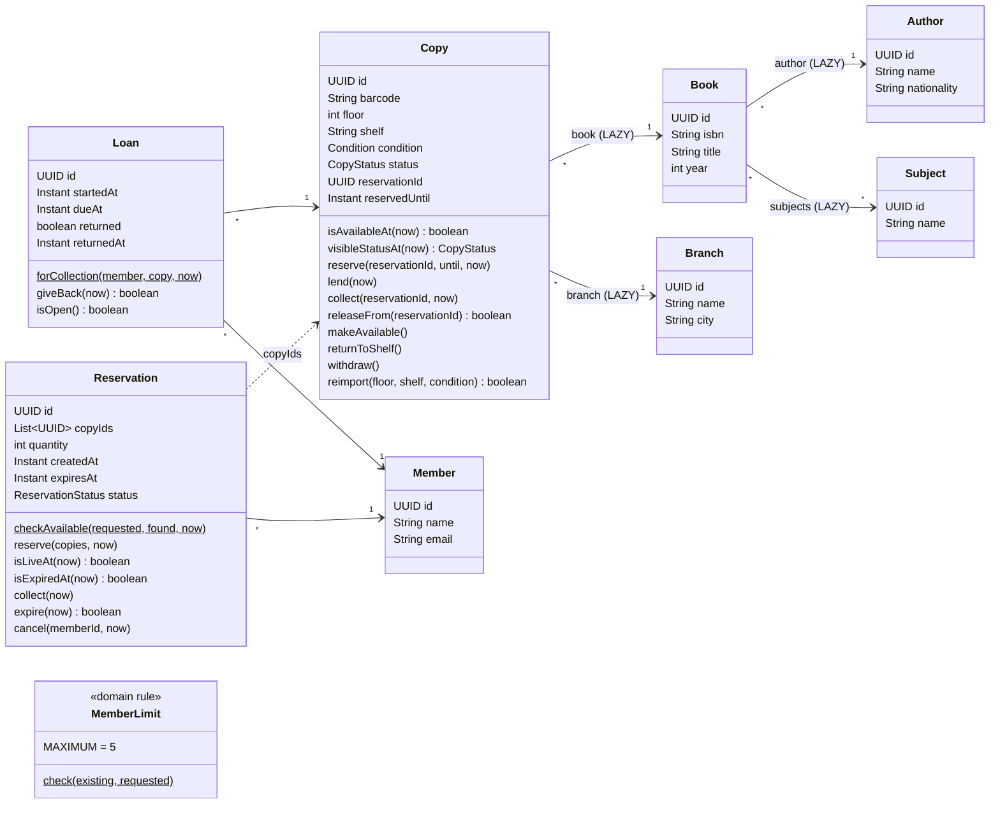
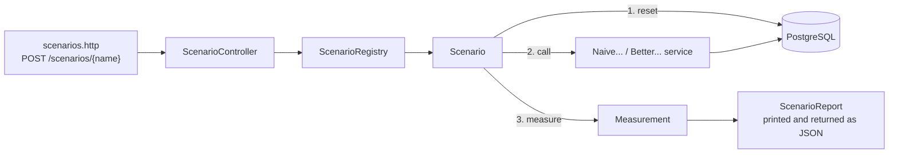
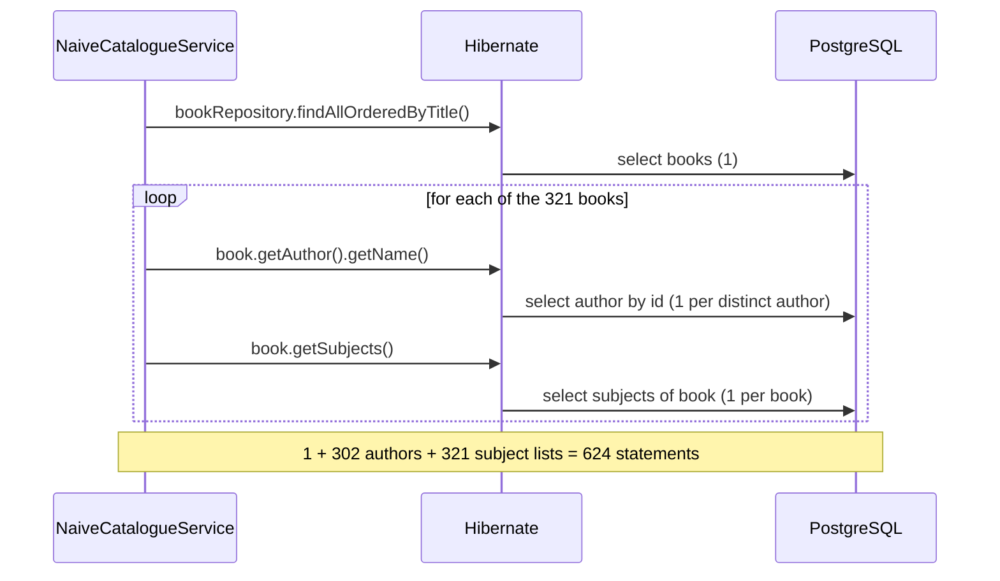
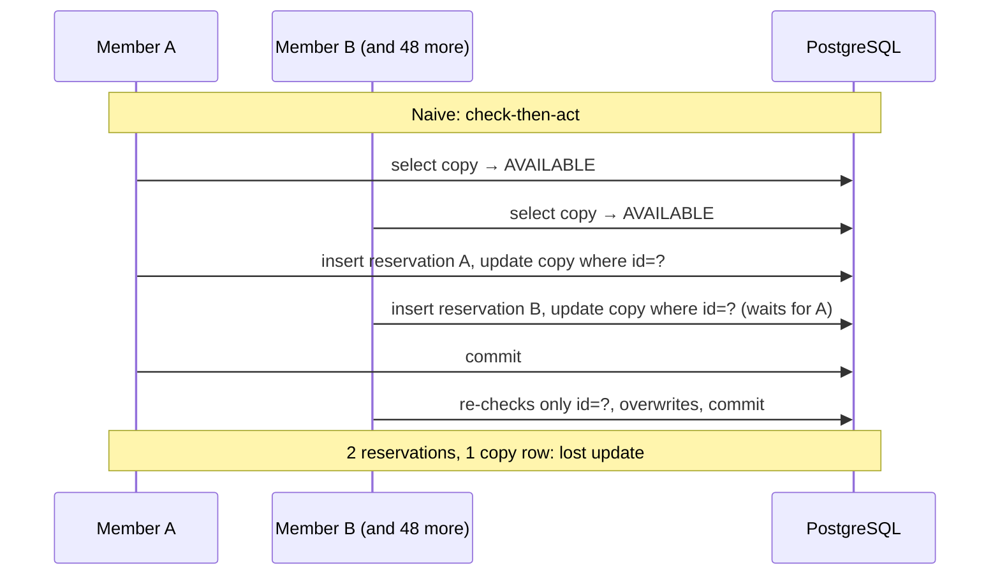
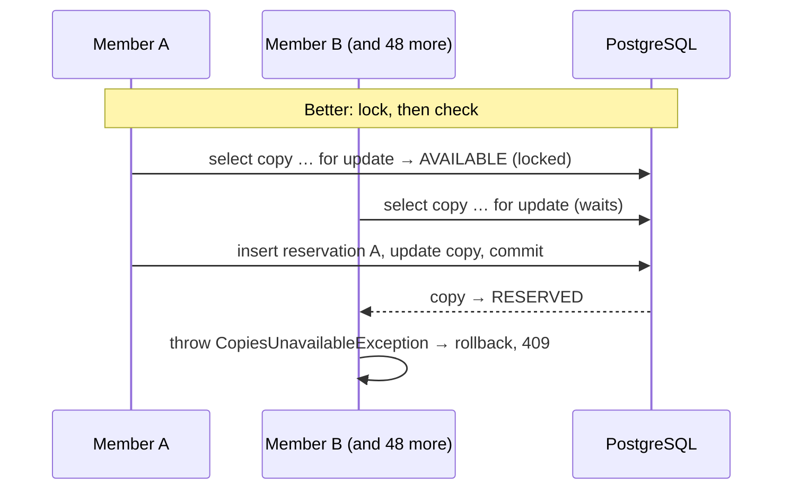
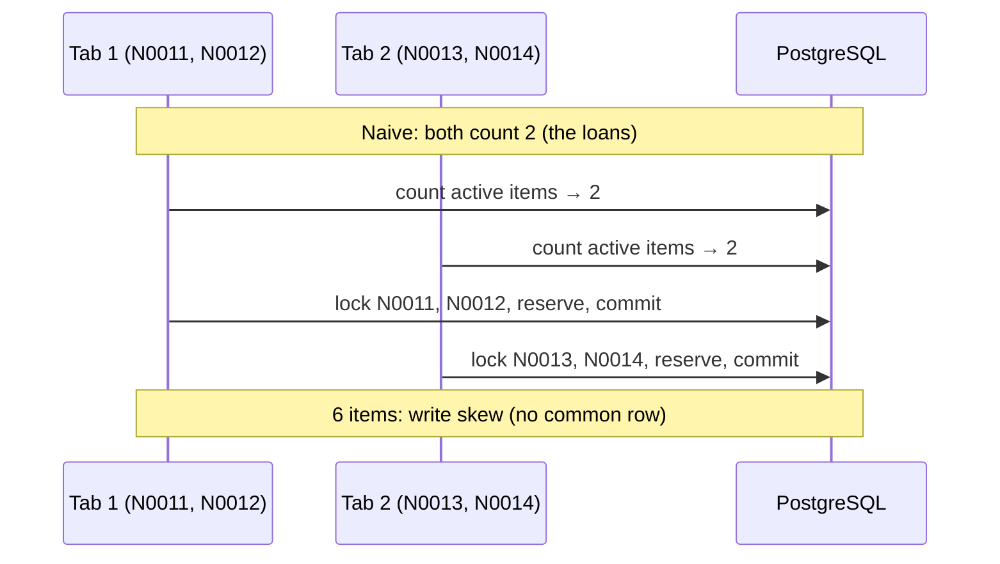
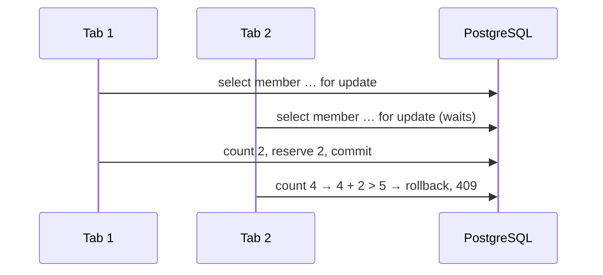

# The library: domain, reading data and reserving copies

This document is for students. It describes the example application, its **domain** and the
**data** it starts with, which every lesson document relies on. Then it covers four lessons, each
with a **naive** version that looks correct, a **scenario** that measures it on a real PostgreSQL,
an explanation of **why** it fails, and the **better** version:

- **The catalogue** (section 4): reading a list of entities and their associations, the N+1
  problem.
- **The shelf map** (section 5): what managed entities cost even when there is no N+1.
- **Reserving the last copy** (section 6): two requests for the same copy, the lost update, row
  locks.
- **The per-member limit** (section 7): two requests of the same member, write skew.

Sections 4 and 5 are about **reading** efficiently; sections 6 and 7 are about **writing** correctly
when requests arrive at the same time. Read sections 1–3 first.

How to use it:

- Start the application (`./mvnw spring-boot:run`, with Docker running) and run the scenarios
  with the requests in [`../scenarios.http`](../scenarios.http), in the order of this document.
  Watch the application's console: the SQL log shows every statement.
- Code links point to `src/main/java/cat/tecnocampus/library/…`. The snippets are copied from the
  code, with some comments shortened.

---

## 1. The domain

### 1.1 Entities and associations

A public library has several **branches**. Each branch holds physical **copies** of **books**. A
book has one **author** and a few **subjects**. **Members** borrow copies (**loans**) or reserve
them for 48 hours (**reservations**). A member can have at most 5 active items at a time. A
reservation ends exactly once: **collected** at the desk (its copies become loans), **cancelled**
by the member, or **expired** after its deadline (a scheduled sweep stores it and notifies the
member). A loan ends when the copy is **returned**.



### 1.2 Enumerations

| Enum | Values |
| --- | --- |
| `CopyStatus` | `AVAILABLE`, `ON_LOAN`, `RESERVED`, `WITHDRAWN` |
| `Condition` | `NEW`, `GOOD`, `WORN`, `DAMAGED` |
| `ReservationStatus` | `ACTIVE`, `CANCELLED`, `COLLECTED`, `EXPIRED` (`ACTIVE` is left exactly once) |

### 1.3 Domain rules

The last column says where each rule is used: **Import** is
[`bulk-import.md`](bulk-import.md); **Shelf map**, **Reservation** and **Member limit** are sections
5–7 of this document; **Expiry** is
[`reservation-expiry-lessons.md`](reservation-expiry-lessons.md).

The rules live in the entities, never in the services. The services orchestrate them.

| Rule | Where | Lesson |
| --- | --- | --- |
| A barcode is unique within a branch | `Copy` + unique constraint `(branch, barcode)` | Import |
| A copy is available if its status is `AVAILABLE`, or `RESERVED` with a passed `reservedUntil` | `Copy.isAvailableAt(now)` | Shelf map, Reservation |
| The public status of an expired reservation is `AVAILABLE` | `Copy.visibleStatusAt(now)` | Shelf map |
| All or nothing: every requested copy must have been found and be available; the exception lists the ones that are not | `Reservation.checkAvailable(requested, found, now)` | Reservation |
| Reserving a copy that is not available is refused | `Copy.reserve(...)` throws `CopiesUnavailableException` | Reservation |
| A loan puts the copy on loan; returning it puts it back | `Loan` constructor → `Copy.lend(now)`, `Loan.giveBack()` → `Copy.returnToShelf()` | Member limit (open loans count) |
| A reservation lasts 48 hours | `Reservation` constructor computes `expiresAt` | Reservation |
| A reservation is live while `ACTIVE` and not expired | `Reservation.isLiveAt(now)` | Member limit |
| A member has at most 5 active items (open loans + copies in live reservations) | `MemberLimit.check(existing, requested)` | Member limit |
| Re-importing a copy changes only its physical attributes; it keeps its id and status | `Copy.reimport(...)` | Import |
| Collect only while live (`now < expiresAt`); expire only once due (`now >= expiresAt`): no instant allows both, none allows neither | `Reservation.collect(now)`, `Reservation.expire(now)` (returns `true` only for the call that must release) | Expiry |
| Expired for a reader as soon as the deadline passes, swept or not (`GET` answers `410`) | `Reservation.isExpiredAt(now)` | Expiry |
| Only the member, and only while live, can cancel; another member's reservation is "not found" | `Reservation.cancel(memberId, now)` | Expiry |
| A reserved copy is collected only by the reservation holding it, before its deadline; the deadline disappears | `Copy.collect(reservationId, now)`; `Loan.forCollection(...)` records it | Expiry |
| An ended reservation gives a copy back only if it still holds it | `Copy.releaseFrom(reservationId)` (`makeAvailable()` is the naive, unconditional release) | Expiry |
| Returning a loan is idempotent: a retry has no second effect | `Loan.giveBack(now)` returns `true` only for the call that closed it | Expiry |

### 1.4 Mapping decisions and what they teach

| Decision | Why | Concept |
| --- | --- | --- |
| UUID ids assigned in the constructor | The id exists before the database sees it | `persist` vs `merge`, `isNew()` |
| Every `@ManyToOne` marked `LAZY` | JPA's default for it is `EAGER` | Lazy vs eager loading |
| `Book.subjects` as `@ManyToMany List` | A small collection per book, like Affora's performances per event | N+1 on collections, `JOIN FETCH` |
| `Copy` has no collection back to its loans or reservations | The copy row alone answers "is it available?" | Aggregates, keeping the lockable row small |
| `Reservation.copyIds` as an `@ElementCollection` of ids | A reservation refers to copies, it does not own them | References between aggregates |
| `Copy.reservationId` and `reservedUntil` on the copy row | The availability check and the lock happen on one row | Lockable row, lost update |

## 2. Data loaded at startup

Hibernate drops and creates the schema at every start (`ddl-auto=create`). `data.sql` runs after
it (`defer-datasource-initialization=true`) and generates the rows with `generate_series`. Every
start begins from the same data; ids are random UUIDs, so scenarios find rows by business key
(branch name, ISBN, barcode, member email). The counts below are checked by
`ExampleDataAndQueriesTest`.

| Data | Volume | Used in |
| --- | --- | --- |
| Branches | `Central` (20,000 copies), `North` (small, for reservations), `Annex` (empty, target of the import) | All |
| Authors | 302: `Author 001`–`Author 300` (one per book), `Prolific Author` (20 books), `Bestselling Author` (the bestseller) | Catalogue |
| Subjects | 20 | Catalogue |
| Books | 321: `Title 001`–`Title 300` (ISBN `978-84-000001`…), `Prolific Title 301`–`320`, and `The Last Copy` (ISBN `978-84-999999`); each with 2–4 subjects (963 links) | Catalogue, Shelf map |
| Copies in `Central` | 20,000 (`C000001`–`C020000`) over books 1–300; 5 floors × 40 shelves × 100 copies | Shelf map; the expiry sweep scenarios reserve hundreds of its available copies for the scenario members (`ExpiryFixtures`) |
| Statuses in `Central` | 18,450 `AVAILABLE`, 1,000 `ON_LOAN` (with their loans), 500 `RESERVED` (with their reservations; 100 already expired, so the map shows 18,550 available), 50 `WITHDRAWN` | Shelf map |
| Members | 60 scenario members (`member01@library.test`…) with no items; 500 readers (`reader001@library.test`…) who own Central's loans and reservations, at most 3 items each | Reservation, Member limit |
| Copies in `North` | The **bestseller** (`N-BEST`, a single copy) and 30 ordinary available copies (`N0001`–`N0030`) | Reservation, Member limit |
| Copies in `Annex` | None | Import |

Resource files:

- `import/annex-20000.csv`: 20,000 rows `isbn,barcode,floor,shelf,condition`, all ISBNs from the
  loaded books.
- `import/annex-5000.csv`: the first 5,000 rows of the same file (the naive import's size).
- `import/annex-5000-error-last-row.csv`: the same 5,000 rows, the last one with an unknown ISBN.
  The parser accepts it; only the database can tell, so the naive import writes 4,999 copies
  before it fails and the rollback undoes them.

---

## 3. How the scenarios work

Every lesson is shown with **scenarios**: small programs inside the application that reset the data
they use, call the naive or the better service, measure what happened and return a **report** as
JSON. Run one with a request from [`../scenarios.http`](../scenarios.http):

```http
POST {{host}}/scenarios/catalogue-naive
```



What a report contains, and the pieces of code you will meet in the reports:

| Piece of code | What it does | Why it matters |
| --- | --- | --- |
| `Measurement.sql(action)` | Counts the JDBC statements, JDBC batches, entities loaded and collections fetched by one action | A statement counter is the first tool to see an N+1 |
| `Measurement.time(warmups, samples, action)` | Runs the action a few times to warm up, then reports the median, min and max | One run of a cold JVM is not a measurement |
| `Measurement.heap(action)` | Peak heap growth, sampled every 2 ms | Memory is a cost too; the sample is noisy, so read it as an order of magnitude |
| `RaceWindow` | Does nothing in normal use; in a concurrency scenario it is a barrier where every request waits until all of them have arrived | Turns "it could happen" into "it happens every time" |
| `ConcurrentRun` | Starts up to 50 tasks at the same instant | Simulates many users clicking together |
| `DemoReset` | Puts back the rows a scenario uses | The naive and the better version start from identical data |

The SQL log is on: while a scenario runs, the application's console shows every statement. Read it
next to the report. The timed repetitions run with the SQL log silenced, because writing hundreds
of log lines per call would be measured too.

All the numbers below were measured once, on one machine (Apple M3 Pro, 18 GB, PostgreSQL 17 in
Docker). Expect other values on your machine, with the same ratios.

---

## 4. The catalogue: the N+1 problem when reading

**What you will learn:** lazy loading, the N+1 problem, how the persistence context hides part of
it, why `EAGER` is not a fix, `JOIN FETCH`, DTO projections, `@Transactional(readOnly = true)`.

### 4.1 The task

List the whole catalogue: for each of the 321 books, its ISBN, title, author name, author
nationality and subjects. Three endpoints return **exactly the same JSON**:

| Version | Endpoint | Service |
| --- | --- | --- |
| Naive | `GET /naive/books` (also `?author=Prolific Author`) | [`NaiveCatalogueService`](../src/main/java/cat/tecnocampus/library/catalogue/NaiveCatalogueService.java) |
| JOIN FETCH | `GET /better/books/join-fetch` | [`JoinFetchCatalogueService`](../src/main/java/cat/tecnocampus/library/catalogue/JoinFetchCatalogueService.java) |
| Projection | `GET /better/books/projection` | [`ProjectionCatalogueService`](../src/main/java/cat/tecnocampus/library/catalogue/ProjectionCatalogueService.java) |

### 4.2 The naive version

```java
// BookRepository
@Query("select b from Book b order by b.title, b.id")
List<Book> findAllOrderedByTitle();

// NaiveCatalogueService
@Transactional(readOnly = true)
public List<BookSummary> list() {
    return books.findAllOrderedByTitle().stream().map(BookSummary::of).toList();
}

// BookSummary: touches the author and the subjects
static BookSummary of(Book book) {
    List<String> subjects = book.getSubjects().stream().map(Subject::getName).sorted().toList();
    return new BookSummary(book.getIsbn(), book.getTitle(), book.getAuthor().getName(),
            book.getAuthor().getNationality(), subjects);
}
```

It looks like one query. It is not. `Book.author` is a `@ManyToOne(fetch = LAZY)` and
`Book.subjects` is a `@ManyToMany`, lazy by default. The query loads only the books. For the
author, Hibernate puts a **proxy** in the field: an object that knows the author's id and nothing
else. For the subjects, it puts an uninitialised collection. The first time `BookSummary.of` calls
`getAuthor().getName()` or iterates `getSubjects()`, Hibernate sends a query to fill it:



This is the **N+1 problem**: one query for the list, then one more per element. Every single
statement is fast. Together they are a round trip to the database per book, and the cost grows
with the size of the catalogue.

**The persistence context hides part of it.** Inside one transaction, Hibernate keeps every entity
it has loaded, by id (the **first-level cache**). When a second book has the same author, the
author is already there and no query is sent. `GET /naive/books?author=Prolific Author` lists the
20 books of one author with **22** statements (1 for the books, 1 for the author, 20 for the
subject lists), not 41. On test data where every book has the same author, the N+1 can look
half as bad as it is.

**`EAGER` is not a fix.** Marking the association `EAGER` makes Hibernate load the authors
*always*, also where nobody needs them. With a JPQL query like this one, it still loads them with
extra statements after the query, so the N+1 stays. JPA's default for `@ManyToOne` is `EAGER`,
which is why every `@ManyToOne` in this project is explicitly `LAZY`. The decision of what to load
belongs to the query of each use case, not to the mapping.

### 4.3 Better, first way: `JOIN FETCH`

```java
@Query("""
        select distinct b from Book b
        join fetch b.author
        left join fetch b.subjects
        order by b.title, b.id
        """)
List<Book> findAllWithAuthorAndSubjects();
```

`join fetch` tells Hibernate to bring the association **in the same SQL statement** and to fill
it in the entities. The service and `BookSummary.of` are unchanged: the same mapping code sends no
more SQL, because there is nothing left to load. Whether a piece of code queries the database
depends on **what was fetched before**, which you cannot see by reading that code.

Two details:

- `left join fetch b.subjects`: a `left` join, so a book without subjects is not lost.
- `distinct`: the join returns one row per book and subject, and `distinct` makes the result
  list contain each book once.

### 4.4 Better, second way: a DTO projection

```java
@Query("""
        select new cat.tecnocampus.library.persistence.BookRow(
            b.id, b.isbn, b.title, a.name, a.nationality, s.name)
        from Book b
        join b.author a
        left join b.subjects s
        order by b.title, b.id, s.name
        """)
List<BookRow> findCatalogueRows();
```

The `select new …` constructor expression returns plain Java records with **only the values the
response needs**. Hibernate builds no entity: no proxies, nothing registered in the persistence
context. The price is that the rows come flat, one per book and subject, and
`ProjectionCatalogueService` groups them by book itself (a `LinkedHashMap` keeps the order).

### 4.5 Measured

Scenarios `catalogue-naive`, `catalogue-join-fetch`, `catalogue-projection`. Each lists the 321
books once with the SQL counted, then times ten calls after three warm-ups. The better scenarios
also check that their response equals the naive one.

| Version | JDBC statements | Entities loaded | Collections fetched | Median time |
| --- | --- | --- | --- | --- |
| Naive | 624 | 643 | 321 | 99.8 ms |
| JOIN FETCH | 1 | 643 | 0 | 4.8 ms |
| Projection | 1 | 0 | 0 | 3.2 ms |

643 entities = 321 books + 302 authors + 20 subjects. `JOIN FETCH` removes the statements but not
the entities; the projection removes both.

**Which one to use?** If you need the entities (you are going to change them, or call domain
methods on them), `JOIN FETCH`. If the use case only **reads** to build a response, a projection
is cheaper and says exactly what the response contains.

### 4.6 `@Transactional(readOnly = true)`: cheaper entities, still entities

Every catalogue service is `@Transactional(readOnly = true)`. What it changes:

- Hibernate's flush mode becomes `MANUAL`: no automatic flush before queries, none at the commit.
- The entities it loads are read-only. Normally Hibernate keeps a **snapshot** (a copy of the
  values) of every entity it loads, so that at flush time it can compare and find what changed.
  This is **dirty checking** ([`bulk-import.md`](bulk-import.md) shows what it costs). A read-only
  entity needs no snapshot, and with no flush there is no comparison: for the naive catalogue,
  643 snapshots neither built nor compared.
- The JDBC connection is marked read-only, and PostgreSQL runs the transaction as `READ ONLY`.

What it does **not** change: the entities are still built, registered in the persistence context
and kept until the end of the transaction, and **lazy loading still works**. `readOnly` does not
fix the N+1: the naive catalogue sends its 624 statements with or without it. Only the projection
avoids the entities altogether.

> **Trap:** if code inside a read-only transaction changes an entity, nothing happens: no
> exception, no `UPDATE`, because nothing is flushed. Use `readOnly` only on methods that really
> only read.

### 4.7 Nothing lazy reaches the controller

`spring.jpa.open-in-view=false` (in `application.properties`): the persistence context closes when
the service's transaction ends. A lazy association touched afterwards, for example by Jackson
while serialising an entity in the controller, throws `LazyInitializationException`. That is why
services return DTOs (`BookSummary`), built inside the transaction. `CatalogueTest` has a test
that shows the exception.

---

## 5. The shelf map: the cost of entities when there is no N+1

**What you will learn:** the first-level cache, the cost of managed entities in a read, response
size as a cost, scalar projections, expiry computed at read time, privacy by construction, why a
second-level cache would not help.

### 5.1 The task

Show every copy of a branch with its floor, shelf, barcode, ISBN and status. `Central` has 20,000
copies. A reserved copy whose reservation has expired must show as `AVAILABLE` (nobody has cleaned
it up yet, but it can be reserved again). And the map is public, so it must **not** reveal who
reserved a copy or until when.

| Version | Endpoint | Service |
| --- | --- | --- |
| Naive | `GET /naive/branches/{name}/shelf-map` | [`NaiveShelfMapService`](../src/main/java/cat/tecnocampus/library/shelfmap/NaiveShelfMapService.java) |
| Better | `GET /better/branches/{name}/shelf-map` | [`ProjectedShelfMapService`](../src/main/java/cat/tecnocampus/library/shelfmap/ProjectedShelfMapService.java) |

The branch goes by name, because ids are random UUIDs that change at every start. An unknown
branch answers `404` problem+json.

### 5.2 Start here: the first-level cache

Scenario `first-level-cache`
([`FirstLevelCacheScenario`](../src/main/java/cat/tecnocampus/library/shelfmap/FirstLevelCacheScenario.java))
looks up the same copy twice:

```java
// In one transaction
Copy first = copies.findById(copyId).orElseThrow();
Copy second = copies.findById(copyId).orElseThrow();   // no SQL: answered by the persistence context
// first == second → true, 1 statement

// In two transactions
Copy first = transactions.execute(status -> copies.findById(copyId).orElseThrow());
Copy second = transactions.execute(status -> copies.findById(copyId).orElseThrow());
// first == second → false, 2 statements
```

Within a transaction, the persistence context guarantees **one Java object per row**. That is the
cache that hid authors in section 4. It is also a cost: every entity loaded stays there, with its
snapshot, until the transaction ends. And it lives only as long as the transaction. That is why
every measured sample in the scenarios runs in its own transaction.

### 5.3 The naive version

```java
// CopyRepository: the N+1 is already avoided (section 4)
@Query("select c from Copy c join fetch c.book where c.branch.id = :branch order by c.floor, c.shelf, c.barcode")
List<Copy> findByBranchWithBooks(@Param("branch") UUID branchId);

// NaiveShelfMapService
@Transactional(readOnly = true)
public NaiveShelfMap get(String branchName) {
    Branch branch = branches.findByName(branchName).orElseThrow(() -> new NotFoundException("Branch", branchName));
    Instant now = clock.instant();
    List<CopyItem> items = copies.findByBranchWithBooks(branch.getId()).stream()
            .map(copy -> CopyItem.of(copy, now))
            .toList();
    return new NaiveShelfMap(branch.getName(), items);
}

// CopyItem: a DTO, without the reservation id or its deadline
public record CopyItem(UUID id, String barcode, int floor, String shelf, String isbn, CopyStatus status) {
    static CopyItem of(Copy copy, Instant now) {
        return new CopyItem(copy.getId(), copy.getBarcode(), copy.getFloor(), copy.getShelf(),
                copy.getBook().getIsbn(), copy.visibleStatusAt(now));
    }
}
```

This version is **correct**, and it has learnt the lessons of section 4: two statements (the branch,
then the copies with their books), a DTO, `readOnly`. The expiry rule is in the domain:
`Copy.visibleStatusAt(now)` shows a `RESERVED` copy whose `reservedUntil` has passed as
`AVAILABLE`, using the request's `Clock`. And mapping to `CopyItem`, which has no field for the
reservation, is the first privacy defence.

Its problem is invisible to a statement counter. It builds **20,301 managed entities** (20,000
copies, 300 books, the branch), then 20,000 DTOs, then a JSON with 20,000 objects that each repeat
the same six field names.

### 5.4 The better version

```java
@Query("""
        select new cat.tecnocampus.library.persistence.ShelfRow(
            c.id, c.barcode, c.floor, c.shelf, b.isbn,
            case when c.status = cat.tecnocampus.library.domain.CopyStatus.RESERVED and c.reservedUntil <= :now
                 then 'AVAILABLE'
                 else cast(c.status as String) end)
        from Copy c join c.book b
        where c.branch.id = :branch
        order by c.floor, c.shelf, c.barcode
        """)
List<ShelfRow> projectShelfMap(@Param("branch") UUID branchId, @Param("now") Instant now);
```

- **Scalars only.** No copy or book entity is built: only the branch is loaded.
- **Expiry decided in the query**, with the request's clock passed as `:now`. The map is right
  without any cleanup job. (The same rule is now written twice, in `Copy.isAvailableAt` and in this
  `CASE`. The tests check that both versions show the same status for every copy.)
- **Privacy by construction.** `reservationId` and `reservedUntil` are used in the condition but
  never selected, and the `ShelfRow` record has no field for them. What is not selected cannot leak.
- **A Hibernate detail.** The `CASE` works on the status **as text**: with an enum literal in
  the `THEN` branch, Hibernate writes it as a number and PostgreSQL refuses to mix it with the text
  column. That is why `ShelfRow` has a second constructor taking the status as a `String`.

The response format is also more compact
([`ShelfMapResponse`](../src/main/java/cat/tecnocampus/library/shelfmap/ShelfMapResponse.java)):
copies are grouped by shelf, floor and shelf are written once per shelf, and the values of each
copy are at the same position of parallel arrays, with one letter per status:

```json
{
  "branch": "Central",
  "legend": { "A": "AVAILABLE", "L": "ON_LOAN", "R": "RESERVED", "W": "WITHDRAWN" },
  "shelves": [
    { "floor": 1, "shelf": "1-01",
      "copyIds": ["…", "…"], "barcodes": ["C000001", "C000002"],
      "isbns": ["978-84-000001", "978-84-000002"], "statuses": "AA" }
  ]
}
```

`ShelfMapResponse.statusesByCopy()` shows how a client reads it back.

### 5.5 Measured

Scenarios `shelf-map-naive` and `shelf-map-projection`, on `Central`. The time and heap include the
**JSON serialisation**, because the size of the response is part of the cost.

| Version | JDBC statements | Entities loaded | JSON bytes | Median time (service + JSON) | Peak heap growth |
| --- | --- | --- | --- | --- | --- |
| Naive | 2 | 20,301 | 2,697,631 | 80.3 ms | 40 MB |
| Projection | 2 | 1 (the branch) | 1,335,304 | 41.6 ms | 16 MB |

Both show 18,550 available (the 100 expired reservations included), 1,000 on loan, 400 reserved
and 50 withdrawn, and neither contains a reservation id or deadline. **The statement count is the
same**: if you only count statements, you will not see this problem.

`readOnly` saves the naive version 20,301 snapshots, but it is no substitute for loading less.

### 5.6 Why not a second-level cache?

A second-level cache keeps entities across transactions. It would help a table that is read
often and changes rarely. `Copy` is the opposite: every loan, return and reservation changes a
copy and invalidates its cached entry. The cost here is not reading the rows from PostgreSQL, but
building 20,000 objects and serialising them.

---

## 6. Reserving the last copy: check-then-act and the lost update

**What you will learn:** check-then-act, the lost update, what `READ COMMITTED` does when two
transactions write the same row, pessimistic locking with JPA (`SELECT … FOR UPDATE`), checking the
locked rows, rollback by exception, a fixed lock order, a lock timeout.

### 6.1 The task

A member reserves one or more copies of a branch for 48 hours. All or nothing: if one copy is not
available, nothing is reserved and the answer lists the copies that are not available.

```http
POST /naive/reservations      (or /better/reservations)
{ "memberEmail": "member01@library.test", "branch": "North", "barcodes": ["N0010"] }
```

| Answer | When |
| --- | --- |
| `201` with `Location`, `id`, `expiresAt`, `copyIds` | Reserved |
| `409`, type `/problems/copies-unavailable`, with `unavailableCopies` | A copy is not available |
| `409`, type `/problems/member-limit-exceeded` | More than 5 items (section 7) |
| `503`, type `/problems/lock-timeout` | The lock was not obtained within 5 s. Not a business rejection: the request can be retried |

The request uses business keys (email, branch name, barcodes), because ids change at every start.
`ReservationLookupService` turns them into ids.

The `North` branch has the **bestseller**: a single copy, `N-BEST`.

### 6.2 The naive version: check, then act

[`NaiveReservationService`](../src/main/java/cat/tecnocampus/library/reservation/NaiveReservationService.java):

```java
@Transactional
public ReservationResponse reserve(UUID memberId, List<UUID> copyIds) {
    Instant now = clock.instant();
    Member member = members.findById(memberId).orElseThrow(...);
    MemberLimit.check(reservations.countActiveItems(memberId, now), copyIds.size());
    // READ and CHECK, without any lock
    List<Copy> found = copies.findAllById(copyIds);
    Reservation.checkAvailable(copyIds, found, now);
    raceWindow.pause();                       // the scenarios make every request wait here
    // ACT: Copy.reserve checks again, but on the same objects, so it passes too
    Reservation reservation = new Reservation(member, copyIds, now);
    entityManager.persist(reservation);
    reservation.reserve(found, now);
    return ReservationResponse.from(reservation);   // the copies' UPDATEs leave at commit
}
```

For one member at a time it is perfect, and the rule even lives in the domain
(`Reservation.checkAvailable`, `Copy.reserve`). Now fifty members ask for the bestseller at the
same instant:



Step by step:

1. A plain `SELECT` takes **no lock**. All fifty read the copy as `AVAILABLE`, and all fifty pass
   the check.
2. Each one writes. Dirty checking turns the change into `UPDATE book_copy SET … WHERE id = ?`.
3. PostgreSQL does lock the row on the `UPDATE`: B waits for A. But when A commits, under
   `READ COMMITTED` PostgreSQL re-checks only B's `WHERE` (`id = ?`), which is still true, and
   B **overwrites** A's change.
4. Fifty `201`s, fifty reservations, and one copy row that remembers only the last of them. This is
   a **lost update**: the check and the write were in the same transaction, but nothing protected
   the decision between them.

`@Transactional` does not prevent it. A transaction makes the changes atomic (all or nothing). It
does not make other transactions wait before you read.

### 6.3 The better version: lock, then check

[`LockingReservationService`](../src/main/java/cat/tecnocampus/library/reservation/LockingReservationService.java)
and its query in
[`CopyRepository`](../src/main/java/cat/tecnocampus/library/persistence/CopyRepository.java):

```java
@Lock(LockModeType.PESSIMISTIC_WRITE)
@QueryHints(@QueryHint(name = "jakarta.persistence.lock.timeout", value = "5000"))
@Query("select c from Copy c where c.id in :ids order by c.id")
List<Copy> lockCopies(@Param("ids") Collection<UUID> ids);
```

```java
@Transactional
public ReservationResponse reserve(UUID memberId, List<UUID> copyIds) {
    Instant now = clock.instant();
    Member member = members.findById(memberId).orElseThrow(...);
    MemberLimit.check(reservations.countActiveItems(memberId, now), copyIds.size());
    raceWindow.pause();
    // LOCK, then CHECK the locked rows: the other requests for these copies wait here
    List<Copy> locked = copies.lockCopies(copyIds);
    Reservation.checkAvailable(copyIds, locked, now);   // throws -> rollback, locks released
    // ACT
    Reservation reservation = new Reservation(member, copyIds, now);
    entityManager.persist(reservation);
    reservation.reserve(locked, now);
    return ReservationResponse.from(reservation);
}
```



`@Lock(PESSIMISTIC_WRITE)` turns the query into `SELECT … FOR UPDATE`. What makes the whole thing
correct is more than the lock:

1. **Lock, check and write are in one transaction.** The lock lasts until the commit.
2. **The rows checked are the rows locked.** `FOR UPDATE` waits for the other transaction and then
   returns the **committed** row. Nothing reads the copies without a lock before. If something did,
   the persistence context would hand back those old objects instead of the fresh rows (the same
   trap is lesson 4 of [`reservation-expiry-lessons.md`](reservation-expiry-lessons.md)).
3. **A missing copy is a rejection.** A copy that doesn't exist can't be locked, so
   `checkAvailable` treats "not found" as "not available".
4. **A rejection throws.** `CopiesUnavailableException` is a runtime exception, so the transaction
   rolls back: a rejected request **leaves no trace**, and its locks are released.
5. **Fixed lock order.** `order by c.id`: every request locks its copies in the same order. Two
   requests for `[N0001, N0002]` and `[N0002, N0001]` can't each hold one copy and wait for the
   other's (a **deadlock**).
6. **Bounded waiting.** The lock timeout (5 s) turns an endless wait into a `503` the client can
   retry ([`ProblemDetailsHandler`](../src/main/java/cat/tecnocampus/library/web/ProblemDetailsHandler.java)
   maps `PessimisticLockingFailureException`). A business rejection is a `409`, and nothing is ever
   a `500`.

The rule stays in the domain: `Copy.reserve` and `Reservation.checkAvailable` are the same in both
versions. The bug was never the rule. It was **which data** the rule was applied to.

### 6.4 Measured

Scenarios (`ReservationScenarios`, `North` reset before each run):

- `reservation-naive` / `reservation-pessimistic`: `member01`–`member50` ask for `N-BEST` at the
  same instant.
- `reservation-overlap-naive` / `reservation-overlap-pessimistic`: `member51` asks for
  `[N0001, N0002]` and `member52` for `[N0003, N0002]` at the same instant.

| Scenario | Outcomes | Reservations claiming the shared copy | Afterwards |
| --- | --- | --- | --- |
| `reservation-naive` | 50 × `201` | 50 | the copy row holds one of the 50 |
| `reservation-pessimistic` | 1 × `201`, 49 × `409` | 1 | the copy row holds the winner |
| `reservation-overlap-naive` | 2 × `201` | 2 (N0002) | N0001, N0002 and N0003 reserved |
| `reservation-overlap-pessimistic` | 1 × `201`, 1 × `409` | 1 (N0002) | the loser's other copy is still `AVAILABLE` |

The overlap scenario shows "a rejected request leaves no trace": with locks, the loser's other copy
(`N0001` or `N0003`) is still available.

**Count promises, not rows.** In the naive run, the copy row looks fine afterwards: it is
`RESERVED`, by one reservation. Only counting the `201`s, or the reservations that claim the copy,
shows that 49 members were promised a copy they will never get.

The latencies (naive median 673 ms, pessimistic 45 ms) are not a speed comparison: the naive
scenario ran first in a cold JVM. Don't draw conclusions from them.

### 6.5 Two practical details

- **Where the race window sits.** In the locking service, `raceWindow.pause()` is **before** the
  lock. A thread that held the lock and then waited at the barrier for the others would wait
  forever for threads that are waiting for its lock.
- **The connection pool.** A transaction holds a database connection until it ends. With Hikari's
  default of 10 connections, only 10 of the 50 requests would run at once and the barrier would
  never fill. That's why the pool is set to 60
  (`spring.datasource.hikari.maximum-pool-size=60`). In a real application, the pool size limits how
  many transactions can wait on a lock at the same time.

---

## 7. The per-member limit: write skew

**What you will learn:** write skew vs lost update, phantoms, why locking the copies does not
help, why `REPEATABLE READ` does not help, making the invariant depend on one row you can lock,
lock order.

### 7.1 The task

A member can have at most **5 active items**: open loans plus copies in live reservations. The rule
is in the domain ([`MemberLimit`](../src/main/java/cat/tecnocampus/library/domain/MemberLimit.java)):

```java
public static void check(long existing, int requested) {
    if (requested <= 0) throw new IllegalArgumentException("A request must ask for at least one item");
    if (existing + requested > MAXIMUM) throw new MemberLimitExceededException(existing, requested);
}
```

and `existing` is counted in one statement
([`ReservationRepository.countActiveItems`](../src/main/java/cat/tecnocampus/library/persistence/ReservationRepository.java)):

```java
@Query("""
        select coalesce((select sum(r.quantity) from Reservation r
                         where r.member = m and r.status = ACTIVE and r.expiresAt > :now), 0)
             + (select count(l) from Loan l where l.member = m and l.returned = false)
        from Member m where m.id = :member
        """)
long countActiveItems(UUID memberId, Instant now);
```

Over the limit: `409`, type `/problems/member-limit-exceeded`, with `activeItems` and `requested`.
A different type from "copy taken", so the client can tell them apart.

### 7.2 The naive version: section 6's correct service

The naive version of this lesson is the **better** version of section 6, `LockingReservationService`
(`POST /better/reservations`). It locks the copies, but counts the member's items **without any
lock**. One member opens two browser tabs and, in each one, reserves two different copies:



Both tabs count 2, both check `2 + 2 ≤ 5`, both insert. The member ends with 6.

This is not a lost update. Nobody overwrote anybody: each tab wrote **different rows** (its own
reservation, its own copies). The rule is about a **set** of rows, and each transaction decided
from a set that didn't yet include the other's insert. This is called **write skew**.

Why the obvious fixes don't help:

- **Locking the copies.** The copies are different, so the tabs never wait for each other.
- **`SELECT … FOR UPDATE` on the member's reservations.** It locks the rows that exist. It can't
  lock the reservation the other tab is **about to insert** (a **phantom**), and a member with no
  reservations has nothing to lock at all.
- **`REPEATABLE READ`.** Each transaction gets a snapshot from its start: both tabs see the same
  count, so the problem is the same. (PostgreSQL's `SERIALIZABLE` would detect it and abort one
  tab. That is a valid alternative, at the price of retrying aborted transactions.)

### 7.3 The better version: one row to lock

[`MemberLockingReservationService`](../src/main/java/cat/tecnocampus/library/reservation/MemberLockingReservationService.java)
(`POST /better/reservations/member-locked`):

```java
// MemberRepository
@Lock(LockModeType.PESSIMISTIC_WRITE)
@QueryHints(@QueryHint(name = "jakarta.persistence.lock.timeout", value = "5000"))
@Query("select m from Member m where m.id = :id")
Optional<Member> lockById(@Param("id") UUID id);

// MemberLockingReservationService
@Transactional
public ReservationResponse reserve(UUID memberId, List<UUID> copyIds) {
    Instant now = clock.instant();
    raceWindow.pause();
    // LOCK the member: the other requests of this member wait here until this one ends
    Member member = members.lockById(memberId).orElseThrow(...);
    // COUNT while holding it: no other request of this member can add items meanwhile
    MemberLimit.check(reservations.countActiveItems(memberId, now), copyIds.size());
    List<Copy> locked = copies.lockCopies(copyIds);
    Reservation.checkAvailable(copyIds, locked, now);
    Reservation reservation = new Reservation(member, copyIds, now);
    entityManager.persist(reservation);
    reservation.reserve(locked, now);
    return ReservationResponse.from(reservation);
}
```



The invariant now depends on **one row that always exists**: the member. Every request of that
member locks it first, so the tabs no longer have nothing in common. The second one waits, and
when it continues, its count (taken **after** the lock) includes the first tab's reservation. The
write skew has become a plain conflict on one row, which a lock solves.

- **Lock order: member → copies**, in every operation that takes both. The same order everywhere
  avoids deadlocks. The expiry lessons keep it: member → reservation → copies.
- **Only this member waits.** Requests of different members lock different member rows and never
  wait for each other.
- **The member row always exists**, so even a member's first request has something to lock. A limit
  per member *and branch*, kept in a counter row of its own, would have no row to lock the first
  time. That's where a native `INSERT … ON CONFLICT` would be justified.

### 7.4 Measured

Scenarios `member-limit-naive` and `member-limit-locked` (`MemberLimitScenarios`). `member53` starts
with two open loans, so the count visibly includes loans. Then two tabs of `member53` ask for two
different copies each, released together. Finally a single request of `member54`, who has nothing,
shows that a first request is accepted.

| Scenario | Active items before | Outcomes of the two tabs | Active items afterwards | New member's first request |
| --- | --- | --- | --- | --- |
| `member-limit-naive` | 2 (loans) | 2 × `201` | **6** (limit 5) | `201` |
| `member-limit-locked` | 2 (loans) | 1 × `201`, 1 × `409` member limit | 4 | `201` |

After `member-limit-locked`, run the last "member-locked" request of the member limit block in
`scenarios.http`: `member53` has 4 items and asks for 4 more, so the answer is `409`.

---

## 8. How these lessons are tested

| Test | What it checks |
| --- | --- |
| [`ExampleDataAndQueriesTest`](../src/test/java/cat/tecnocampus/library/persistence/ExampleDataAndQueriesTest.java) | The data of section 2: counts per branch, statuses, members |
| [`CatalogueTest`](../src/test/java/cat/tecnocampus/library/catalogue/CatalogueTest.java) | The three versions return the same 321 books; 624 / 1 / 1 statements; the projection loads no entity; `LazyInitializationException` after the transaction; the endpoints over HTTP |
| [`ShelfMapTest`](../src/test/java/cat/tecnocampus/library/shelfmap/ShelfMapTest.java) | Both versions show the same status for every copy; with the clock two days ahead every reservation shows as available; 20,301 entities vs 1; no reservation id or deadline in either JSON; unknown branch → `404` |
| [`ReservationTest`](../src/test/java/cat/tecnocampus/library/reservation/ReservationTest.java) | One member at a time, both correct; three copies with one taken → none reserved; naive, fifty members → fifty successes; with locks, exactly one; overlapping requests; opposite orders ten times, never a deadlock; the endpoint over HTTP |
| [`MemberLimitTest`](../src/test/java/cat/tecnocampus/library/domain/MemberLimitTest.java), [`MemberLimitReservationTest`](../src/test/java/cat/tecnocampus/library/reservation/MemberLimitReservationTest.java) | The limit's boundaries; loans count; copies locked only → 6 items; member locked → one success, one rejection, 4 items; a member's first request is accepted |

Run them with `./mvnw test -Dtest='ExampleDataAndQueriesTest,CatalogueTest,ShelfMapTest,ReservationTest,MemberLimit*Test'`.

---

## 9. Questions to check your understanding

1. The naive catalogue sends 624 statements for 321 books, but 22 (not 41) for the 20 books of
   `Prolific Author`. Why? What would you see on test data where every book has the same author?
2. `BookSummary.of` is used by the naive and the `JOIN FETCH` versions. In one it sends hundreds
   of statements, in the other none. What decides it?
3. `JOIN FETCH` and the projection both send one statement. When would you choose each one?
4. A method annotated `@Transactional(readOnly = true)` changes an entity's field. What happens?
   Does `readOnly` reduce the number of statements of the naive catalogue?
5. The naive shelf map sends only two statements. Why is it still the slower version? Which
   number in the report shows the problem?
6. Name two ways in which the projected shelf map guarantees that no reservation id can appear in
   the JSON.
7. In the naive reservation, `Copy.reserve` checks that the copy is available, and PostgreSQL does
   lock the row on the `UPDATE`. Why do fifty members still get a `201`?
8. Why does `lockCopies` order by id? What could happen without it?
9. In the locking reservation, what would go wrong if the service called `copies.findAllById(ids)`
   before `copies.lockCopies(ids)`?
10. Why is the member limit broken by `LockingReservationService`, which locks every row it writes?
    Is it a lost update?
11. Why does locking the member row fix the limit, while locking the member's existing reservations
    would not?
