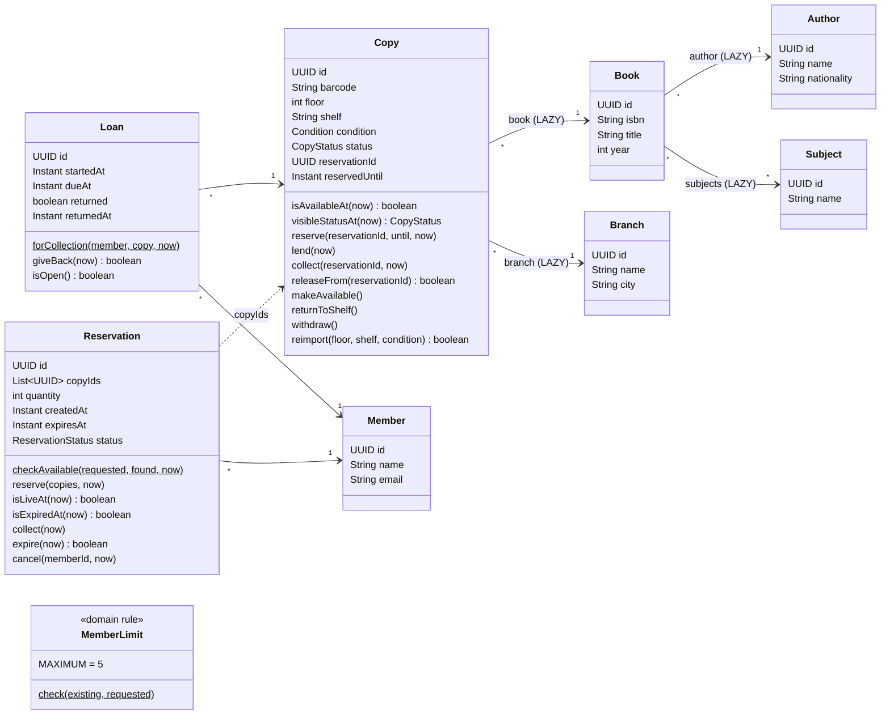
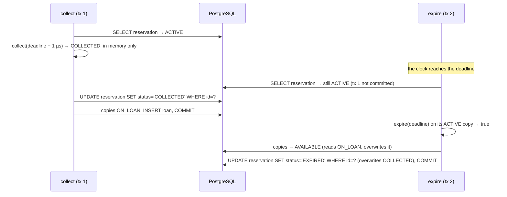
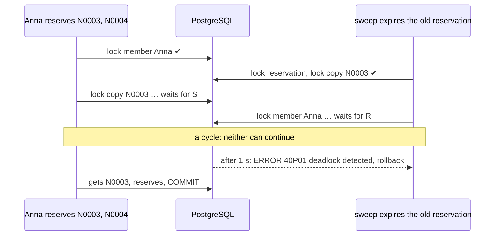

# Reservation expiry, collection and return: lessons to learn

This document is for students. It explains, with the code of this repository, what goes wrong
when **two operations try to change the same row at the same time**, and how to make them take
turns. The example is the library's reservation: a member reserves copies for 48 hours, and then
either collects them at the desk or lets the reservation expire.

Every concept comes with:

- the **naive** code, which looks correct and passes every sequential test;
- a **scenario** that forces the bad timing, and what it **measured** on a real PostgreSQL;
- an explanation of **why** it fails, down to the SQL;
- the **better** code, and what it measured.

How to use it:

- Read sections 1 and 2 first: the domain, the data, the problem, and the background every
  lesson relies on.
- Then each lesson of section 3 can be read on its own.
- Run the scenarios yourself: start the application (`./mvnw spring-boot:run`) and use the
  "Expiry" requests at the end of [`../scenarios.http`](../scenarios.http). Each scenario prints a
  report, and the SQL log shows every statement. The reports measured for this document are in
  [`../design/evidence`](../design/evidence/).
- Run the tests: `./mvnw test -Dtest='Expiry*Test,ReservationExpiryTest,CopyCollectTest,MovableClockTest'`.

Code links point to `src/main/java/cat/tecnocampus/library/…`. Line numbers refer to the version of
the code this document was written with.

---

## 1. The library and the problem

Sections 1.1 and 1.2 describe the whole example application: its entities and the data it starts
with. All the lesson documents use them. The rest of this section (1.3–1.6) is the problem of
this document: the life of a reservation.

### 1.1 The library domain

A public library has several **branches**. Each branch holds physical **copies** of **books**. A
book has one **author** and a few **subjects**. **Members** borrow copies (**loans**) or reserve
them for 48 hours (**reservations**). A member can have at most 5 active items at a time. A
reservation ends exactly once: **collected** at the desk (its copies become loans), **cancelled**
by the member, or **expired** after its deadline (a scheduled sweep stores it and notifies the
member). A loan ends when the copy is **returned**.



#### Enumerations

| Enum | Values |
| --- | --- |
| `CopyStatus` | `AVAILABLE`, `ON_LOAN`, `RESERVED`, `WITHDRAWN` |
| `Condition` | `NEW`, `GOOD`, `WORN`, `DAMAGED` |
| `ReservationStatus` | `ACTIVE`, `CANCELLED`, `COLLECTED`, `EXPIRED` (`ACTIVE` is left exactly once) |

#### Domain rules

The rules live in the entities, never in the services. The services orchestrate them.

| Rule | Where | Topic |
| --- | --- | --- |
| A barcode is unique within a branch | `Copy` + unique constraint `(branch, barcode)` | Import |
| A copy is available if its status is `AVAILABLE`, or `RESERVED` with a passed `reservedUntil` | `Copy.isAvailableAt(now)` | Shelf map, Reservation |
| The public status of an expired reservation is `AVAILABLE` | `Copy.visibleStatusAt(now)` | Shelf map |
| All or nothing: every requested copy must have been found and be available; the exception lists the ones that are not | `Reservation.checkAvailable(requested, found, now)` | Reservation |
| Reserving a copy that is not available is refused | `Copy.reserve(...)` throws `CopiesUnavailableException` | Reservation |
| A loan puts the copy on loan; returning it puts it back | `Loan` constructor → `Copy.lend(now)`, `Loan.giveBack()` → `Copy.returnToShelf()` | Member limit (open loans count) |
| A reservation lasts 48 hours | `Reservation` constructor computes `expiresAt` | Reservation |
| A reservation is live while `ACTIVE` and not expired | `Reservation.isLiveAt(now)` | Member limit |
| A member has at most 5 active items (open loans + copies in live reservations) | `MemberLimit.check(existing, requested)` | Member limit |
| Re-importing a copy changes only its physical attributes; it keeps its id and status | `Copy.reimport(...)` | Import |
| Collect only while live (`now < expiresAt`); expire only once due (`now >= expiresAt`): no instant allows both, none allows neither | `Reservation.collect(now)`, `Reservation.expire(now)` (returns `true` only for the call that must release) | Expiry |
| Expired for a reader as soon as the deadline passes, swept or not (`GET` answers `410`) | `Reservation.isExpiredAt(now)` | Expiry |
| Only the member, and only while live, can cancel; another member's reservation is "not found" | `Reservation.cancel(memberId, now)` | Expiry |
| A reserved copy is collected only by the reservation holding it, before its deadline; the deadline disappears | `Copy.collect(reservationId, now)`; `Loan.forCollection(...)` records it | Expiry |
| An ended reservation gives a copy back only if it still holds it | `Copy.releaseFrom(reservationId)` (`makeAvailable()` is the naive, unconditional release) | Expiry |
| Returning a loan is idempotent: a retry has no second effect | `Loan.giveBack(now)` returns `true` only for the call that closed it | Expiry |

#### Mapping decisions and what they teach

| Decision | Why | Concept |
| --- | --- | --- |
| UUID ids assigned in the constructor | The id exists before the database sees it | `persist` vs `merge`, `isNew()` |
| Every `@ManyToOne` marked `LAZY` | JPA's default for it is `EAGER` | Lazy vs eager loading |
| `Book.subjects` as `@ManyToMany List` | A small collection per book, like Affora's performances per event | N+1 on collections, `JOIN FETCH` |
| `Copy` has no collection back to its loans or reservations | The copy row alone answers "is it available?" | Aggregates, keeping the lockable row small |
| `Reservation.copyIds` as an `@ElementCollection` of ids | A reservation refers to copies, it does not own them | References between aggregates |
| `Copy.reservationId` and `reservedUntil` on the copy row | The availability check and the lock happen on one row | Lockable row, lost update |

The rows of the domain rules table marked **Expiry** are the ones this document is about.

### 1.2 Data loaded at startup

Hibernate drops and creates the schema at every start (`ddl-auto=create`). `data.sql` runs after
it (`defer-datasource-initialization=true`) and generates the rows with `generate_series`. Every
start begins from the same data; ids are random UUIDs, so scenarios find rows by business key
(branch name, ISBN, barcode, member email). The counts below are checked by
`ExampleDataAndQueriesTest`.

| Data | Volume | Used in |
| --- | --- | --- |
| Branches | `Central` (20,000 copies), `North` (small, for reservations), `Annex` (empty, target of the import) | All |
| Authors | 302: `Author 001`–`Author 300` (one per book), `Prolific Author` (20 books), `Bestselling Author` (the bestseller) | Catalogue |
| Subjects | 20 | Catalogue |
| Books | 321: `Title 001`–`Title 300` (ISBN `978-84-000001`…), `Prolific Title 301`–`320`, and `The Last Copy` (ISBN `978-84-999999`); each with 2–4 subjects (963 links) | Catalogue, Shelf map |
| Copies in `Central` | 20,000 (`C000001`–`C020000`) over books 1–300; 5 floors × 40 shelves × 100 copies | Shelf map; the expiry sweep scenarios reserve hundreds of its available copies for the scenario members (`ExpiryFixtures`) |
| Statuses in `Central` | 18,450 `AVAILABLE`, 1,000 `ON_LOAN` (with their loans), 500 `RESERVED` (with their reservations; 100 already expired, so the map shows 18,550 available), 50 `WITHDRAWN` | Shelf map |
| Members | 60 scenario members (`member01@library.test`…) with no items; 500 readers (`reader001@library.test`…) who own Central's loans and reservations, at most 3 items each | Reservation, Member limit |
| Copies in `North` | The **bestseller** (`N-BEST`, a single copy) and 30 ordinary available copies (`N0001`–`N0030`) | Reservation, Member limit |
| Copies in `Annex` | None | Import |

Resource files:

- `import/annex-20000.csv`: 20,000 rows `isbn,barcode,floor,shelf,condition`, all ISBNs from the
  loaded books.
- `import/annex-5000.csv`: the first 5,000 rows of the same file (the naive import's size).
- `import/annex-5000-error-last-row.csv`: the same 5,000 rows, the last one with an unknown ISBN.
  The parser accepts it; only the database can tell, so the naive import writes 4,999 copies
  before it fails and the rollback undoes them.

### 1.3 What the library wants

Of the whole domain, this document looks at one part: what happens to a reservation after it has
been made, and to the loans it becomes.

- A member **reserves** one or more copies. The reservation lasts **48 hours**
  ([`Reservation.DURATION`](../src/main/java/cat/tecnocampus/library/domain/Reservation.java#L39)).
  While it is live, nobody else can reserve those copies.
- Before the deadline, the member **collects** the reservation at the desk: each copy becomes a
  **loan**, and the reservation is `COLLECTED`. From then on the reservation's deadline no longer
  matters: the loan has its own due date (21 days).
- If nobody collects it, the reservation **expires**. Its copies go back on the shelf, it stops
  counting towards the member's limit of 5 items, and the member receives a **notice** with their
  email and the barcodes. A scheduled process, the **sweep**, stores the expiry and sends the
  notice.
- Before the deadline the member can also **cancel** the reservation.
- A member returns a loaned copy (**return**). The return machine sometimes retries a request.
- Everybody who reads a reservation must see it as expired as soon as its deadline has passed,
  even if the sweep has not run yet: the shelf map shows the copy as available,
  `GET /reservations/{id}` answers `410 Gone`, and the member's count no longer includes it.

The endpoints, in a naive and a better version:

| Operation | Endpoint | Success | Refused |
| --- | --- | --- | --- |
| Collect | `POST /naive|better/reservations/{id}/collection` with `{"memberEmail": …}` | `200` with the loan ids | `409 /problems/reservation-not-active` |
| Cancel | `DELETE /naive|better/reservations/{id}?memberEmail=…` | `204` | `409 /problems/reservation-not-active` |
| Return | `POST /naive|better/loans/{id}/return` | `200`, also when retried | — |
| Read | `GET /reservations/{id}` | `200` | `410 /problems/reservation-expired` once the deadline has passed |
| Expire | no endpoint: the sweep ([`ExpirySweep`](../src/main/java/cat/tecnocampus/library/expiry/ExpirySweep.java#L55)) | | |

### 1.4 State the invariant before writing any code

The most useful thing you can do before writing a line of code is to write down what must
**always** be true. For one reservation, collection and expiry compete. Exactly **one** of them
must win, and the effects of the winner must happen **exactly once**:

| Winner | Reservation | Copies | Loans | Member's active items | Notice |
| --- | --- | --- | --- | --- | --- |
| collection | `COLLECTED` | `ON_LOAN`, no reservation, no deadline | +1 per copy | unchanged (n reserved become n on loan) | none |
| expiry | `EXPIRED` | `AVAILABLE` (unless another reservation took them since, see lesson 6) | none | −n | exactly one |

Two consequences you will use all the time:

- **Both cannot answer "yes".** If collection answered `200` and expiry answered `true`, one of
  the two told a lie.
- **The answer must match what was committed.** A collection that answered `200` must still own
  its loans *and* its copies after everything has committed. Checking only the reservation's
  status is not enough: the tests of this lesson check the five columns of the table, read from
  the database after both transactions have finished.

### 1.5 The time rule lives in the domain, and takes `now` as a parameter

"A reservation is live while `now < expiresAt`" is a **business rule**, so it lives in the entity:

```java
// Reservation.java
public boolean isLiveAt(Instant now) {                       // line 116
    return status == ReservationStatus.ACTIVE && now.isBefore(expiresAt);
}

public void collect(Instant now) {                            // line 137
    if (!isLiveAt(now)) throw new ReservationNotActiveException(id);
    status = ReservationStatus.COLLECTED;
}

/** Returns true only for the caller that must release the copies and send the notice. */
public boolean expire(Instant now) {                          // line 150
    if (status != ReservationStatus.ACTIVE || now.isBefore(expiresAt)) return false;
    status = ReservationStatus.EXPIRED;
    return true;
}
```

See [`Reservation.java:116-170`](../src/main/java/cat/tecnocampus/library/domain/Reservation.java#L116).

Three design decisions are hidden in these few lines:

1. **The boundary is decided once.** At `expiresAt − 1 µs` the reservation can be collected and
   not expired; at exactly `expiresAt` it can be expired and not collected. There is no instant at
   which both are allowed, and none at which neither is. If you write `<=` in one place and `<` in
   another, there is an instant when both (or neither) succeed. The unit tests check both sides of
   the boundary:
   [`ReservationExpiryTest.java:26`](../src/test/java/cat/tecnocampus/library/domain/ReservationExpiryTest.java#L26)
   and [`:37`](../src/test/java/cat/tecnocampus/library/domain/ReservationExpiryTest.java#L37).
2. **`expire` returns whether *this* call expired it.** Only the caller that gets `true` releases
   the copies and sends the notice. A second call returns `false`
   ([`ReservationExpiryTest.java:49`](../src/test/java/cat/tecnocampus/library/domain/ReservationExpiryTest.java#L49)).
   This is the first brick of "exactly once".
3. **`now` is a parameter, never `Instant.now()`.** The domain does not read the clock. That makes
   it testable without waiting 48 hours, and, as lessons 1 and 2 show, it lets the service choose
   *when* the time is read, which turns out to matter.

The copy has the matching rules:
[`Copy.collect(reservationId, now)`](../src/main/java/cat/tecnocampus/library/domain/Copy.java#L122)
puts it on loan only for the reservation that holds it and only before its deadline, and removes
the deadline; [`Copy.releaseFrom(reservationId)`](../src/main/java/cat/tecnocampus/library/domain/Copy.java#L140)
gives it back only if that reservation still holds it. The loan side is
[`Loan.forCollection`](../src/main/java/cat/tecnocampus/library/domain/Loan.java#L63) and
[`Loan.giveBack(now)`](../src/main/java/cat/tecnocampus/library/domain/Loan.java#L73), which
returns `true` only for the call that closed the loan.

> **Important:** these domain methods are the same in the naive and the better versions. They are
> correct. Every bug in this document is about **how many transactions get to apply a correct rule
> to the same row, and on which data**.

### 1.6 A clock you can control

Every service receives a `java.time.Clock` bean and calls `clock.instant()`. In this application
the bean is a [`MovableClock`](../src/main/java/cat/tecnocampus/library/MovableClock.java#L24): it is
the system clock, unless a test or a scenario **stops** it at an exact instant (`fixAt`) or
**moves** it (`advance`). That is how a test puts the clock one microsecond before a deadline, then
exactly on it, in a few milliseconds. The tests show how it behaves:
[`MovableClockTest.java`](../src/test/java/cat/tecnocampus/library/MovableClockTest.java#L31).
You can also move it from the editor: `POST /demo/clock?plusHours=48`, then `DELETE /demo/clock`.

**Precision: a bug found while writing this lesson.** The clock is truncated to **microseconds**
([`MovableClock.java:46`](../src/main/java/cat/tecnocampus/library/MovableClock.java#L46)), because a
PostgreSQL `timestamp` keeps microseconds. The time rule is applied twice, in Java
(`now.isBefore(expiresAt)`) and in SQL (`expires_at <= :now`, in the sweep's query and the member's
count). With nanoseconds, the JDBC driver *rounds* `deadline − 1 ns` up to the deadline, so Java said
"still live" and SQL said "expired" **about the same instant**: the sweep picked a live reservation
and the member's count stopped counting it. A rule applied in two places must compare at the same
precision. (On Linux the system clock really has nanoseconds, so this is not only a test problem.)

---

## 2. Background you need

### 2.1 Transactions in Spring, and what `@Transactional` does not do

`@Transactional` on a public method of a Spring bean makes the call run inside one database
transaction: everything it writes is committed together at the end, or rolled back together if a
runtime exception escapes. Three details matter in this lesson:

- **It works through a proxy.** The annotation is applied by an object Spring puts in front of
  your bean. A call from another bean goes through the proxy; a call from the same object
  (`this.expire(id)`) does not, so it gets **no** transaction of its own. This is called
  **self-invocation**. That is why the sweep ([`ExpirySweep`](../src/main/java/cat/tecnocampus/library/expiry/ExpirySweep.java#L55))
  calls `expirer.expire(id)` on **another** bean.
- **Propagation `REQUIRED` (the default):** a `@Transactional` method called while a transaction
  is already open **joins** it instead of starting its own. Lesson 9 shows what that does to a
  sweep.
- **It does not arbitrate.** Two transactions on two threads both run, both read, both write. A
  transaction makes *your* writes atomic; it does not make *other* transactions wait. Lesson 1 is
  entirely about this.

### 2.2 What PostgreSQL does under `READ COMMITTED`

`READ COMMITTED` is PostgreSQL's default isolation level, and the one this application uses.

- A plain `SELECT` **takes no lock**, never waits, and sees only data that was **committed before
  the statement started**. Another transaction's uncommitted change is invisible.
- An `UPDATE` (or `DELETE`, or `SELECT … FOR UPDATE`) on a row that another transaction has
  modified and not yet committed **waits** for that transaction to finish. When it finishes,
  PostgreSQL **re-evaluates the `WHERE` clause on the committed row** and updates it only if it
  still matches.

That last sentence is the key to half the fixes in this document: an `UPDATE … WHERE status =
'ACTIVE'` cannot overwrite a status another transaction has just changed, because PostgreSQL
checks the condition again after waiting.

### 2.3 The persistence context and dirty checking

Inside a transaction, JPA (Hibernate) keeps every entity it has loaded in the **persistence
context**, also called the **first-level cache**:

- Loading the same id twice returns **the same Java object**, without a second query. If the
  entity is already there, a query that returns it gives you that object as it is in memory, **even
  if the row has changed in the database since** (lesson 4).
- You do not call `update`. At flush time (before commit, and before some queries) Hibernate
  compares every managed entity with the snapshot it took when it loaded it (**dirty checking**) and
  writes `UPDATE table SET … WHERE id = ?` for each changed one.
- Two properties of that `UPDATE` cause trouble:
  - its `WHERE` has **only the id**, never a condition on the old values, so it cannot detect that
    someone else changed the row in between (lesson 1);
  - by default it writes **every column** of the entity, not only the ones you changed. A stale
    object therefore writes back old values of columns you never touched (lesson 10).

### 2.4 Row locks

- **`SELECT … FOR UPDATE`** (in JPA: `@Lock(LockModeType.PESSIMISTIC_WRITE)` on a repository query)
  locks the rows it returns until the transaction ends. Another transaction that tries to lock or
  update those rows **waits**. Example:
  [`ReservationRepository.lockById`](../src/main/java/cat/tecnocampus/library/persistence/ReservationRepository.java#L57).
- **Lock timeout:** the hint `jakarta.persistence.lock.timeout = 5000` limits that wait to 5 s; then
  the statement fails (`55P03`), and this application answers `503`, never `500`.
- **`FOR UPDATE SKIP LOCKED`:** rows locked by someone else are simply **not returned**. Nothing
  waits, nothing fails. Ideal for a background job that should leave busy rows for later:
  [`MemberRepository.lockIfFree`](../src/main/java/cat/tecnocampus/library/persistence/MemberRepository.java#L37),
  [`ReservationRepository.lockIfFree`](../src/main/java/cat/tecnocampus/library/persistence/ReservationRepository.java#L69).
  JPQL has no portable way to say it, so these two queries are native SQL.
- **`FOR UPDATE NOWAIT`:** fails immediately if the row is locked. Be careful: in PostgreSQL a failed
  statement **aborts the whole transaction**, so after it you cannot even return `false` cleanly.
  That is why this code uses `SKIP LOCKED` instead.
- **Deadlock:** transaction A holds row 1 and waits for row 2; B holds row 2 and waits for row 1.
  Neither can continue. PostgreSQL detects the cycle after `deadlock_timeout` (1 s by default) and
  aborts one of them with SQL state `40P01`. The cure is to take locks **in the same order
  everywhere** (lesson 7).

### 2.5 Conditional updates and affected-row counts

A JPQL bulk statement in a Spring Data repository:

```java
@Modifying(clearAutomatically = true, flushAutomatically = true)
@Query("update Reservation r set r.status = EXPIRED where r.id = :id and r.status = ACTIVE and r.expiresAt <= :now")
int expireIfDue(UUID id, Instant now);
```

([`ReservationRepository.java:91-98`](../src/main/java/cat/tecnocampus/library/persistence/ReservationRepository.java#L98))

- It returns the number of **affected rows**. With a condition on the old state, that number is a
  decision: **1** means "you won", **0** means "someone else decided first, or the rule says no".
- Because of 2.2, a second `UPDATE` of the same row waits for the first one and then re-checks the
  `WHERE` on the committed row, so the two cannot both get 1.
- A bulk statement bypasses the persistence context. `flushAutomatically` writes the pending
  changes of managed entities **before** it; `clearAutomatically` empties the persistence context
  **after** it, so no managed entity keeps a value the statement just changed. After a clear, the
  entities you had are detached: read what you need from them before.
- **A count you do not check is not a guarantee.** If the code ignores the 0, the condition
  protected nothing (lesson 3).

---

## 3. The lessons

Each lesson follows the same plan: story, naive code, what was measured, why, the fix, what the
fix measured. The forced timings are produced by **pause points** (see section 5): the services call
`pauses.observe("collect-validated", id)` and similar at chosen places, which do nothing in normal
operation and let a scenario stop a thread exactly there.

### Lesson 0 · Sequential tests cannot see a race

**Scenario `expiry-boundary`** runs the **naive** version one operation at a time, on both sides of
the deadline. Every answer is right
([report](../design/evidence/expiry-boundary.json)):

| Clock | Operation | Answer |
| --- | --- | --- |
| deadline − 1 µs | shelf map, `GET`, collect | `RESERVED`, `ACTIVE`, `200` |
| deadline | shelf map (nothing swept yet) | shows `AVAILABLE`, row still `RESERVED` |
| deadline | `GET`, collect | `410`, `409` |
| deadline | sweep, twice | first run expires 1, second run nothing |
| a day later | sweep | the collected reservation is no candidate |

The sequential integration test does the same:
[`ExpiryTransitionTest.java`](../src/test/java/cat/tecnocampus/library/expiry/ExpiryTransitionTest.java#L88).

**What to learn:** a green test suite says nothing about concurrency. The bugs of the next lessons
exist only when two transactions **overlap**, and a test that calls one operation after the other
never makes them overlap.

---

### Lesson 1 · Lost update between two transitions

**Story.** Anna reaches the desk at 09:59:59.999 on the day her reservation expires. The librarian
scans it. At the same moment the sweep, whose clock already says 10:00, picks the same reservation.

**Naive code** ([`NaiveExpiryTransitions.java:65-101`](../src/main/java/cat/tecnocampus/library/expiry/NaiveExpiryTransitions.java#L65)):

```java
@Transactional
public CollectionResponse collect(UUID memberId, UUID reservationId) {
    Instant now = clock.instant();                                    // (1) time read first
    Reservation reservation = reservations.findById(reservationId)   // (2) plain read, no lock
            .filter(r -> r.getMember().getId().equals(memberId)).orElseThrow(...);
    reservation.collect(now);                                         // (3) decided in Java
    List<UUID> copyIds = reservation.getCopyIds();
    copies.lendOwned(reservationId);                                  // (4) count ignored
    // one Loan.forCollection(...) per copy, persisted
}

@Transactional
public boolean expire(UUID reservationId) {
    Instant now = clock.instant();
    Reservation reservation = reservations.findById(reservationId).orElse(null);   // plain read
    if (reservation == null || !reservation.expire(now)) return false;              // decided in Java
    copies.findAllById(reservation.getCopyIds()).forEach(Copy::makeAvailable);
    notices.send(...);
    return true;
}
```

It looks right: every method is transactional, the rule is in the domain, the sweep uses its own
transaction per reservation. Many teams would stop here.

**Measured** (scenario `collect-expiry-naive`, 10 rounds per ordering, every round the same;
[report](../design/evidence/expiry-naive-scenarios.json)):

| Ordering | collect | expire | Reservation | Copy | Open loans | Active items | Notices |
| --- | --- | --- | --- | --- | --- | --- | --- |
| collection commits first | `200` | `true` | `EXPIRED` | `AVAILABLE` | 1 | 1 | 1 |
| expiry commits first | `200` | `true` | `COLLECTED` | `AVAILABLE` | 1 | 1 | 1 |
| **required**, collection first | `200` | `false` | `COLLECTED` | `ON_LOAN` | 1 | 1 | 0 |
| **required**, expiry first | `409` | `true` | `EXPIRED` | `AVAILABLE` | 0 | 0 | 1 |

**Both operations said "yes"** in every round. Anna walks out with the book and an open loan, the
shelf map shows the copy as available, the next member can reserve it, and Anna gets an email
saying her reservation expired. The second row is the most dangerous: the reservation *says*
`COLLECTED`, so a test that checks only the status passes. Only the copy, the loans and the
notices reveal the damage.

**Why: collection commits first.** The clock is one microsecond before the deadline.



Each transaction **reads** the reservation, **decides** in Java, and **writes** the result. The
decision is correct for the data it read, but that data is already out of date when the write
happens. Hibernate's `UPDATE … WHERE id = ?` has no condition on the old status (2.3), so the
database does not notice, and the second writer silently erases the first writer's decision. This
is a **lost update**: the same defect as two members reserving the last copy, now between two
*different* operations on one row.

`@Transactional` does not help (2.1): under `READ COMMITTED` the plain `SELECT` took no lock and
saw only committed data (2.2).

**The fix: make one row the referee.** Both transitions must, in this order:

1. obtain the right to decide on the reservation row (a lock, or a conditional `UPDATE`);
2. read the **current** status and the **current** time *after* obtaining it;
3. apply the domain rule;
4. do all side effects in the same transaction, and check that each one affected what it should.

Then the second transaction to arrive necessarily sees the first one's committed result, and the
domain rule refuses it. Two ways to do step 1:

**Option A, pessimistic lock** ([`LockingExpiryTransitions.java:69-116`](../src/main/java/cat/tecnocampus/library/expiry/LockingExpiryTransitions.java#L69)):

```java
@Transactional
public CollectionResponse collect(UUID memberId, UUID reservationId) {
    ownedBy(memberId, reservationId);                              // scalars only (lesson 4)
    Member member = members.lockById(memberId).orElseThrow();      // lock 1: member
    Reservation reservation = reservations.lockById(reservationId) // lock 2: reservation, read fresh
            .orElseThrow(...);
    Instant now = clock.instant();                                 // after the locks (lesson 2)
    reservation.collect(now);                                      // current status, current time
    List<Copy> held = copies.lockCopies(reservation.getCopyIds()); // lock 3: copies, id order
    // each copy: copy.collect(reservationId, now) — throws if not held; then a Loan
}
```

`lockById` is a `SELECT … FOR UPDATE`. If expiry holds the row, collection **waits**, and when it
gets the row it reads the status expiry committed. The decision stays in the domain object.

**Option B, conditional update** ([`ConditionalExpiryTransitions.java:61-84`](../src/main/java/cat/tecnocampus/library/expiry/ConditionalExpiryTransitions.java#L61)):

```java
members.lockById(memberId);                                    // keeps the lock order (lesson 7)
Instant now = clock.instant();
if (reservations.collectIfLive(reservationId, memberId, now) == 0)   // the arbitration point
    throw new ReservationNotActiveException(reservationId);
if (copies.lendOwned(reservationId) != copyIds.size())               // the count is checked
    throw new CopiesUnavailableException(copyIds);
```

with [`collectIfLive`](../src/main/java/cat/tecnocampus/library/persistence/ReservationRepository.java#L89):
`update Reservation r set r.status = COLLECTED where r.id = :id and r.member.id = :member and
r.status = ACTIVE and r.expiresAt > :now`. The database decides (2.5).

**Measured after the fix** (`collect-expiry-locked` and `collect-expiry-conditional`, 10 rounds
per ordering each; [report](../design/evidence/expiry-better-scenarios.json)): every round matches the
**required** rows of the table above, for both options. The mandatory test is
[`ExpiryRaceTest`](../src/test/java/cat/tecnocampus/library/expiry/ExpiryRaceTest.java#L33); before
the fix it failed in 10 of 10 rounds ([captured output](../design/evidence/expiry-naive-race.log)).

**A versus B.** Both are correct.

| | A: pessimistic lock | B: conditional update |
| --- | --- | --- |
| Where the decision is made | in the domain (`reservation.collect(now)`) | in the `WHERE` of a query |
| Time rule written | once, in `Reservation` | twice: in `Reservation` and in the query (`>` here, `<=` in `expireIfDue`), which the boundary tests must pin |
| Statements | more (lock, then load, then update) | fewer |
| Persistence context | normal entities | bulk updates: clear the context, read what you need before |

---

### Lesson 2 · Read the time after you have the right to decide

In the naive `collect`, `Instant now = clock.instant()` is the **first** line
([`NaiveExpiryTransitions.java:67`](../src/main/java/cat/tecnocampus/library/expiry/NaiveExpiryTransitions.java#L67)).
In the "expiry commits first" ordering above, collection read `now = deadline − 1 µs`, then waited;
meanwhile the deadline passed and expiry committed; then collection decided with its **old**
"now" and accepted. Any wait between reading the clock and deciding (a lock, a slow query, a
garbage-collection pause) makes the time stale, exactly like a stale row.

In the better version the clock is read **after** the locks
([`LockingExpiryTransitions.java:76`](../src/main/java/cat/tecnocampus/library/expiry/LockingExpiryTransitions.java#L76)):
if collection waited behind expiry and crossed the deadline meanwhile, it now refuses.

**What to learn:** the instant that decides a transition is the instant at which you hold the right
to decide, not the instant the request arrived.

---

### Lesson 3 · An affected-row count you ignore is not a guarantee

The naive author already knew conditional updates:
[`CopyRepository.lendOwned`](../src/main/java/cat/tecnocampus/library/persistence/CopyRepository.java#L85)
puts on loan only the copies whose `reservationId` is this reservation. But
[`NaiveExpiryTransitions.java:76`](../src/main/java/cat/tecnocampus/library/expiry/NaiveExpiryTransitions.java#L76)
ignores what it returns. In the "expiry commits first" ordering, expiry had already released the
copy, so `lendOwned` updated **0 rows**, which means "this reservation holds no copy any more". The
code went on, created the loan, and answered `200`: a loan of a copy that is on the shelf.

The better versions check every count and **throw** when it is wrong
([`ConditionalExpiryTransitions.java:74`](../src/main/java/cat/tecnocampus/library/expiry/ConditionalExpiryTransitions.java#L74),
[`LockingExpiryTransitions.java:81`](../src/main/java/cat/tecnocampus/library/expiry/LockingExpiryTransitions.java#L81)).
Throwing a runtime exception rolls the whole transaction back (2.1), so the reservation's change is
undone too, and nothing half-done is committed.

**What to learn:** decide in advance what count each statement must affect, and treat any other
count as either a business answer (0 = someone else won) or an error that rolls back. Never ignore
it. (Lesson 6 shows a case where 0 is a perfectly normal answer.)

---

### Lesson 4 · A lock does not refresh an entity you already loaded

**Story.** Anna tapped "cancel" on her phone a minute ago, on a slow connection. She is now at the
desk collecting the same reservation. The cancel request arrives while she collects.

**Naive code**: the author learned lesson 1 and "added a lock"
([`NaiveExpiryTransitions.java:103-113`](../src/main/java/cat/tecnocampus/library/expiry/NaiveExpiryTransitions.java#L103)):

```java
@Transactional
public void cancel(UUID memberId, UUID reservationId) {
    Reservation reservation = reservations.findById(reservationId).orElseThrow(...);  // loaded now
    reservations.lockById(reservationId);                // SELECT … FOR UPDATE: waits, then...
    reservation.cancel(memberId, clock.instant());       // ...decides on the SAME old object
    copies.findAllById(reservation.getCopyIds()).forEach(Copy::makeAvailable);
}
```

**Measured** (`cancel-stale-naive`, 5 rounds, the cancel paused after its first read while Anna
collects): every round, cancel answered `204`, the reservation ended `CANCELLED`, the copy
`AVAILABLE`, with **1 open loan**. Anna has the book, and the system put it back on the shelf.

**Why.** The lock is real: the SQL log shows the `FOR UPDATE`, and the cancel really waited. But
`lockById` returned the `Reservation` that was **already in the persistence context** (2.3): the
same Java object, with the `ACTIVE` it had when it was first read. Taking a row lock does not
refresh the fields of an object you already hold. You got the lock, and you still decided on data
from before the wait.

**The fix.** Before arbitration, read only **scalars**, never the entity. The better version checks
the owner with a projection
([`ReservationRepository.transitionKey`](../src/main/java/cat/tecnocampus/library/persistence/ReservationRepository.java#L61),
returning a [`ReservationKey`](../src/main/java/cat/tecnocampus/library/persistence/ReservationKey.java)
record with the reservation id and the member id). A projection is not an entity, so the
persistence context stays empty, and the `Reservation` is loaded **for the first time under the
lock** ([`LockingExpiryTransitions.java:118-128`](../src/main/java/cat/tecnocampus/library/expiry/LockingExpiryTransitions.java#L118)).

**Measured after the fix** (`cancel-locked`): `409`, the reservation stays `COLLECTED`, the copy
`ON_LOAN`. Test:
[`ExpiryBetterScenariosTest.java:65`](../src/test/java/cat/tecnocampus/library/expiry/ExpiryBetterScenariosTest.java#L65).

**What to learn:** in a transaction that will lock a row, do not load that row as an entity before
the lock. (`entityManager.refresh(entity, LockModeType.PESSIMISTIC_WRITE)` also works, but it is easy
to forget the next time someone adds an earlier read.)

---

### Lesson 5 · Lazy expiry: decide on read, write only when you must

The sweep runs every so often. Between the deadline and the next run, the database still says
`ACTIVE` / `RESERVED`. The application must not lie in that window. Two ways to apply expiry:

- **Lazy expiry**: every reader and writer applies the rule `now < expiresAt` itself.
- **Sweep**: a background job stores the expiry.

This application uses **both**, with different jobs:

| Who | What it does with an expired reservation that nothing has swept yet | Code |
| --- | --- | --- |
| Shelf map | shows the copy `AVAILABLE`; the row stays `RESERVED` | [`Copy.visibleStatusAt`](../src/main/java/cat/tecnocampus/library/domain/Copy.java#L87), and a `CASE` in the projection query |
| `GET /reservations/{id}` | answers `410 Gone`; the row stays `ACTIVE` | [`ReservationLookupService.java:62-66`](../src/main/java/cat/tecnocampus/library/reservation/ReservationLookupService.java#L62), [`Reservation.isExpiredAt`](../src/main/java/cat/tecnocampus/library/domain/Reservation.java#L124) |
| The member's count | no longer counts it | `r.expiresAt > :now` in [`countActiveItems`](../src/main/java/cat/tecnocampus/library/persistence/ReservationRepository.java#L35) |
| A new reservation of the copy | may take it: a reserved copy whose deadline has passed is available | [`Copy.isAvailableAt`](../src/main/java/cat/tecnocampus/library/domain/Copy.java#L81) |
| The sweep | stores `EXPIRED`, releases the copies, sends the notice | [`ExpirySweep`](../src/main/java/cat/tecnocampus/library/expiry/ExpirySweep.java#L55) |

Reads apply the rule and **write nothing**. A write that happens anyway (a new reservation of the
copy) applies the rule and fixes the data it touches as part of its own work. Everything nobody
touches waits for the sweep.

**What to learn:** the sweep is **bookkeeping**, not correctness. The system is correct because
every reader and writer applies the time rule. Without the sweep, copies and limits would still be
right, but no notice would ever be sent and the stored status would stay `ACTIVE` forever.

---

### Lesson 6 · When lazy expiry and the sweep meet: release only what you still own

**Story.** Anna's reservation of N0002 expires at 10:00. Nobody has swept yet. At 10:05 Bruno
reserves N0002: lazy expiry allows it (lesson 5), so the copy row now says `RESERVED` by Bruno until
Friday. At 10:06 the sweep finally reaches Anna's reservation.

This lesson needs **no concurrency at all**: the steps happen one after the other.

**Naive code:** the sweep releases the copies of Anna's reservation with
[`Copy.makeAvailable()`](../src/main/java/cat/tecnocampus/library/domain/Copy.java#L155): back to
`AVAILABLE`, whoever holds them.

**Measured** (`sweep-after-rereserve-naive`): Anna's reservation `EXPIRED`; Bruno's `ACTIVE` but
holding **nothing**; Clara then asks for N0002 and gets `201`. Two live reservations promise the
same copy.

**The fix.** Give a copy back only if it is still held by the reservation being expired:
[`Copy.releaseFrom(reservationId)`](../src/main/java/cat/tecnocampus/library/domain/Copy.java#L140)
in option A, or, in option B, the conditional
[`releaseOwned`](../src/main/java/cat/tecnocampus/library/persistence/CopyRepository.java#L98):
`update Copy … where c.reservationId = :reservation and c.status = RESERVED`.

**Measured after the fix** (`sweep-after-rereserve-owned`): the copy stays Bruno's, Clara gets `409`,
one live promise.

**What to learn:** here a count of **0** is a normal answer, not an error: "this copy has moved on".
The sweep must not throw, or one re-reserved copy would block the expiry forever. Compare with
lesson 3, where 0 meant "you lost" and had to roll back. The count is always meaningful; what it
means depends on the operation.

---

### Lesson 7 · Lock order, deadlocks, and a job that never waits

**Story.** Anna's old reservation of N0003 has just expired. At home, she reserves N0003 and N0004
again. Reserving locks **the member, then the copies**
([`MemberLockingReservationService`](../src/main/java/cat/tecnocampus/library/reservation/MemberLockingReservationService.java#L58)),
because that is how the limit of 5 items is protected. At the same instant the sweep expires the old
reservation.

**Naive code** ([`CopiesFirstExpiryTransitions.java:50-66`](../src/main/java/cat/tecnocampus/library/expiry/CopiesFirstExpiryTransitions.java#L50)):
an expiry that has learned everything so far (fresh read under the lock, time after the locks,
`releaseFrom`) but locks in the order that looks natural from its own point of view:
**reservation, copies, then the member** (because the member's count changes).

**Measured** (`sweep-deadlock-naive`, 5 rounds; each thread stops right after its first lock, then
both continue): every round, PostgreSQL aborted the sweep with **SQL state `40P01`, deadlock
detected**, after about one second. Anna's reservation succeeded. Had PostgreSQL chosen Anna's
transaction, she would have received an error for a perfectly valid request.

**Why.**



**The fix, part 1: one lock order everywhere.** Every operation that touches these rows locks them
in the same order: **member → reservation → copies**. Reserve (member, copies), collect, cancel and
expire all follow it
([`LockingExpiryTransitions.java:73-80`](../src/main/java/cat/tecnocampus/library/expiry/LockingExpiryTransitions.java#L73)).
Then a cycle is impossible: whoever has the member first goes first. Copies are always locked in id
order (`order by c.id` in
[`lockCopies`](../src/main/java/cat/tecnocampus/library/persistence/CopyRepository.java#L68)) for
the same reason.

**The fix, part 2: the background job never waits behind a user.** The better expiry takes the
member and the reservation with `SKIP LOCKED` (2.4)
([`LockingExpiryTransitions.java:102-109`](../src/main/java/cat/tecnocampus/library/expiry/LockingExpiryTransitions.java#L102)).
If Anna is reserving or collecting right now, the sweep gets no row and returns `false` at once.

**Measured after the fix** (`sweep-ordered`, 5 rounds): no deadlock; the sweep skipped
(`expire = false`), Anna got `201` without waiting, and the next run (`expireAgain = true`) expired
the old reservation.

**Why skipping is safe.** The skipped reservation stays `ACTIVE` with its deadline passed in the
database. Every reader already treats it as expired (lesson 5), and the next sweep run sees it again.
The cost is only that the bookkeeping happens a little later.

**What to learn:** choose one global order for your locks and write it down; a deadlock is not a
hang but an abort, which shows up as random failures under load. A background job should never make
a user wait.

---

### Lesson 8 · Two application instances, and effects exactly once

**Story.** The library runs two instances of the application behind a load balancer. Each has its
own scheduler, so both sweeps start at 10:00 on the same 100 expired reservations.

**Naive code:** the naive `expire` of lesson 1, called by two sweeps. Both read `ACTIVE`, both decide
`true`, both write `EXPIRED`, both send a notice.

**Measured** (`sweep-two-workers-naive`; the two sweeps meet after reading each reservation):

| | `expire()` returned `true` | Stored `EXPIRED` | Notices | Members notified twice |
| --- | --- | --- | --- | --- |
| naive | 200 | 100 | **200** | 100 |
| better (`sweep-two-workers-skip-locked`) | 100 (51 + 49) | 100 | 100 | 0 |

**Why it matters that the rows look right.** `EXPIRED` written twice is still `EXPIRED`; a copy made
`AVAILABLE` twice is still `AVAILABLE`. A test that checks only the final rows **passes**. Only the
side effects (two emails per member) show the bug. If the expiry also decremented a stored counter,
the counter would be wrong.

**Why `@Scheduled(fixedDelay)` does not help.** `fixedDelay` keeps one scheduler from overlapping
with itself. Two instances have two schedulers. Only the database, which both share, can arbitrate.

**The fix:** lesson 1's arbitration plus lesson 7's `SKIP LOCKED`. For each reservation, one worker
gets the rows; the other either skips them (locked) or finds `EXPIRED` and gets `false` from the
domain.

**What to learn:** "it happens only once" must be guaranteed by the data, not by the assumption that
only one copy of your program is running.

---

### Lesson 9 · Side effects that leave the system: send them after the commit

**Story.** Three reservations expire. While expiring the second one, something fails *after* its
notice was sent (in the scenario, a pause point throws; in real life, a constraint, a bug, a lost
connection).

**Naive code:** the notice is sent inside the transaction
([`NaiveExpiryTransitions.java:98`](../src/main/java/cat/tecnocampus/library/expiry/NaiveExpiryTransitions.java#L98)).

**Measured** (`expiry-notice-rollback-naive`): 2 reservations expired, 1 failed and is still `ACTIVE`,
**3 notices** sent. One member was told about an expiry that did not happen. A rollback undoes the
database; it cannot undo an email.

**The fix.** The better transitions **publish an event** inside the transaction
([`LockingExpiryTransitions.java:112`](../src/main/java/cat/tecnocampus/library/expiry/LockingExpiryTransitions.java#L112)),
and a listener sends the notice **only after the commit**
([`ExpiryNoticeListener.java:25`](../src/main/java/cat/tecnocampus/library/expiry/ExpiryNoticeListener.java#L25)):

```java
@TransactionalEventListener(phase = TransactionPhase.AFTER_COMMIT)
void expired(ExpiryNotice notice) { notices.send(notice); }
```

If the transaction rolls back, the event is discarded.

**Measured after the fix** (`expiry-notice-after-commit`): 2 expired, 1 failed, **2 notices**; the
failed reservation sent nothing and stays a candidate for the next run.

**The limit of this fix.** Now the notice is sent **at most once**: if the application crashes
between the commit and the send, the notice is lost. **Exactly once** would need the notice stored
in a table *in the same transaction* (an **outbox**) and sent by a separate job that marks it as sent.
That is beyond this lesson, but you should know the difference.

**What to learn:** anything that leaves your database (an email, a payment, a message to another
service) cannot be rolled back. Do it after the commit, and decide whether "at most once" is enough.

---

### Lesson 10 · Designing the sweep: one big transaction or many small ones

**Story.** The sweep was switched off for a weekend. On Monday there are 1,000 expired reservations.
While the sweep runs, Bruno reserves a copy that the sweep has just released.

**Naive code** ([`OneTransactionSweep.java:43-52`](../src/main/java/cat/tecnocampus/library/expiry/OneTransactionSweep.java#L43)):
one `@Transactional` method over every expired reservation, typically written as
`@Scheduled(fixedRate = 60_000) @Transactional public void sweep()`. Each `transitions.expire(id)`
call **joins** that transaction (propagation `REQUIRED`, 2.1) instead of starting its own.

**Better code:** [`ExpirySweep.sweepOnce()`](../src/main/java/cat/tecnocampus/library/expiry/ExpirySweep.java#L55)
reads a **page** of at most 100 candidate ids, oldest deadline first
([`findExpiredIds`](../src/main/java/cat/tecnocampus/library/persistence/ReservationRepository.java#L47),
served by the index `ix_reservation_expiry (status, expires_at)` declared on
[`Reservation`](../src/main/java/cat/tecnocampus/library/domain/Reservation.java#L36)), and expires
each one **in its own transaction** through another bean. A failing reservation is counted and
skipped; it stays a candidate for the next run. The scheduler
([`ExpirySweepScheduler.java:44`](../src/main/java/cat/tecnocampus/library/expiry/ExpirySweepScheduler.java#L44))
runs it with `fixedDelay`.

**Measured** (`sweep-one-transaction` against `sweep-batched`, 1,000 reservations):

| | One transaction | Bounded (pages of 100, one transaction each) |
| --- | --- | --- |
| Time to expire all 1,000 | 6.2–8.0 s | **12.4 s** (11 runs) |
| JDBC statements + batches | 3,061 + 1,999 | 5,011 + 2,000 |
| Bruno reserves a released copy during the sweep | **times out after 5 s** (`55P03`, a `503`) | `201` after **19 ms** |
| One reservation in the middle fails | **0 expired**, 501 notices already sent | the failing one is retried by the next run: 1,000 expired, 1,000 notices |

Look at the first line carefully: **the bounded sweep is slower in total**. It sends more statements
per reservation (the key, the member lock, the reservation lock, the copy locks) and commits 1,000
times instead of once. If you expected the "better" version to be faster, the measurement corrects
you. The bounded sweep is better for other reasons:

- **Nobody waits behind it.** In the single transaction, every copy the sweep has released stays
  locked until the final commit, so Bruno waited 5 s and failed. In the bounded sweep each
  reservation's locks last milliseconds.
- **A failure costs one reservation**, not the whole run, and sends no false notices (lesson 9).
- **Each run does bounded work.** A backlog of 1,000 takes 10 runs of 100; with one run per minute,
  the last reservation is stored ten minutes late. That is fine, because readers apply the rule
  themselves (lesson 5). "Every 60 s" is the interval between runs, not a maximum delay.

Three more details of the sweep design:

- **`fixedDelay` versus `fixedRate`.** With `fixedDelay` the delay counts from the **end** of the
  previous run, so a slow run is never followed immediately by another. With `fixedRate`, a run
  longer than the rate is followed at once by the next one. Neither prevents two **instances** from
  running at the same time (lesson 8).
- **Self-invocation.** If `sweepOnce()` called `this.expire(id)` in the same class, Spring's proxy
  would be bypassed: no transaction per reservation, and the `@Modifying` queries would fail with
  "no transaction is in progress" (2.1).
- **Tests and the real timer.** The scheduler is created only when
  `library.expiry.sweep-enabled=true`
  ([`@ConditionalOnProperty`](../src/main/java/cat/tecnocampus/library/expiry/ExpirySweepScheduler.java#L32)).
  It is off by default and in tests, and a test checks that the bean is absent
  ([`ExpiryTransitionTest.java:83`](../src/test/java/cat/tecnocampus/library/expiry/ExpiryTransitionTest.java#L83)):
  a timer running behind your tests would expire their data at a moment they did not choose.

**What to learn:** measure before you claim a performance improvement. Here the fix is about
**contention and failure isolation**, not throughput.

---

### Lesson 11 · A retried return, idempotency, and full-row updates

**Story.** Anna drops N0005 into the return machine. The machine times out waiting for the answer
and sends the same request again. Between the two, Bruno, who saw N0005 back on the shelf map,
reserves it.

**Naive code** ([`NaiveLoanReturnService.java:36-43`](../src/main/java/cat/tecnocampus/library/loan/NaiveLoanReturnService.java#L36)):
load the loan and its copy, call `loan.giveBack(now)`, let dirty checking write. `Loan.giveBack` is
even idempotent: called twice one after the other, the second call does nothing.

**Measured** (`return-double-scan-naive`, 5 rounds: both returns read the loan and the copy, the
first commits, Bruno reserves, the second continues): both returns `200`, Bruno `201`, and then
**Bruno's reservation no longer holds the copy**; Clara reserves it too.

**Why.** Both returns read the loan as open and the copy as `ON_LOAN`. The second one decided on that
stale data: "open, so close it, and put the copy on the shelf". Hibernate's `UPDATE` of the copy
writes **every column** of the stale object (2.3): `status = AVAILABLE`, but also
`reservation_id = null` and `reserved_until = null`, the values it read before Bruno's reservation.
Bruno's reservation was erased by columns this code never meant to touch. (`@DynamicUpdate` would
write only the changed column, `status`; it would narrow the damage, not remove it: the copy would
still be `AVAILABLE` while Bruno holds it.)

**The fix** ([`ConditionalLoanReturnService.java:40-49`](../src/main/java/cat/tecnocampus/library/loan/ConditionalLoanReturnService.java#L40)):

```java
if (loans.closeIfOpen(loanId, clock.instant()) == 1          // only the first return gets 1
        && copies.shelveIfOnLoan(copyId) != 1)               // and only it touches the copy
    throw new IllegalStateException("The copy of an open loan was not on loan");
return LoanResponse.from(loans.findById(loanId).orElseThrow());
```

[`closeIfOpen`](../src/main/java/cat/tecnocampus/library/persistence/LoanRepository.java#L29) is
`update Loan l set l.returned = true, l.returnedAt = :now where l.id = :id and l.returned = false`;
[`shelveIfOnLoan`](../src/main/java/cat/tecnocampus/library/persistence/CopyRepository.java#L106)
changes only the status, and only if the copy is still `ON_LOAN`.

**Measured after the fix** (`return-conditional`): both returns `200` with **the same** loan, Bruno
keeps the copy, Clara gets `409`.

**What to learn:** a retry is normal on a network, so design operations to be **idempotent**: the
second identical request must answer the same and change nothing. "Same answer" matters: answering
the retry with an error would make the client believe the return failed.

---

## 4. The better solution in one page

For a transition of a row that several operations compete for:

1. **Write the invariant** (1.4) and the boundary (1.5) first.
2. **Before arbitration, read only scalars** (lesson 4): ids, keys, as a projection.
3. **Take the right to decide on one row**, in the global lock order (lesson 7):
   - option A: `SELECT … FOR UPDATE` (`@Lock(PESSIMISTIC_WRITE)`), then load the entity under the
     lock and let the domain decide;
   - option B: a conditional `UPDATE … WHERE <old state>` and its affected-row count.
4. **Read the clock after** you have that right (lesson 2).
5. **Do every side effect in the same transaction**, through rows you have locked or conditional
   statements, and **check every count** (lessons 3 and 6).
6. **Background jobs never wait** behind users: `SKIP LOCKED`, and leave the row for the next run
   (lesson 7).
7. **Effects that leave the system go after the commit** (lesson 9).
8. **Bound the work** of a job: pages, one transaction per item, through another bean (lesson 10).
9. **Make retries idempotent** (lesson 11).

The reference implementation of this list is
[`LockingExpiryTransitions`](../src/main/java/cat/tecnocampus/library/expiry/LockingExpiryTransitions.java#L69);
option B is [`ConditionalExpiryTransitions`](../src/main/java/cat/tecnocampus/library/expiry/ConditionalExpiryTransitions.java#L61).

## 5. Reflexes that do not work

| Reflex | Why it is not enough |
| --- | --- |
| Add `@Transactional` | It makes your writes atomic; it does not make other transactions wait (2.1, lesson 1) |
| `synchronized` on the service method | Protects one JVM only. Two instances (lesson 8), or the sweep in one and the request in the other, still race. It also serializes every reservation, not only the contested one |
| Check the status again just before saving | Still a Java `if` on data read without a lock: the window gets smaller, it does not close |
| `findById`, then `lockById` | The lock does not refresh the object you already have (lesson 4) |
| Run the sweep less often | Changes how often the race happens, not whether it can |
| One `@Transactional` around the whole sweep | Locks everything until the end; one failure rolls back everything (lesson 10) |
| `SERIALIZABLE` isolation | It would detect the conflict and abort one transaction, but then every transition needs a retry loop around it |
| `NOWAIT` in the background job | In PostgreSQL the failed statement aborts the whole transaction; `SKIP LOCKED` returns nothing instead (2.4) |

## 6. How these concepts are tested

### 6.1 Unit tests: the rule, without a database

[`ReservationExpiryTest`](../src/test/java/cat/tecnocampus/library/domain/ReservationExpiryTest.java),
[`CopyCollectTest`](../src/test/java/cat/tecnocampus/library/domain/CopyCollectTest.java),
[`LoanTest`](../src/test/java/cat/tecnocampus/library/domain/LoanTest.java): build the objects in
memory, call the domain methods on both sides of the boundary, check the result. If a rule needs a
database to be tested, it is in the wrong layer.

### 6.2 Sequential integration tests

[`ExpiryTransitionTest`](../src/test/java/cat/tecnocampus/library/expiry/ExpiryTransitionTest.java):
real PostgreSQL (Testcontainers), the movable clock, one operation at a time. They prove the
operations work; they cannot prove anything about concurrency (lesson 0).

### 6.3 Forcing an interleaving: the mandatory kind of test

"Run it 1,000 times" and `Thread.sleep` do not make a race reproducible. Two tools do:

- **A controlled clock** (1.4).
- **Pause points.** The services call
  [`TransitionPauses.observe(stage, id)`](../src/main/java/cat/tecnocampus/library/scenario/TransitionPauses.java#L57)
  at chosen places. In normal operation nothing is armed and the call does nothing. A test arms a
  stage: [`stopAt`](../src/main/java/cat/tecnocampus/library/scenario/TransitionPauses.java#L72)
  makes the next thread that reaches it stop, tell the test "I am here", and wait for "go on";
  `meetAt` makes N threads meet there; `failAt` makes it throw.

The "collection commits first" round
([`ExpiryRaces.collectionCommitsFirst`](../src/main/java/cat/tecnocampus/library/expiry/ExpiryRaces.java#L119)):

```java
clock.fixAt(reservation.expiresAt().minus(1, ChronoUnit.MICROS));
Stop collecting = pauses.stopAt(COLLECT_VALIDATED, reservation.id());
Future<CollectionResponse> collection = async(() -> collect.apply(anna, reservation.id()));
collecting.awaitReachedOrDone(collection);          // collection has decided, not committed

clock.fixAt(reservation.expiresAt());               // the deadline arrives
Stop expiring = pauses.stopAt(EXPIRY_READ, reservation.id());
Future<Boolean> expiry = async(() -> expirer.expire(reservation.id()));
expiring.awaitReachedOrDone(expiry);                // expiry has read the reservation

collecting.resume();  String collected = outcome(collection);    // collection commits first
expiring.resume();    String expired  = outcome(expiry);         // then expiry continues
return new Round(collected, expired, facts(reservation.id(), anna, "N0001"));
```

The same driver runs the naive and both better versions; the test
[`ExpiryRaceTest`](../src/test/java/cat/tecnocampus/library/expiry/ExpiryRaceTest.java#L33) asserts
the required result for ten fresh fixtures per ordering.

Three rules make such a test trustworthy:

1. **No `@Transactional` on the test.** Each operation must commit in its own transaction, on its
   own thread. A transactional test sees its own uncommitted writes and rolls them back at the end,
   so it can "prove" a success that no other connection would ever see.
2. **Assert every fact of the invariant**, read from the database after both transactions have
   committed: reservation status, copy status and holder, open loans, active items, notices. Lesson
   1's "expiry first" round has the correct-looking status `COLLECTED`; only the other facts show the
   loss.
3. **Both orderings, and several fresh fixtures each**, so a lucky schedule cannot pass by accident.

[`ExpiryNaiveScenariosTest`](../src/test/java/cat/tecnocampus/library/expiry/ExpiryNaiveScenariosTest.java)
shows that each naive version really does the damage described in this document;
[`ExpiryBetterScenariosTest`](../src/test/java/cat/tecnocampus/library/expiry/ExpiryBetterScenariosTest.java)
shows that each better version keeps the invariant under the same forced timings.

## 7. Checklist of common mistakes

- `Instant.now()` or `LocalDateTime.now()` inside the domain or a service: untestable without waiting.
- Reading the clock at the start of the method instead of after the lock.
- Believing `@Transactional` makes read-decide-write atomic against other transactions.
- `synchronized`, or an in-memory set of "reservations being processed".
- Loading the entity before locking it (stale first-level cache).
- Ignoring the affected-row count of a conditional statement; or throwing when 0 is a normal answer.
- Releasing copies "by reservation id" without checking who holds them now.
- Locking in different orders in different operations.
- A background job that waits (or fails) behind users instead of skipping busy rows.
- Sending an email, a payment or a message inside the transaction.
- `@Scheduled` and `@Transactional` on the same method that processes every row.
- Calling a `@Transactional` method from the same class.
- Tests annotated `@Transactional`, tests that check only the status, tests of only one ordering.
- Comparing times in Java and in SQL at different precisions.
- A retry answered with an error, or a retry with a second effect.

## 8. Questions to check your understanding

1. In lesson 1, both operations answered success. Which committed state did each one miss, and why
   did PostgreSQL not stop the second write?
2. What exactly is wrong with `UPDATE reservation SET status = ? WHERE id = ?` in a concurrent
   transition? Write the statement that would have been safe.
3. Which instant decides a collection: when the request arrived, or another one? Why?
4. In lesson 4 the SQL log shows `FOR UPDATE`. Why did the cancellation still decide on `ACTIVE`?
   Name two ways to avoid it.
5. In lesson 3 an affected-row count of 0 had to roll back; in lesson 6 a count of 0 must not. What
   is the difference?
6. The better sweep skips a reservation it cannot lock. Why is that safe, and what does it cost?
7. If you removed the sweep entirely, what would still be correct, and what would be wrong?
8. Draw the deadlock of lesson 7. Which single rule removes it, and why does it work?
9. In lesson 8 the final rows are identical in the naive and the better versions. What evidence shows
   the naive version is wrong?
10. Why must the notice be sent after the commit? What can still go wrong, and what is an outbox?
11. The bounded sweep was slower. Why is it still the better design? What would you measure to
    decide the page size?
12. `fixedDelay` versus `fixedRate`, and why neither protects you from two application instances.
13. Why did a retried return erase a column it never changed? Would `@DynamicUpdate` fix it?
14. Your race test is not `@Transactional`. What could a transactional version have "proved" that is
    not true?

## 9. Glossary

| Term | Meaning in this document |
| --- | --- |
| Invariant | A statement about the data that must be true after every committed transaction |
| Transition | An operation that moves a row from one state to another (`ACTIVE` → `COLLECTED`) |
| Arbitration | The point where the database decides which of two competing transactions wins |
| Lost update | A write that silently overwrites another transaction's committed decision |
| Check-then-act | Reading data, deciding in code, then writing, with nothing protecting the decision in between |
| Persistence context / first-level cache | The set of entities Hibernate manages in one transaction; one Java object per row |
| Dirty checking | Hibernate comparing managed entities with their snapshots and writing `UPDATE`s for the changes |
| Projection | A query that returns chosen values (scalars, a record) instead of managed entities |
| Pessimistic lock | `SELECT … FOR UPDATE`: other transactions wait for the row until you commit |
| `SKIP LOCKED` | A lock that returns no row instead of waiting when the row is locked |
| Deadlock | Two transactions each waiting for a lock the other holds; PostgreSQL aborts one (`40P01`) |
| Conditional update | `UPDATE … WHERE <expected old state>`; its affected-row count says who won |
| Lazy expiry | Applying the deadline when reading or writing, without storing it |
| Sweep | A scheduled job that stores expiries and sends notices |
| Idempotent | Repeating the request gives the same answer and no second effect |
| At most once / exactly once | A side effect that can be lost but never duplicated / never lost nor duplicated |
| Outbox | A table written in the same transaction as the change, from which a separate job sends the messages |
| Self-invocation | Calling a method of the same object, which bypasses Spring's proxy and its `@Transactional` |
| Propagation `REQUIRED` | A transactional method joins the transaction that is already open |
