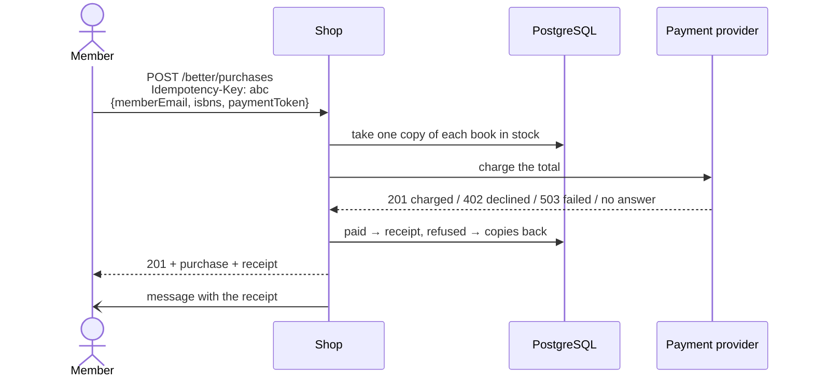
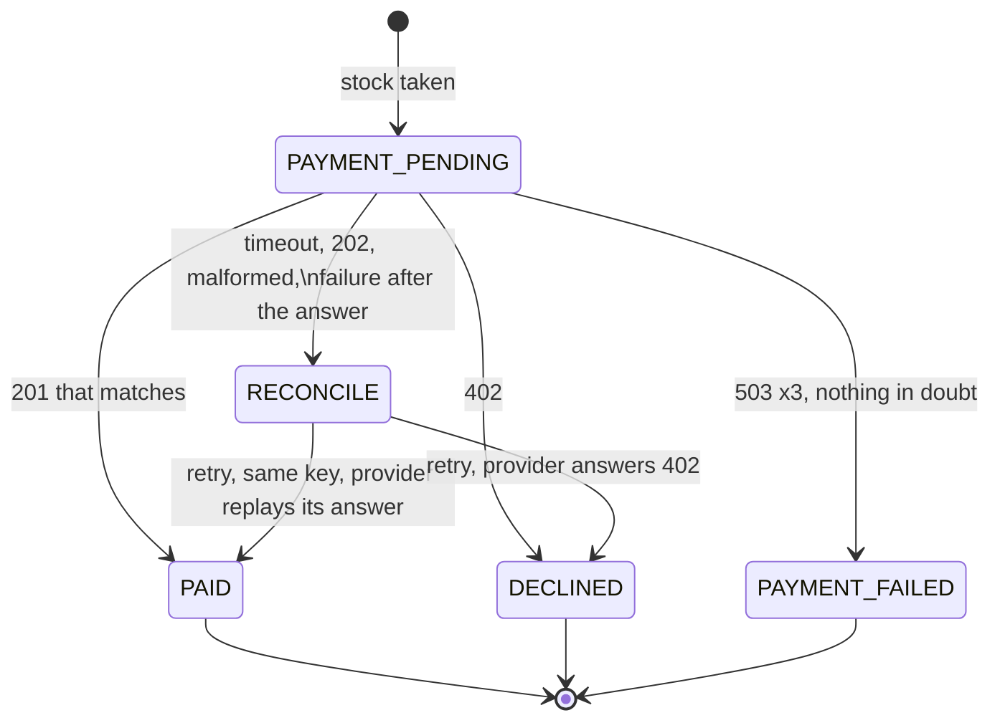
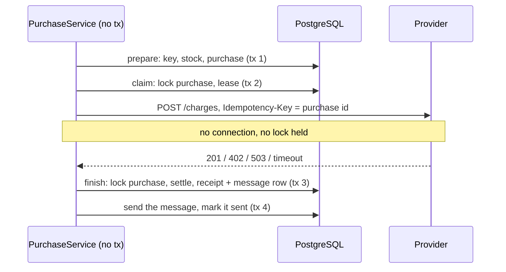

# Selling books: idempotent purchase, external payment and receipt

This document is for students. Until now the library only lent books; now it also **sells** them.
A member sends one request with a list of books and a payment token; the shop takes the books
that are still in stock, charges the card through an **external payment provider**, and sends the
member a **receipt**.

It is the library's version of three problems every shop has, and that Affora's purchase has too:

| Problem | What can go wrong |
| --- | --- |
| **The same request arrives twice** (double click, browser retry, lost response) | Two purchases and two charges for one click |
| **The provider is slow, fails or answers late** | The database connection pool runs out; a member pays for books the shop puts back on sale |
| **Something fails after the money moved** | A member is told about a receipt that does not exist; or never told at all |

Every concept comes with:

- the **naive** code, which looks correct and passes every one-request-at-a-time test;
- a **scenario** that shows the failure, and what it **measured**;
- an explanation of **why** it fails;
- the **better** code, and what it measured with the same scenario.

How to use it:

- Start the application: `./mvnw spring-boot:run`. Docker must be running: Spring Boot starts
  PostgreSQL **and the payment gateway** from [`../compose.yaml`](../compose.yaml). The first start
  builds the gateway's image, which takes a few minutes.
- Run the scenarios with the "Selling books" requests of [`../scenarios.http`](../scenarios.http).
  The reports measured for this document are in
  [`../design/evidence/selling-books-scenarios.json`](../design/evidence/selling-books-scenarios.json).
- Run the tests: `./mvnw test -Dtest='PurchaseTest,PurchaseCommandTest,RestClientPaymentGatewayTest,*PurchaseTest,ShopScenariosTest,PurchaseJourneyTest'`.

Measurements: Apple M3 Pro, 18 GiB, macOS 26, JDK 25, PostgreSQL 17 and the gateway in Docker
Desktop, nothing else running. Times will differ on your machine; counts (purchases, charges,
connections, messages) should not.

Code is in `src/main/java/cat/tecnocampus/library/`: `shop/` (the purchase), `payment/` (the HTTP
client of the provider), `receipt/` (sending messages), `domain/` (the entities and their rules).

---

## 1. The problem

### 1.1 What the shop does



The rules (the requirements of this example):

- **Books.** Each ISBN must be in the shop's catalogue (`404` otherwise). A book with no copies left
  is **skipped** and the purchase carries on with the others. If no book is in stock: `409`, nothing
  bought, nothing charged.
- **Idempotency.** The `Idempotency-Key` header is mandatory. A retry with the same key and the same
  body gets **the original answer, with the original status**. The same key with a different body is
  `422`. Ten simultaneous submissions with one key make **one purchase, one charge, ten identical
  answers**.
- **Payment.** A **definitive** refusal gives the copies back. An **indeterminate** result keeps them
  and leaves the purchase for **reconciliation**: never cancel by guesswork. Every network call has a
  timeout. Retry only what is safe to repeat.
- **Receipt.** Once the charge is accepted, a receipt is issued and a message is sent. If anything
  fails after the charge, nothing is issued. A message never announces a receipt that does not
  exist. If the application dies right after committing, the message is still sent when it comes
  back.

### 1.2 The provider

The provider is a separate application, `fake-payment-gateway/` (the same one Affora uses), built to
misbehave on demand. The behaviour is chosen by the **payment token**, the way real providers use
test card numbers, so the shop's code never contains a branch for a scenario.

| Token | Provider answers | What it proves |
| --- | --- | --- |
| `tok_ok` | `201 SUCCEEDED` | charged |
| `tok_reject` | `402 REJECTED` | refused; asking again will not change it |
| `tok_fail` | `503` | it failed and **recorded nothing**: safe to ask again |
| `tok_slow` | the right answer, after a delay (8 s by default) | depends on whether we waited |
| `tok_pending` | `202 PENDING` | not decided yet |

It honours an `Idempotency-Key` header: the same key gets the stored answer instead of a second
charge. Its `/admin` API (reset, delays, failure rate, list of charges) is for scenarios and tests
only; the shop never calls it.

### 1.3 The HTTP client: `RestClient`

The shop calls the provider with Spring's **`RestClient`**
([`payment/RestClientPaymentGateway.java`](../src/main/java/cat/tecnocampus/library/payment/RestClientPaymentGateway.java)).
Three things in that class are deliberate, and are what an assistant usually gets wrong:

```java
HttpClient httpClient = HttpClient.newBuilder()
        .connectTimeout(properties.connectTimeout())          // 1 s
        .build();
JdkClientHttpRequestFactory requestFactory = new JdkClientHttpRequestFactory(httpClient);
requestFactory.setReadTimeout(properties.readTimeout());      // 2 s
this.restClient = builder                                     // the RestClient.Builder Spring Boot provides
        .baseUrl(properties.url())
        .requestFactory(requestFactory)
        .build();
```

1. **Explicit timeouts.** The JDK client under `RestClient` has **no read timeout** unless you set
   one: a provider that never answers would keep the request waiting for ever. Both timeouts are
   required properties and are bounded at start-up
   ([`PaymentGatewayProperties`](../src/main/java/cat/tecnocampus/library/payment/PaymentGatewayProperties.java)).
2. **Statuses are answers, not errors.** `retrieve()` throws on every 4xx and 5xx. Catch that
   exception generically and a `402` (definitive) and a `503` (retryable) become the same thing. The
   adapter uses `exchange(...)`, which hands over every response, and maps each status to its own
   outcome:

   ```java
   .exchange((request, response) -> classify(charge, response));
   ```

   | Observed | Outcome |
   | --- | --- |
   | `201` whose amount, currency and reference match the charge, with a provider reference | `SUCCEEDED` |
   | `402` | `DECLINED` |
   | `503`, or a connection that was never opened (refused, connect timeout) | `RETRYABLE`: nothing can have been charged |
   | anything else: read timeout, `202`, malformed body, a `201` that is not ours | `UNKNOWN`: money may have moved |

3. **A `201` is believed only if it is ours.** Amount, currency and reference are compared with the
   charge. A `201` for another amount is not "paid".

The adapter never throws: a timeout is an outcome like any other.

---

## 2. Background

### 2.1 A transaction holds a connection from start to end

With Spring, a `@Transactional` method takes a JDBC connection from the pool (HikariCP) when it
starts and gives it back at the commit or rollback. Everything the method does in between, including
**waiting for an HTTP answer**, happens while holding it. The pool has a fixed size (60 here), and
every request of the application shares it.

`@Transactional(timeout = …)` does **not** limit an HTTP call: Spring checks it when the next SQL
statement runs. Only the HTTP client's own timeout bounds the wait.

### 2.2 A database constraint decides; a check in Java only looks

"Look for a row; if it is not there, insert it" is a check-then-act, the same race as the
reservation of the last copy. Ten transactions can all look before any of them commits. A **unique
constraint** is checked by PostgreSQL on the index: of ten simultaneous inserts of the same key, one
commits; the others wait for it, then fail.

### 2.3 Effects that leave the system cannot be rolled back

A message sent (or a card charged) is outside the database. If the transaction that "caused" it
rolls back afterwards, the effect stays. So the order matters: first make the decision durable
(commit), then let the effect leave, from what was committed.

### 2.4 The states of a purchase

A boolean "paid" cannot say "we do not know", and "we do not know" is the state that must never be
treated as "no". A purchase ([`domain/Purchase.java`](../src/main/java/cat/tecnocampus/library/domain/Purchase.java)) has five:



| State | Copies | Answer | For the member |
| --- | --- | --- | --- |
| `PAID` | sold | `201` | bought, here is the receipt |
| `RECONCILE` | **kept** | `202` | not decided yet; ask again with the same key, or a person will look at it |
| `DECLINED` | back on sale | `402` | your card was refused |
| `PAYMENT_FAILED` | back on sale | `503` | the provider is failing, nothing was charged, try later |

The rule that decides is in the entity (`Purchase.settle`): the services only lock the row, call it,
and do what it says with the stock.

---

## 3. The two versions

**Naive** ([`shop/NaivePurchaseService.java`](../src/main/java/cat/tecnocampus/library/shop/NaivePurchaseService.java)):
what everybody writes first, and what an assistant produces for "a purchase that charges the card
and sends a receipt". One method, one transaction:

```java
@Transactional
public PurchaseAnswer purchase(PurchaseCommand command) {
    Member member = reads.member(command.memberEmail());
    Optional<Purchase> existing = purchases.findFirstByMemberIdAndIdempotencyKeyOrderByCreatedAt(...);
    if (existing.isPresent()) return answerFor(existing.get());          // (1) check-then-act

    ShopStock.Taken taken = stock.take(command.isbns());
    Purchase purchase = Purchase.awaitingPayment(...);
    entityManager.persist(purchase);

    Reply reply = gateway.charge(...);                                   // (2) HTTP inside the transaction
    if (reply.outcome() != Outcome.SUCCEEDED) {                          // (3) a timeout is not a "no"
        purchase.markFailed();
        stock.release(purchase);
        return ...;
    }
    purchase.markPaid(reply.providerRef());
    Receipt receipt = Receipt.issueFor(purchase, now);
    entityManager.persist(receipt);
    mailbox.send(...);                                                   // (4) sent before the commit
    return ...;
}
```

**Better** ([`shop/PurchaseService.java`](../src/main/java/cat/tecnocampus/library/shop/PurchaseService.java)):
no `@Transactional`. It coordinates short steps, each a call to another bean, and the network call
is between transactions, never inside one:

| Step | Class | Transaction | What it does |
| --- | --- | --- | --- |
| Prepare | `PurchasePreparation.prepare` | short | insert the key row (unique), take the stock, create the purchase `PAYMENT_PENDING` |
| Claim | `PaymentClaims.claim` | short, row locked | settled → answer; another request is charging → wait; otherwise take a 15 s **lease** |
| Charge | `PaymentCharges.charge` | **none** (`Propagation.NEVER`) | the HTTP call; up to 3 calls on `503`, always with the same provider key |
| Finish | `PaymentCompletion.finish` | short, row locked | `Purchase.settle`; stock back or kept; on `PAID`, the receipt and its message row |
| Send | `ReceiptDispatcher.deliverAfterCommit` | own, after the commit | send the message, mark it sent |



Both versions share the stock (`ShopStock`): taking a copy is one conditional statement,
`update … set stock = stock - 1 where id = ? and stock > 0`, and the affected-row count says whether
a copy was left (the lesson of the last copy, again). Offers are taken in id order, the same for
every purchase, so two purchases of overlapping lists cannot deadlock.

---

## 4. The lessons

### Lesson 1 · One key, ten requests

**Scenarios** `purchase-key-naive`, `purchase-key-better`: member01 sends the same purchase (books 1
and 2, `tok_ok`) ten times at the same instant, with the same key. In the naive scenario a race
window makes every request do its "is the key there?" before any of them goes on: it makes the bad
timing happen on every run instead of now and then.

**Measured:**

| Fact | Naive | Better |
| --- | --- | --- |
| Answers | 10 × `201 PAID` | 10 × `201 PAID` |
| Distinct answer bodies | **10** | 1 |
| Purchases created | **10** | 1 |
| Charges at the provider | **10** | 1 |
| Receipts / messages received | **10 / 10** | 1 / 1 |
| Copies of book 1 taken | **10** | 1 |

**Why the naive version fails.** Each request looked for a purchase with that key. None had
committed yet, so none found one, and each created its own. Each purchase has its own id, and the
shop uses the purchase id as the provider's idempotency key, so the provider saw ten different keys
and charged ten times. The provider's idempotency cannot save you if *your* side creates ten
different things.

**The better version.** The key gets its own row, `PurchaseKey`, with a **unique constraint** on
(member, key), inserted **first** and flushed at once
([`PurchasePreparation`](../src/main/java/cat/tecnocampus/library/shop/PurchasePreparation.java)):

```java
entityManager.persist(new PurchaseKey(member.getId(), key, command.fingerprint(), purchaseId));
flushKey();                   // the unique index decides now, not at commit
ShopStock.Taken taken = stock.take(command.isbns());
```

The first insert wins. The other nine wait on the index until it commits, then fail; their
transactions roll back **before having taken any stock**. Each loser then reads the winner's
purchase in a new transaction. It finds it `PAYMENT_PENDING` with a live lease ("someone is charging
it right now"), waits 50 ms and asks again, until the purchase is settled. Then it answers from the
same purchase: same status, same body.

Two details:

- **The fingerprint.** The key row stores a hash of the body (sorted ISBNs + token). A retry must be
  the *same* request; the same key with other books is `422`, not a replay of something else.
- **Where the answer comes from.** It is not stored: it is rebuilt from the purchase, and a settled
  purchase never changes. Same purchase, same answer.

**Decisions you must be able to justify:**

- *What happens when the retry arrives while the first is still running?* It waits for the answer,
  up to 15 s, then gets `503` with `Retry-After` and should retry with the same key. An immediate
  `409 in progress` would also be valid, but then the ten answers are not identical.
- *How long is a key remembered?* Here, for ever (the rows are never deleted). A real shop deletes
  them after a period announced to its clients, e.g. 24 h; a retry after that is a new purchase.

**Alternative:** lock the member row first (the per-member lesson), then check and insert. Also
correct, as long as *every* code path that creates purchases takes that lock. The constraint holds
whatever code inserts.

### Lesson 2 · The slow provider and the connection pool

**Scenarios** `purchase-pool-naive`, `purchase-pool-better`: 80 members buy one book each at the same
instant. The provider takes 1.5 s per charge (`tok_slow`). The pool has 60 connections. 300 ms after
the start, while the purchases wait for the provider, the scenario samples the pool and reads the
catalogue, which never talks to the provider, as a client that gives up after 500 ms would see it.

**Measured** (three runs of each after a warm-up run; the counts were identical every time):

| Fact | Naive | Better |
| --- | --- | --- |
| Pool while the purchases wait | **60 active, 0 idle, 20 threads waiting** | 0 active, 60 idle, 0 waiting |
| Unrelated catalogue read | **no answer within 500 ms**; it answered after 1.26–1.28 s | 321 books in 6–10 ms |
| Answers | 80 × `201` | 80 × `201` |
| Purchase latency (median / p95) | **3.07–3.09 s / 3.08–3.10 s** | 1.62–1.65 s / 1.63–1.66 s |

**Why.** Each naive purchase took a connection when its transaction started and kept it while
waiting 1.5 s for the provider, doing nothing with it. 60 purchases held the 60 connections; the
other 20 queued for one, and so did the catalogue read: it got a connection only when the first
purchases finished, 1.3 s later, although it needs 10 ms of database work. The 20 queued purchases
took two rounds of the provider's delay (3.1 s). **The database was idle.** The bottleneck was the
application holding connections it did not use.

Nothing *failed* here only because HikariCP lets a request wait up to 30 s for a connection
(`connection-timeout`, its default). Make the provider a little slower or the load a little higher,
and the queue passes that limit: then every request that needs the database, the catalogue
included, fails with `Connection is not available, request timed out`. In a first version of this
scenario we lowered that timeout to 500 ms and saw exactly that: 20 purchases and the catalogue
failed after about 505 ms. We did not keep it: such a short timeout also made other lessons fail
while the pool was still opening its connections after a start.

A little arithmetic (Little's law): a pool of `N` connections, each held for `T` seconds, serves at
most `N / T` requests per second. Database work only: `T ≈ 0.01 s`, 60 connections → thousands per
second. With the HTTP call inside: `T = 1.5 s` → 40 per second, for the whole application, and
`T` is decided by somebody else's network.

**Why a bigger pool is not the fix.** It only moves the threshold; PostgreSQL has a hard
`max_connections` shared by every instance of the application; and an idle transaction still holds
its row locks.

**The better version** never holds a connection during the call. The call is in its own class,
with no transaction, and it says so:

```java
@Transactional(propagation = Propagation.NEVER)
public PaymentEvidence charge(PaymentAttempt attempt, String paymentToken) { … }
```

`NEVER` is a guard: if someday someone calls it from inside a transaction, Spring throws at once
instead of silently bringing the problem back. The step receives a `PaymentAttempt` (plain values),
never an entity, so nothing lazy can trigger a query, and take a connection, during the call.

In the better version every purchase answers in about 1.6 s (the provider's 1.5 s plus a few short
transactions), and the catalogue answers in milliseconds: **nothing else in the application has to
wait** because the provider is slow. Same pool, same provider, same timeouts; only the lifetime of
the connection changed.

**A trap we fell into while building it.** The first better version sent the receipt message from
an `@TransactionalEventListener(phase = AFTER_COMMIT)` that opened a `REQUIRES_NEW` transaction. In
the 80-purchase scenario (run then with the 500 ms checkout timeout mentioned above), two runs out
of three ended with 11 to 20 purchases in `RECONCILE` and Hikari errors showing 73–77 threads
waiting for a connection. The reason: during "after commit",
the finished transaction's connection is **still bound to the thread** (it is released after the
listeners). A listener that opens a new transaction holds **two** connections at once: 80 purchases
finishing together needed up to 160 from a pool of 60, and starved each other. (With the default
30 s timeout we would expect them to wait instead of failing at once; we did not measure it.) The fix: the
coordinator, which has no transaction, sends the message after `finish` has returned and released
its connection. Same lesson as above, in a place where nobody looks.

### Lesson 3 · The late answer

**Scenarios** `purchase-late-answer-naive`, `purchase-late-answer-better`: the provider takes 3 s
(`tok_slow`); the shop's read timeout is 2 s. The provider charges the card; the shop never sees the
answer. Then the member retries with the same key.

**Measured:**

| Fact | Naive | Better |
| --- | --- | --- |
| First request | `503 PAYMENT_FAILED` after 2.03 s | `202 RECONCILE` after 2.05 s |
| Copies taken after it | **0** (back on sale) | 1 (kept) |
| Charges at the provider once it has answered | **1** | 1 |
| Retry with the same key | `503 PAYMENT_FAILED` | `201 PAID` |
| Receipts | **0** | 1 |
| Charges at the end | 1 | 1 |

**Why the naive version fails.** It treats "no answer" as "no". A timeout proves nothing: the
request may have reached the provider, which may have charged. The naive shop put the book back on
sale and told the member the payment failed; the member was charged. The retry finds the purchase
`PAYMENT_FAILED` and answers the same: the member paid and has nothing.

**The better version** classifies the timeout as `UNKNOWN`. `Purchase.settle` turns it into
`RECONCILE`: the copies stay taken, and the answer is `202` (accepted, not decided). The retry with
the same key claims the payment again and sends the charge **with the same provider key** (the
purchase id). The provider recognises the key and replays its stored answer, `201`
(`X-Gateway-Idempotent-Replay: true`), without charging again. The purchase becomes `PAID`; one
receipt, one charge.

Rules that make it safe:

- **Retry only what is proven unrecorded.** A `503` from this provider means "nothing recorded", so
  the charge step tries up to 3 calls (50 ms, 100 ms apart). A timeout is never retried blindly, and
  never with a new key: that is exactly how a member is charged twice.
- **After an unknown, a `503` proves nothing.** If an earlier attempt may have charged, three `503`
  now say nothing about that attempt: the purchase stays in `RECONCILE` (`earlierAttemptUnknown`).
- **`RECONCILE` is not a dead end, and not an automatic release.** A retry can settle it. If nobody
  retries, `reviewAfter` (24 h) tells a person when to look. Time alone is no evidence that the card
  was not charged, and this provider has no "what happened to charge X?" endpoint.
- **The lease.** Claiming the payment records a nonce valid for 15 s. Only the attempt holding the
  current nonce may record a result. If a process sends the charge and then freezes for longer than
  the lease, a retry takes over, and when the old process wakes up its result is ignored
  (`StockAction.NONE`). Two fences together: the provider's key (one charge), our nonce (one
  decision).

### Lesson 4 · A failure after the charge

**Scenarios** `receipt-failure-naive`, `receipt-failure-better`: something fails right after the
receipt is issued and before the commit (the scenario injects an exception at that point; in real
life: a constraint, a bug, a lost connection). Then the member retries with the same key.

**Measured:**

| Fact | Naive | Better |
| --- | --- | --- |
| First request | `500` | `202 RECONCILE` |
| Purchases / receipts | **0 / 0** (rolled back) | 1 / 0 |
| Messages received by the member | **1** | 0 |
| Charges at the provider | 1 | 1 |
| Copies taken | **0** | 1 |
| After the retry: purchases / receipts / messages / charges | 1 / 1 / **2 / 2** | 1 / 1 / 1 / 1 |

**Why the naive version fails.** The message left before the commit. The rollback undid the
purchase and the receipt, but not the message, nor the charge. The member was told about a receipt
that does not exist. Worse, since no purchase was left with the key, the retry created a new one:
**charged twice**, two messages.

**The better version.**

- The receipt and its message are written **in the same transaction** as `PAID`
  ([`PaymentCompletion.finish`](../src/main/java/cat/tecnocampus/library/shop/PaymentCompletion.java)).
  The message is a row (`ReceiptMessage`, `PENDING`): an **outbox**. A rollback removes all three
  together. Nothing has left the system yet.
- The message is sent **after** the commit, from the committed row.
- The provider had already answered when the failure happened, so the money may have moved. The
  coordinator records `RECONCILE` in a new transaction (`localFailure`) instead of giving the copies
  back. The retry settles it with the provider's stored answer.

### Lesson 5 · A crash after the commit

**Scenario** `receipt-restart-better`: the purchase commits, and the application "dies" before
sending the message (the scenario switches off the send that follows the commit). Then it comes
back and its job runs, twice.

**Measured:**

| Moment | Pending messages | Messages received |
| --- | --- | --- |
| After the purchase (`201 PAID`) | 1 | 0 |
| Job, first run | sent 1 | 1 |
| Job, second run | sent 0 | 1 |

**Why it works.** The message was committed with the receipt, so it survives the crash as a
`PENDING` row. The job ([`ReceiptDispatcher.deliverPending`](../src/main/java/cat/tecnocampus/library/receipt/ReceiptDispatcher.java))
reads the pending rows; each delivery
([`ReceiptDelivery`](../src/main/java/cat/tecnocampus/library/receipt/ReceiptDelivery.java)) locks
its row with `FOR UPDATE SKIP LOCKED`, sends, and marks it `SENT`. If the after-commit send and the
job reach the same row at the same instant, the second one finds no row and moves on.

**The honest guarantee is "at least once".** If the application dies after sending and before
marking the row sent, the row is still `PENDING` and the message goes out again. Exactly once is
impossible when the effect leaves the system and cannot commit together with the database; at
least once, plus a message the member can recognise as a repeat (it names the receipt number), is
what real systems do.

The scheduled job is off by default (`library.receipts.dispatch-enabled=false`), like the expiry
sweep: the scenario must see the pending message before "the restart". A production shop leaves it
on.

### All the answers at once

**Scenario** `purchase-outcomes` (better version):

| Request | Answer | Copies | Receipt |
| --- | --- | --- | --- |
| `tok_ok`, books 5 + 41 (sold out) + 6 | `201 PAID`, 2 bought, 41 skipped, 23.50 € | taken | yes |
| `tok_reject`, book 7 | `402 DECLINED` | given back | no |
| `tok_fail`, book 8 | `503 PAYMENT_FAILED` after 3 calls, nothing charged | given back | no |
| `tok_pending`, book 9 | `202 RECONCILE` | kept | no |
| `tok_ok`, book 41 only | `409 nothing available`, nothing created | — | — |

---

## 5. The better purchase in one page

- One `Idempotency-Key` per purchase; a **unique (member, key) row**, inserted first. Losers read the
  winner's purchase and wait for its answer.
- **Short transactions**; the provider is called with **no transaction** (`Propagation.NEVER`),
  with plain values, never entities.
- `RestClient` with **explicit connect and read timeouts**; every status mapped with `exchange`; a
  `201` checked against the charge.
- **The provider key is the purchase id**, the same on every attempt; only `503` is retried.
- The rule is in the entity: **settle** says `PAID` / `DECLINED` / `PAYMENT_FAILED` / `RECONCILE` and
  what to do with the stock. Unknown means **keep the copies**.
- A **lease with a nonce**: one attempt at a time, and a late attempt cannot decide.
- Receipt and message row **in the same transaction** as `PAID`; the message is sent **after the
  commit**, by code that holds no other connection, and by a job for what is left; **at least once**.

## 6. Mistakes to avoid

Most of these are what an assistant produces by default:

1. `@Transactional` on the controller or the whole purchase: the HTTP call ends up inside.
2. Splitting into private `@Transactional` methods of the same class: self-invocation bypasses the
   proxy, nothing changes, and every test still passes.
3. "Fixing" it with `REQUIRES_NEW` around the database work: the outer transaction is suspended but
   **keeps its connection**; each request now holds two. (The `AFTER_COMMIT` listener of lesson 2 is
   the same trap.)
4. No read timeout, or `retrieve()` with a generic `catch`: a `402` and a `503` become the same.
5. Treating a timeout or any exception as "declined" and releasing the copies.
6. Retrying every failure, or with a new idempotency key per attempt.
7. Accepting any `201` without checking amount, currency and reference.
8. A boolean `paid`.
9. "Look for the key, insert if missing" without a constraint.
10. Sending the message inside the transaction, or from an `AFTER_COMMIT` listener that opens a new
    transaction.
11. Testing only with an in-memory fake provider: no timeout, no late answer, no `503` is ever
    exercised. The tests here use the real simulator over HTTP, in a container.

## 7. Questions to check your understanding

1. Ten requests with the same key arrive together. Which statement decides that only one purchase
   exists? What do the other nine do, and why do they not take stock?
2. Why does a slow provider make the catalogue slow, and eventually fail? Which resource runs out,
   and why would a larger pool not fix it? What does `@Transactional(timeout = 15)` actually bound?
3. Which observation in the pool scenario proves that no connection is held during the HTTP call?
4. Why is a timeout different from a decline? What evidence allows giving the copies back?
5. Why must a retry reuse the same provider key? What happens if it does not?
6. A purchase has been in `RECONCILE` for two days. What may and may not happen to its copies?
7. A process sends the charge, then freezes for 20 s, then tries to record the result. What stops
   it, and why are both the provider's key and the lease nonce needed?
8. Why is the message written as a row in the same transaction, instead of being sent there? What
   guarantee do you get, and why not "exactly once"?
9. Why did sending the message from an `AFTER_COMMIT` listener starve the pool?
10. Why does `RestClient`'s `retrieve()` need care here, and what does `exchange(...)` change?

## 8. Glossary

**Must know**

- **Idempotency key**: a value the client chooses and repeats on every retry of the same operation,
  so the server can recognise the retry and answer it with the original result.
- **Check-then-act**: deciding on a read and acting later, while another transaction can change what
  was read. Fixed by a constraint, a lock or a conditional statement.
- **Connection pool / pool starvation**: the fixed set of database connections the application shares;
  starvation is when requests hold them without using them and others cannot get one.
- **Timeout (connect / read)**: how long to wait to open the connection / to get the answer.
- **Definitive vs indeterminate outcome**: a result that proves what happened (`402`, `503` that
  recorded nothing) versus one that does not (timeout, `202`).
- **Reconciliation**: settling an indeterminate outcome later, with more evidence (a retry, a person).
- **Outbox**: writing the message to send as a row in the same transaction as the change it reports,
  and sending it after the commit.
- **At least once / at most once**: an effect that may repeat but is never lost / that is never
  repeated but may be lost.

**Advisable**

- **Lease and fencing nonce**: a time-limited right to act, identified by a value that a later holder
  replaces, so a late actor can be recognised and ignored.
- **Little's law**: work in progress = throughput × time in the system.
- **`SKIP LOCKED`**: read only the rows nobody has locked, instead of waiting for them.
- **`Propagation.NEVER`**: run without a transaction, and fail if called inside one.
