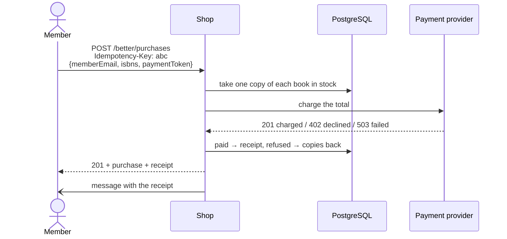
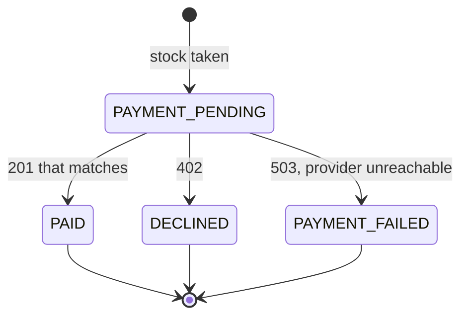
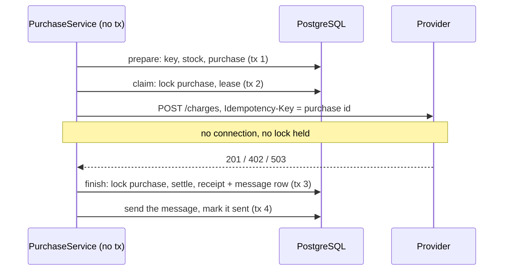

# Selling books: idempotent purchase, external payment and receipt

This document is for students. Until now the library only lent books; now it also **sells** them.
A member sends one request with a list of books and a payment token; the shop takes the books
that are still in stock, charges the card through an **external payment provider**, and sends the
member a **receipt**.

It is the library's version of three problems every shop has, and that Affora's purchase has too:

| Problem | What can go wrong |
| --- | --- |
| **The same request arrives twice** (double click, browser retry, lost response) | Two purchases and two charges for one click |
| **The provider is slow, or fails** | The database connection pool runs out and unrelated requests stop answering; a failed payment leaves the copies taken |
| **Something fails after the money moved** | A member is told about a receipt that does not exist; or never told at all |

Every concept comes with:

- the **naive** code, which looks correct and passes every one-request-at-a-time test;
- a **scenario** that shows the failure, and what it **measured**;
- an explanation of **why** it fails;
- the **better** code, and what it measured with the same scenario.

How to use it:

- Start the application: `./mvnw spring-boot:run`. Docker must be running: Spring Boot starts
  PostgreSQL **and the payment gateway** from [`../compose.yaml`](../compose.yaml). The first start
  builds the gateway's image, which takes a few minutes.
- Run the scenarios with the "Selling books" requests of [`../scenarios.http`](../scenarios.http).
  The reports measured for this document are in
  [`../design/evidence/selling-books-scenarios.json`](../design/evidence/selling-books-scenarios.json).
- Run the tests: `./mvnw test -Dtest='PurchaseTest,PurchaseCommandTest,RestClientPaymentGatewayTest,*PurchaseTest,ShopScenariosTest,PurchaseJourneyTest'`.

Measurements: Apple M3 Pro, 18 GiB, macOS 26, JDK 25, PostgreSQL 17 and the gateway in Docker
Desktop, nothing else running. Times will differ on your machine; counts (purchases, charges,
connections, messages) should not.

Code is in `src/main/java/cat/tecnocampus/library/`: `shop/` (the purchase), `payment/` (the HTTP
client of the provider), `receipt/` (sending messages), `domain/` (the entities and their rules).

---

## 1. The problem

### 1.1 What the shop does



The rules (the requirements of this example):

- **Books.** Each ISBN must be in the shop's catalogue (`404` otherwise). A book with no copies left
  is **skipped** and the purchase carries on with the others. If no book is in stock: `409`, nothing
  bought, nothing charged.
- **Idempotency.** The `Idempotency-Key` header is mandatory. A retry with the same key and the same
  body gets **the original answer, with the original status**. The same key with a different body is
  `422`. Ten simultaneous submissions with one key make **one purchase, one charge, ten identical
  answers**.
- **Payment.** The provider succeeds, declines (`402`) or fails (`503`). On a decline or a failure
  the purchase **fails**: its copies go back on sale and the member gets an error. The charge is
  **not retried**; the member can start again. **The call to the provider never happens inside a
  database transaction.**
- **Receipt.** Once the charge is accepted, a receipt is issued and a message is sent. If anything
  fails after the charge, nothing is issued. A message never announces a receipt that does not
  exist. If the application dies right after committing, the message is still sent when it comes
  back.

### 1.2 The provider

The provider is a separate application, `fake-payment-gateway/` (the same one Affora uses), built to
misbehave on demand. The behaviour is chosen by the **payment token**, the way real providers use
test card numbers, so the shop's code never contains a branch for a scenario.

| Token | Provider answers | What it proves |
| --- | --- | --- |
| `tok_ok` | `201 SUCCEEDED` | charged |
| `tok_reject` | `402 REJECTED` | refused; asking again will not change it |
| `tok_fail` | `503` | it failed and **recorded nothing** |
| `tok_slow` | `201 SUCCEEDED`, after a delay (8 s by default; the pool scenario sets 1.5 s) | used to make the provider slow |

It honours an `Idempotency-Key` header: the same key gets the stored answer instead of a second
charge. Its `/admin` API (reset, delay, failure rate, list of charges) is for scenarios and tests
only; the shop never calls it.

The gateway can do more (`tok_pending` answers `202 PENDING`, an answer can arrive after the shop
has stopped waiting). This example leaves those cases out on purpose: see
[What this example leaves out](#what-this-example-leaves-out).

### 1.3 The HTTP client: `RestClient`

The shop calls the provider with Spring's **`RestClient`**
([`payment/RestClientPaymentGateway.java`](../src/main/java/cat/tecnocampus/library/payment/RestClientPaymentGateway.java)).
Three things in that class are deliberate, and are what an assistant usually gets wrong:

```java
HttpClient httpClient = HttpClient.newBuilder()
        .connectTimeout(properties.connectTimeout())          // 1 s
        .build();
this.restClient = builder                                     // the RestClient.Builder Spring Boot provides
        .baseUrl(properties.url())
        .requestFactory(new JdkClientHttpRequestFactory(httpClient))
        .build();
```

1. **The client is configured, not left at its defaults.** The builder Spring Boot provides keeps
   its JSON converters and metrics; the request factory adds a **connect timeout**: a connection
   that cannot be opened proves the request never left, so the purchase can fail cleanly. There is
   deliberately **no read timeout** (see
   [What this example leaves out](#what-this-example-leaves-out)).
2. **Statuses are answers, not errors.** `retrieve()` throws on every 4xx and 5xx. Catch that
   exception generically and a `402` (declined) and a `503` (provider failing) become the same
   thing. The adapter uses `exchange(...)`, which hands over every response, and maps each status
   to its own outcome:

   ```java
   .exchange((request, response) -> classify(charge, response));
   ```

   | Observed | Outcome | Purchase |
   | --- | --- | --- |
   | `201` whose amount, currency and reference match the charge, with a provider reference | `SUCCEEDED` | `PAID` |
   | `402` | `DECLINED` | `DECLINED` |
   | `503`, a connection that cannot be opened, anything else | `FAILED` | `PAYMENT_FAILED` |

3. **A `201` is believed only if it is ours.** Amount, currency and reference are compared with the
   charge. A `201` for another amount is not "paid".

The adapter never throws: a provider that cannot be reached is an outcome like any other.

---

## 2. Background

### 2.1 A transaction holds a connection from start to end

With Spring, a `@Transactional` method takes a JDBC connection from the pool (HikariCP) when it
starts and gives it back at the commit or rollback. Everything the method does in between, including
**waiting for an HTTP answer**, happens while holding it. The pool has a fixed size (60 here), and
every request of the application shares it.

`@Transactional(timeout = …)` does **not** limit an HTTP call: Spring checks it when the next SQL
statement runs. How long the call lasts is decided by the provider.

That is **the main lesson of this example: never call an external system from inside a database
transaction.** Whatever the transaction holds (a connection from a small pool, often locks on rows)
stays held for as long as somebody else's system takes to answer.

### 2.2 A database constraint decides; a check in Java only looks

"Look for a row; if it is not there, insert it" is a check-then-act, the same race as the
reservation of the last copy. Ten transactions can all look before any of them commits. A **unique
constraint** is checked by PostgreSQL on the index: of ten simultaneous inserts of the same key, one
commits; the others wait for it, then fail.

### 2.3 Effects that leave the system cannot be rolled back

A message sent (or a card charged) is outside the database. If the transaction that "caused" it
rolls back afterwards, the effect stays. So the order matters: first make the decision durable
(commit), then let the effect leave, from what was committed.

### 2.4 The states of a purchase

A boolean "paid" is not enough: a purchase can be waiting for its payment, and a refused card and a
failing provider must be told apart. A purchase
([`domain/Purchase.java`](../src/main/java/cat/tecnocampus/library/domain/Purchase.java)) has four
states:



| State | Copies | Answer | For the member |
| --- | --- | --- | --- |
| `PAID` | sold | `201` | bought, here is the receipt |
| `PAYMENT_PENDING` | taken | `202` | not finished (recording the payment failed): ask again with the same key |
| `DECLINED` | back on sale | `402` | your card was refused |
| `PAYMENT_FAILED` | back on sale | `503` | the provider failed, nothing was charged, start again later |

The rule that decides is in the entity (`Purchase.settle`): the services only lock the row, call it,
and do what it says with the stock.

---

## 3. The two versions

**Naive** ([`shop/NaivePurchaseService.java`](../src/main/java/cat/tecnocampus/library/shop/NaivePurchaseService.java)):
what everybody writes first, and what an assistant produces for "a purchase that charges the card
and sends a receipt". One method, one transaction:

```java
@Transactional
public PurchaseAnswer purchase(PurchaseCommand command) {
    Member member = reads.member(command.memberEmail());
    Optional<Purchase> existing = purchases.findFirstByMemberIdAndIdempotencyKeyOrderByCreatedAt(...);
    if (existing.isPresent()) return answerFor(existing.get());          // (1) check-then-act

    ShopStock.Taken taken = stock.take(command.isbns());
    Purchase purchase = Purchase.awaitingPayment(...);
    entityManager.persist(purchase);

    Reply reply = gateway.charge(...);                                   // (2) HTTP inside the transaction
    if (reply.outcome() != Outcome.SUCCEEDED) {
        purchase.markDeclined() / markFailed();                          // this part is fine
        stock.release(purchase);
        return ...;
    }
    purchase.markPaid(reply.providerRef());
    Receipt receipt = Receipt.issueFor(purchase, now);
    entityManager.persist(receipt);
    mailbox.send(...);                                                   // (3) sent before the commit
    return ...;
}
```

**Better** ([`shop/PurchaseService.java`](../src/main/java/cat/tecnocampus/library/shop/PurchaseService.java)):
no `@Transactional`. It coordinates short steps, each a call to another bean, and the network call
is between transactions, never inside one:

| Step | Class | Transaction | What it does |
| --- | --- | --- | --- |
| Prepare | `PurchasePreparation.prepare` | short | insert the key row (unique), take the stock, create the purchase `PAYMENT_PENDING` |
| Claim | `PaymentClaims.claim` | short, row locked | settled → answer; another request is charging → wait; otherwise take a 15 s **lease** |
| Charge | `PaymentCharges.charge` | **none** (`Propagation.NEVER`) | the HTTP call, once, with the purchase id as the provider's idempotency key |
| Finish | `PaymentCompletion.finish` | short, row locked | `Purchase.settle`; stock sold or back on sale; on `PAID`, the receipt and its message row |
| Send | `ReceiptDispatcher.deliverAfterCommit` | own, after the commit | send the message, mark it sent |



Both versions share the stock (`ShopStock`): taking a copy is one conditional statement,
`update … set stock = stock - 1 where id = ? and stock > 0`, and the affected-row count says whether
a copy was left (the lesson of the last copy, again). Offers are taken in id order, the same for
every purchase, so two purchases of overlapping lists cannot deadlock.

### Prepare and claim: two steps, not one

Creating the purchase and getting the right to charge it could look like one step. They are two
because they answer different questions, and run a different number of times: **prepare** decides
*what is bought*, **once per key**; **claim** decides *who may pay now*, **as many times as
needed**, by whichever request is there.

```
prepare (once per key) ─► claim ─► claim ─► claim ... ─► charge ─► finish
                            BUSY    BUSY    GRANTED
```

1. **Claim runs many times, by requests that created nothing.** It is called by the request that
   created the purchase; by every retry that found it already there (`knownPurchase`) or lost the
   insert race (`afterCollision`); again every 50 ms while another attempt is charging (`BUSY`);
   and after a lease ran out or was given up, to take over. If the right to charge were granted
   only when the purchase is created, only its creator could ever pay it: after a crash, a retry
   would find a `PAYMENT_PENDING` purchase holding its copies, and no way to pay it. Since the claim
   must exist on its own, **everybody, the creator included, goes through it**: one path grants the
   right to charge.
2. **Different transactions, different locks.**

   | | `prepare` | `claim` |
   | --- | --- | --- |
   | Timeout | 10 s | 5 s |
   | Touches | the key's unique index, the **stock**, inserts the purchase | **one** purchase row (`lockById`) |
   | May wait for | another request's key insert, the stock | the same purchase's row, for an instant |

   `prepare` is the heavy, contended step: it competes with every buyer for the same copies.
   `claim` locks one row, compares two columns, writes two, and commits. Apart, the polling loop
   runs only the small transaction, no transaction holds stock while deciding who charges, and
   each lock is held as briefly as possible.
3. **The loser of the race needs new transactions anyway.** Its `prepare` failed on the unique
   index and rolled back; that transaction cannot grant anything. It continues with
   `afterCollision` and then `claim`, the same flow as everybody else, with no special case.
4. **Two different things.** The purchase is lasting business state (what was bought, the copies,
   the total, the status), and must survive crashes and retries. The lease is passing coordination
   state (who talks to the provider right now, and until when). A purchase can exist with no lease:
   after a crash, after `abandon`, between attempts.

The price is one extra short transaction for the creator (`prepare` commits, then `claim` locks the
row it has just created). Granting the creator's lease inside `prepare` would save it, at the cost
of a second place that grants leases, with its own edge cases.

### The lease: the right to charge, for a limited time

A **lease** is a temporary, exclusive right to charge the purchase, written in two columns of the
purchase row
([`domain/Purchase.java`](../src/main/java/cat/tecnocampus/library/domain/Purchase.java)):

```java
private UUID paymentLease;   // who holds the right: a random nonce, one per attempt
private Instant leaseUntil;  // until when: now + PAYMENT_LEASE (15 s)
```

As with renting, you have it for a limited time, and if you do not give it back it becomes free
anyway when the time is up.

**Why not a lock.** "Only one at a time" is usually a row lock, but a lock lives in a transaction,
and the charge happens between transactions (section 2.1). So the right is written **in the row**,
in a short transaction (`claim`), and the lock ends at its commit, **before** the HTTP call. The row
lock protects the moment the lease is handed out; the lease protects the charge.

**How `claimPayment` decides** (called with the row locked):

```java
if (status.isSettled())                               → SETTLED  (paid, declined or failed: nothing to do)
if (paymentLease != null && now.isBefore(leaseUntil)) → BUSY     (another attempt is charging now)
otherwise: paymentLease = new UUID, leaseUntil = now + 15 s → GRANTED (you may charge)
```

`PurchaseService` charges on `GRANTED`, waits 50 ms and claims again on `BUSY` (for up to 15 s, then
`503`), and answers from the purchase on `SETTLED`.

**Why it expires: no stuck purchases.** The obvious alternative is a status `CHARGING`. If the
process dies in the middle (crash, deployment, out of memory), nobody puts the status back, and the
purchase stays `CHARGING` for ever, holding its copies. A lease needs no cleaning: if its holder
dies, `leaseUntil` passes and the next claim is `GRANTED` with a new lease. That is the comment in
`Purchase`: *"Not a status: when an attempt dies, its lease simply runs out and the next claim
takes over."* Taking over does not charge twice, because the new attempt uses **the same provider
key** (the purchase id): the provider replays its stored answer, or makes the one charge that never
happened.

**Why a nonce and not only a time: fencing.** The UUID says **which** attempt holds the right, and
only that attempt may decide:

```java
public StockAction settle(UUID lease, PaymentEvidence evidence) {
    if (!holdsLease(lease)) return StockAction.NONE;   // you were replaced: change nothing
    ...
}
```

It matters because there is no read timeout, so a slow attempt can outlive its own lease:

```
t=0     A claims → lease L1 (until t=15)        A calls the provider... (slow)
t=16    B claims → L1 expired → lease L2         B calls the provider, same provider key
t=17    B gets the answer → settle(L2) ✔          PAID, stock sold, receipt
t=20    A finally gets its answer → settle(L1) ✘  NONE, changes nothing
```

Without the nonce, A would also write its result: it could overwrite B's decision, give back copies
already sold, or issue a second receipt.

**Giving it back early: `abandon`.** If the provider answered but recording the result failed (the
`finish` transaction rolled back), the purchase is still `PAYMENT_PENDING` with its copies.
`abandonAttempt(lease)` then clears the lease at once, if this attempt still holds it, so a retry
does not wait 15 s: it claims, charges with the same provider key, and gets the same answer
(lesson 3).

| Part | Meaning |
| --- | --- |
| `paymentLease` (UUID) | which attempt has the right to charge now; only it may settle |
| `leaseUntil` | when that right ends by itself if its holder disappears |
| `BUSY` | a live lease held by someone else: wait for its answer |
| Expired lease | the holder is presumed dead: take over, same provider key |
| `settle` with an old lease | that attempt was replaced: its result is ignored |
| `abandon` | give the right back early, so a retry does not wait for the expiry |

The row lock makes sure only one request at a time can *obtain* a lease; the lease makes sure only
one attempt at a time *charges and decides*, with no database lock held during the HTTP call; the
expiry makes sure a crash never leaves a purchase stuck.

---

## 4. The lessons

### Lesson 1 · One key, ten requests

**Scenarios** `purchase-key-naive`, `purchase-key-better`: member01 sends the same purchase (books 1
and 2, `tok_ok`) ten times at the same instant, with the same key. In the naive scenario a race
window makes every request do its "is the key there?" before any of them goes on: it makes the bad
timing happen on every run instead of now and then.

**Measured:**

| Fact | Naive | Better |
| --- | --- | --- |
| Answers | 10 × `201 PAID` | 10 × `201 PAID` |
| Distinct answer bodies | **10** | 1 |
| Purchases created | **10** | 1 |
| Charges at the provider | **10** | 1 |
| Receipts / messages received | **10 / 10** | 1 / 1 |
| Copies of book 1 taken | **10** | 1 |

**Why the naive version fails.** Each request looked for a purchase with that key. None had
committed yet, so none found one, and each created its own. Each purchase has its own id, and the
shop uses the purchase id as the provider's idempotency key, so the provider saw ten different keys
and charged ten times. The provider's idempotency cannot save you if *your* side creates ten
different things.

**The better version.** The key gets its own row, `PurchaseKey`, with a **unique constraint** on
(member, key), inserted **first** and flushed at once
([`PurchasePreparation`](../src/main/java/cat/tecnocampus/library/shop/PurchasePreparation.java)):

```java
entityManager.persist(new PurchaseKey(member.getId(), key, command.fingerprint(), purchaseId));
flushKey();                   // the unique index decides now, not at commit
ShopStock.Taken taken = stock.take(command.isbns());
```

The first insert wins. The other nine wait on the index until it commits, then fail; their
transactions roll back **before having taken any stock**. Each loser then reads the winner's
purchase in a new transaction. It finds it `PAYMENT_PENDING` with a live lease ("someone is charging
it right now"), waits 50 ms and asks again, until the purchase is settled. Then it answers from the
same purchase: same status, same body.

Two details:

- **The fingerprint.** The key row stores a hash of the body (sorted ISBNs + token). A retry must be
  the *same* request; the same key with other books is `422`, not a replay of something else.
- **Where the answer comes from.** It is not stored: it is rebuilt from the purchase, and a settled
  purchase never changes. Same purchase, same answer.

**Two ways to find the key, and why both.** Before inserting, `prepare` first *looks* for the key:

```java
@Transactional(timeout = 10)
public UUID prepare(PurchaseCommand command) {
    Member member = reads.member(command.memberEmail());
    Optional<UUID> known = knownPurchase(member.getId(), command);
    if (known.isPresent()) {
        return known.get();       // a retry that arrives after the first request committed
    }
    UUID purchaseId = UUID.randomUUID();
    entityManager.persist(new PurchaseKey(member.getId(), command.idempotencyKey(), command.fingerprint(), purchaseId));
    flushKey();                   // the unique index decides now, not at commit
    ...
```

`knownPurchase` reads the key row of (member, key):

- **No row**: a new request; carry on, insert the key, take the stock, create the purchase.
- **A row with the same fingerprint**: the same request again; return the **existing** purchase id
  at once. No new key, no new purchase, **no stock taken again**.
- **A row with another fingerprint**: the key reused for a different request; `422`
  (`IdempotencyKeyReusedException`).

Returning the existing id does not mean "answer now": the coordinator then claims the purchase
(see [Prepare and claim](#prepare-and-claim-two-steps-not-one)), and the retry joins it wherever it
is: settled → the same answer; someone charging → wait; an earlier attempt abandoned → charge again
with the same provider key.

*But the insert and the flush already detect an existing key. Why look first?* For **correctness**
the look is **not needed**. Without it, a retry would try to insert the key; the row is already
committed, so PostgreSQL rejects the insert **at once** (it only waits when the other transaction
has not committed yet); `flushKey()` turns that into `KeyTakenException`; the transaction rolls back
before taking any stock; and `afterCollision` calls the same `knownPurchase` in a new transaction,
which returns the same purchase id, or `422` if the fingerprint differs. Same result.

The two mechanisms cover different timings:

| Situation | What catches it |
| --- | --- |
| **Sequential retry**: the first request committed, then the retry arrives (timeout on the client, a second click, a network retry). The usual case. | **`knownPurchase`**: one `SELECT`, no failed insert |
| **Concurrent duplicates**: both requests are inside `prepare` and neither has committed | **The unique index + `flushKey()`**: the second insert waits, fails when the first commits, then `afterCollision` |

The look alone would be wrong: it is check-then-act, and two concurrent requests can both see
"no row". The constraint is the guarantee. The look is a **fast path** for the common case, and it
saves, on every ordinary retry:

- **a transaction**: without it, a failed insert, a rollback, then a second (read-only) transaction
  in `afterCollision`; with it, one `SELECT` in one transaction;
- **exceptions as normal flow**: a retry is expected, not an error; without the look it would go
  through a constraint violation, a Hibernate exception, `KeyTakenException`, a catch and a rollback
  (after a constraint violation the persistence context cannot be used any more, which is why
  `afterCollision` needs a new transaction);
- **noise in the logs**: PostgreSQL logs `ERROR: duplicate key value violates unique constraint`
  for every failed insert; every retry would leave one, and hide the real errors.

It is also **the first thing** after loading the member: the key belongs to the member (two members
may use the same key value), and it must come **before `stock.take(...)`**, or a retry would take
copies again for a purchase nobody will pay.

**Decisions you must be able to justify:**

- *What happens when the retry arrives while the first is still running?* It waits for the answer,
  up to 15 s, then gets `503` with `Retry-After` and should retry with the same key. An immediate
  `409 in progress` would also be valid, but then the ten answers are not identical.
- *How long is a key remembered?* Here, for ever (the rows are never deleted). A real shop deletes
  them after a period announced to its clients, e.g. 24 h; a retry after that is a new purchase.

**Alternative:** lock the member row first (the per-member lesson), then check and insert. Also
correct, as long as *every* code path that creates purchases takes that lock. The constraint holds
whatever code inserts.

### Lesson 2 · The slow provider and the connection pool

**Scenarios** `purchase-pool-naive`, `purchase-pool-better`: 80 members buy one book each at the same
instant. The provider takes 1.5 s per charge (`tok_slow`). The pool has 60 connections. 300 ms after
the start, while the purchases wait for the provider, the scenario samples the pool and reads the
catalogue, which never talks to the provider, as a client that gives up after 500 ms would see it.

**Measured** (three runs of each after a warm-up run; the counts were identical every time):

| Fact | Naive | Better |
| --- | --- | --- |
| Pool while the purchases wait | **60 active, 0 idle, 20 threads waiting** | 0 active, 60 idle, 0 waiting |
| Unrelated catalogue read | **no answer within 500 ms**; it answered after 1.26–1.28 s | 321 books in 6–10 ms |
| Answers | 80 × `201` | 80 × `201` |
| Purchase latency (median / p95) | **3.07–3.09 s / 3.08–3.10 s** | 1.62–1.65 s / 1.63–1.66 s |

**Why.** Each naive purchase took a connection when its transaction started and kept it while
waiting 1.5 s for the provider, doing nothing with it. 60 purchases held the 60 connections; the
other 20 queued for one, and so did the catalogue read: it got a connection only when the first
purchases finished, 1.3 s later, although it needs 10 ms of database work. The 20 queued purchases
took two rounds of the provider's delay (3.1 s). **The database was idle.** The bottleneck was the
application holding connections it did not use.

Nothing *failed* here only because HikariCP lets a request wait up to 30 s for a connection
(`connection-timeout`, its default). Make the provider a little slower or the load a little higher,
and the queue passes that limit: then every request that needs the database, the catalogue
included, fails with `Connection is not available, request timed out`. In a first version of this
scenario we lowered that timeout to 500 ms and saw exactly that: 20 purchases and the catalogue
failed after about 505 ms. We did not keep it: such a short timeout also made other lessons fail
while the pool was still opening its connections after a start.

A little arithmetic (Little's law): a pool of `N` connections, each held for `T` seconds, serves at
most `N / T` requests per second. Database work only: `T ≈ 0.01 s`, 60 connections → thousands per
second. With the HTTP call inside: `T = 1.5 s` → 40 per second, for the whole application, and
`T` is decided by somebody else's network.

**Why a bigger pool is not the fix.** It only moves the threshold; PostgreSQL has a hard
`max_connections` shared by every instance of the application; and an idle transaction still holds
its row locks.

**The better version** never holds a connection during the call. The call is in its own class,
with no transaction, and it says so:

```java
@Transactional(propagation = Propagation.NEVER)
public PaymentEvidence charge(PaymentAttempt attempt, String paymentToken) { … }
```

`NEVER` is a guard: if someday someone calls it from inside a transaction, Spring throws at once
instead of silently bringing the problem back. The step receives a `PaymentAttempt` (plain values),
never an entity, so nothing lazy can trigger a query, and take a connection, during the call.

In the better version every purchase answers in about 1.6 s (the provider's 1.5 s plus a few short
transactions), and the catalogue answers in milliseconds: **nothing else in the application has to
wait** because the provider is slow. Same pool, same provider; only the lifetime of the connection
changed.

**A trap we fell into while building it.** The first better version sent the receipt message from
an `@TransactionalEventListener(phase = AFTER_COMMIT)` that opened a `REQUIRES_NEW` transaction. In
the 80-purchase scenario (run then with the 500 ms checkout timeout mentioned above), two runs out
of three ended with 11 to 20 purchases whose payment could not be recorded, and Hikari errors showing 73–77 threads
waiting for a connection. The reason: during "after commit",
the finished transaction's connection is **still bound to the thread** (it is released after the
listeners). A listener that opens a new transaction holds **two** connections at once: 80 purchases
finishing together needed up to 160 from a pool of 60, and starved each other. (With the default
30 s timeout we would expect them to wait instead of failing at once; we did not measure it.) The fix: the
coordinator, which has no transaction, sends the message after `finish` has returned and released
its connection. Same lesson as above, in a place where nobody looks.

**What happens if the process dies while waiting for the provider?** It depends on where the
call is, and you must be able to explain both:

- **Naive.** The transaction never commits: PostgreSQL rolls it back when the connection drops. No
  purchase, the copies are back on sale, and the key was never saved. But the provider may have
  charged the card. A retry with the same key finds nothing, creates a new purchase with a new id
  (a new provider key) and charges again.
- **Better.** The purchase was committed `PAYMENT_PENDING` before the call, with its copies taken
  and a 15 s **lease** (a nonce and an expiry time) recorded by the claim. Nothing else happens until a
  retry with the same key arrives. Within the 15 s the retry waits; after them it takes over with a
  new nonce and charges **with the same provider key** (the purchase id): if the first call had
  charged, the provider answers with its stored `201` (`X-Gateway-Idempotent-Replay: true`) and
  nothing is charged twice. If the old process somehow comes back and tries to record its answer,
  its nonce is no longer the current one and it changes nothing (`StockAction.NONE`). If no retry
  ever comes, the purchase stays `PAYMENT_PENDING` with its copies: this example has no job that
  cleans it up (a real shop would need one, or a way to ask the provider what happened).

### Lesson 3 · A failure after the charge

**Scenarios** `receipt-failure-naive`, `receipt-failure-better`: something fails right after the
receipt is issued and before the commit (the scenario injects an exception at that point; in real
life: a constraint, a bug, a lost connection). Then the member retries with the same key.

**Measured:**

| Fact | Naive | Better |
| --- | --- | --- |
| First request | `500` | `202 PAYMENT_PENDING` |
| Purchases / receipts | **0 / 0** (rolled back) | 1 / 0 |
| Messages received by the member | **1** | 0 |
| Charges at the provider | 1 | 1 |
| Copies taken | **0** | 1 |
| After the retry: purchases / receipts / messages / charges | 1 / 1 / **2 / 2** | 1 / 1 / 1 / 1 |

**Why the naive version fails.** The message left before the commit. The rollback undid the
purchase and the receipt, but not the message, nor the charge. The member was told about a receipt
that does not exist. Worse, since no purchase was left with the key, the retry created a new one:
**charged twice**, two messages.

**The better version.**

- The receipt and its message are written **in the same transaction** as `PAID`
  ([`PaymentCompletion.finish`](../src/main/java/cat/tecnocampus/library/shop/PaymentCompletion.java)).
  The message is a row (`ReceiptMessage`, `PENDING`): an **outbox**. A rollback removes all three
  together. Nothing has left the system yet.
- The message is sent **after** the commit, from the committed row.
- The provider had already answered when the failure happened, so the money may have moved: the
  copies must not go back on sale. Nothing was recorded, so the purchase is still
  `PAYMENT_PENDING` with its copies, and the answer is `202`. The coordinator gives up the lease in
  a new transaction (`PaymentCompletion.abandon`), so the retry does not have to wait for it to run
  out. The retry charges again with the same provider key, and the provider replays its stored
  `201`: one receipt, one message, one charge.

### Lesson 4 · A crash after the commit

**Scenario** `receipt-restart-better`: the purchase commits, and the application "dies" before
sending the message (the scenario switches off the send that follows the commit). Then it comes
back and its job runs, twice.

**Measured:**

| Moment | Pending messages | Messages received |
| --- | --- | --- |
| After the purchase (`201 PAID`) | 1 | 0 |
| Job, first run | sent 1 | 1 |
| Job, second run | sent 0 | 1 |

**Why it works.** The message was committed with the receipt, so it survives the crash as a
`PENDING` row. The job ([`ReceiptDispatcher.deliverPending`](../src/main/java/cat/tecnocampus/library/receipt/ReceiptDispatcher.java))
reads the pending rows; each delivery
([`ReceiptDelivery`](../src/main/java/cat/tecnocampus/library/receipt/ReceiptDelivery.java)) locks
its row with `FOR UPDATE SKIP LOCKED`, sends, and marks it `SENT`. If the after-commit send and the
job reach the same row at the same instant, the second one finds no row and moves on.

**The honest guarantee is "at least once".** If the application dies after sending and before
marking the row sent, the row is still `PENDING` and the message goes out again. Exactly once is
impossible when the effect leaves the system and cannot commit together with the database; at
least once, plus a message the member can recognise as a repeat (it names the receipt number), is
what real systems do.

The scheduled job is off by default (`library.receipts.dispatch-enabled=false`), like the expiry
sweep: the scenario must see the pending message before "the restart". A production shop leaves it
on.

### All the answers at once

**Scenario** `purchase-outcomes` (better version):

| Request | Answer | Copies | Receipt |
| --- | --- | --- | --- |
| `tok_ok`, books 5 + 41 (sold out) + 6 | `201 PAID`, 2 bought, 41 skipped, 23.50 € | taken | yes |
| `tok_reject`, book 7 | `402 DECLINED` | given back | no |
| `tok_fail`, book 8 | `503 PAYMENT_FAILED` after one call, nothing charged | given back | no |
| `tok_ok`, book 41 only | `409 nothing available`, nothing created | — | — |

---

## 5. The better purchase in one page

- One `Idempotency-Key` per purchase; a **unique (member, key) row**, inserted first. Losers read the
  winner's purchase and wait for its answer.
- **Short transactions**; the provider is called with **no transaction** (`Propagation.NEVER`),
  with plain values, never entities.
- `RestClient` configured with a **connect timeout**; every status mapped with `exchange`; a
  `201` checked against the charge.
- **One call, no retry.** A decline or a failure fails the purchase and gives the copies back.
- **The provider key is the purchase id**, so any later attempt for the same purchase is answered
  with the provider's stored answer instead of a second charge.
- The rule is in the entity: **settle** says `PAID` / `DECLINED` / `PAYMENT_FAILED` and what to do
  with the stock.
- A **lease with a nonce**: one attempt at a time, a process that died is replaced after 15 s, and a
  late attempt cannot decide.
- Receipt and message row **in the same transaction** as `PAID`; the message is sent **after the
  commit**, by code that holds no other connection, and by a job for what is left; **at least once**.

### What this example leaves out

Deliverable 4 (and this example) deliberately leave out the **indeterminate outcome**: an answer
that does not say whether the money moved. In a real shop it shows up as a read timeout, a
`202 PENDING`, or a connection that breaks after the request was sent. Handling it needs a state of
its own ("we do not know: keep the copies"), a way to settle it later (retry with the same key, or
ask the provider), and a person when nothing else works. That is why:

- **There is no read timeout.** A read timeout gives up on a request the provider already has and
  may be charging; it would bring the indeterminate case back. Once the request is sent, the shop
  waits for the answer.
- **There is no retry.** Retrying a `503` is safe with this provider, but it is not asked for: the
  member can start again.
- **`tok_pending` and late answers are not handled.** The gateway can still produce them (the
  pool scenario uses `tok_slow` to make it slow), but the shop treats anything that is not a `201`
  or a `402` as a failure.

The price is honest to state: if the provider charges and the shop never learns it (the process
dies and nobody retries, or a takeover gets a `503` while the first call is still being charged),
the shop and the provider disagree. *Timeouts and when a retry is safe* is advisable vocabulary
for this course, not required.

## 6. Mistakes to avoid

Most of these are what an assistant produces by default:

1. `@Transactional` on the controller or the whole purchase: the HTTP call ends up inside.
2. Splitting into private `@Transactional` methods of the same class: self-invocation bypasses the
   proxy, nothing changes, and every test still passes.
3. "Fixing" it with `REQUIRES_NEW` around the database work: the outer transaction is suspended but
   **keeps its connection**; each request now holds two. (The `AFTER_COMMIT` listener of lesson 2 is
   the same trap.)
4. `retrieve()` with a generic `catch`: a `402` and a `503` become the same.
5. Releasing the copies when *recording* the answer fails: the provider may have charged.
6. A new provider idempotency key per attempt of the same purchase.
7. Accepting any `201` without checking amount, currency and reference.
8. A boolean `paid`.
9. "Look for the key, insert if missing" without a constraint.
10. Sending the message inside the transaction, or from an `AFTER_COMMIT` listener that opens a new
    transaction.
11. Testing only with an in-memory fake provider: no slow answer, no `503`, no real HTTP is ever
    exercised. The tests here use the real simulator over HTTP, in a container.

## 7. Questions to check your understanding

1. Ten requests with the same key arrive together. Which statement decides that only one purchase
   exists? What do the other nine do, and why do they not take stock?
2. Why does a slow provider make the catalogue slow, and eventually fail? Which resource runs out,
   and why would a larger pool not fix it? What does `@Transactional(timeout = 15)` actually bound?
3. Which observation in the pool scenario proves that no connection is held during the HTTP call?
4. Which transactions does the better purchase run, and what does each one hold? Which one is
   running while the provider is called?
5. The process dies while waiting for the provider. What happens to the purchase and its copies,
   in the naive version and in the better one? What does a retry with the same key do?
6. Why must a retry reuse the same provider key? What happens if it does not?
7. A process sends the charge, then freezes for 20 s, then tries to record the result. What stops
   it, and why are both the provider's key and the lease nonce needed?
8. Why is the message written as a row in the same transaction, instead of being sent there? What
   guarantee do you get, and why not "exactly once"?
9. Why did sending the message from an `AFTER_COMMIT` listener starve the pool?
10. Why does `RestClient`'s `retrieve()` need care here, and what does `exchange(...)` change?
11. `prepare` looks for the key before inserting it, but the unique constraint would catch the
    retry anyway. Is the look needed for correctness? What does it save, and why is it not enough
    on its own?
12. Why are creating the purchase and claiming the right to charge it two steps? Which requests
    call each, and how many times?
13. Why is the right to charge a lease that expires, and not a row lock or a `CHARGING` status?
    What does the nonce add to the expiry time?

## 8. Glossary

**Must know**

- **Idempotency key**: a value the client chooses and repeats on every retry of the same operation,
  so the server can recognise the retry and answer it with the original result.
- **Check-then-act**: deciding on a read and acting later, while another transaction can change what
  was read. Fixed by a constraint, a lock or a conditional statement.
- **Connection pool / pool starvation**: the fixed set of database connections the application shares;
  starvation is when requests hold them without using them and others cannot get one.
- **Why a network call does not belong inside a database transaction**: everything the transaction
  holds stays held for as long as the other system takes.
- **Outbox**: writing the message to send as a row in the same transaction as the change it reports,
  and sending it after the commit.
- **At least once / at most once**: an effect that may repeat but is never lost / that is never
  repeated but may be lost.

**Advisable**

- **Timeouts (connect / read) and when a retry is safe**: a connect timeout proves the request never
  left; a read timeout proves nothing, so the result is indeterminate (see
  [What this example leaves out](#what-this-example-leaves-out)).
- **Lease and fencing nonce**: a time-limited right to act, identified by a value that a later holder
  replaces, so a late actor can be recognised and ignored.
- **Little's law**: work in progress = throughput × time in the system.
- **`SKIP LOCKED`**: read only the rows nobody has locked, instead of waiting for them.
- **`Propagation.NEVER`**: run without a transaction, and fail if called inside one.
